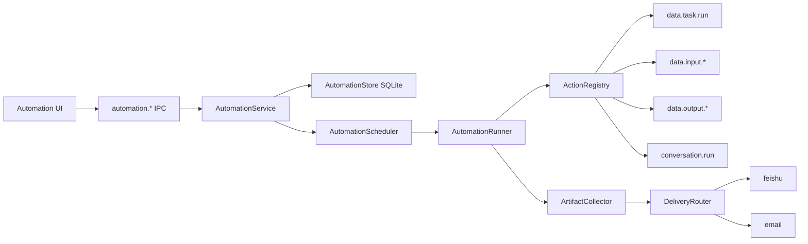
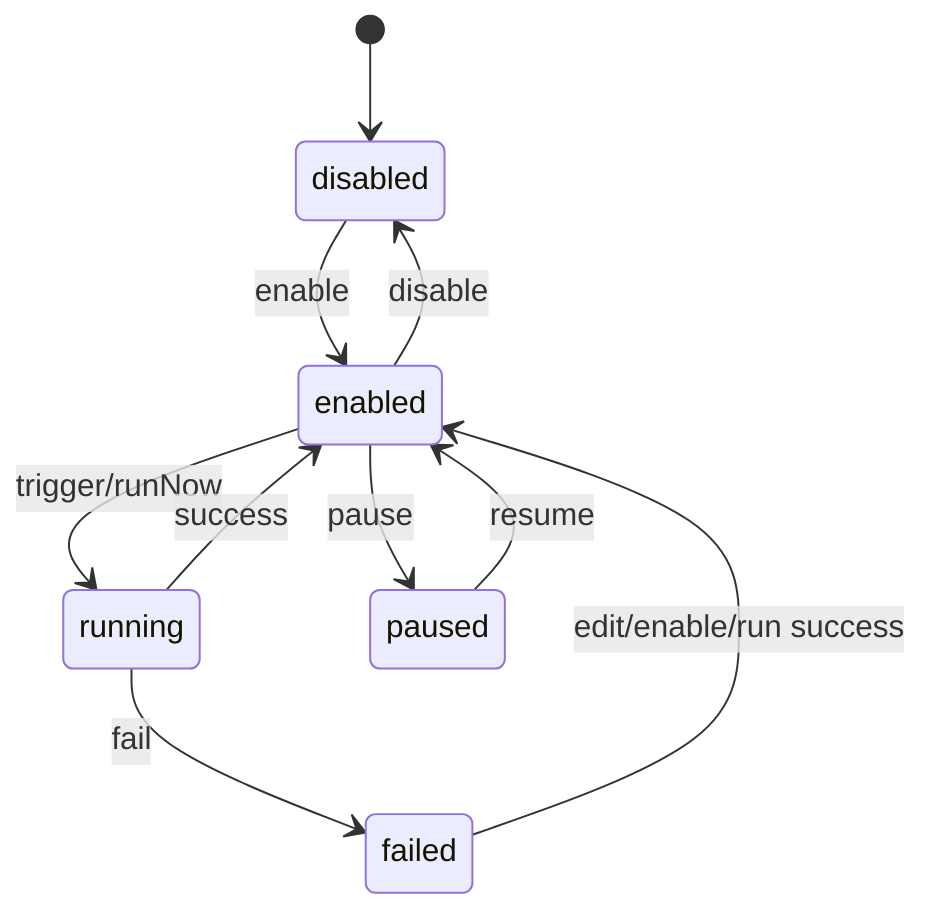

# 自动化配置与执行逻辑重设计 v0.1

## 1. 背景

当前自动化能力本质上仍是 `scheduled_tasks`：

- 状态只有 `enabled`，缺少运行态、失败态、暂停态和执行记录视角。
- 触发逻辑和任务实体耦合，单次、循环、每日、每周等逻辑散在 `ScheduledTaskManager` 中。
- 执行动作主要是“任务对话”，近期通过 `automation_config` 额外塞入了 `data_task`，扩展性不足。
- 输出产物没有统一协议，无法稳定交给飞书、邮件等输出通道。
- 详情配置界面仍围绕“定时任务”表单组织，不能表达多来源动作、多输出通道和未来 action 注册。

本方案把“定时任务”重构为“自动化”。定时只是自动化的启动模式之一，自动化的核心是：

```text
Automation = State + Trigger + ActionGraph + Artifact + Delivery
```

---

## 2. 目标与非目标

### 2.1 目标

- 自动化有独立状态，可以开启、关闭、暂停、运行中、失败后保留错误。
- 启动模式支持：
  - 单次在指定时间执行。
  - 循环周期内执行，例如每 N 分钟/小时/天、每日固定时间、每周固定日和时间。
- 执行动作由多个来源组成：
  - 调用数据任务执行。
  - 调用输入数据能力，例如读取、预览、导入输入表。
  - 调用输出表数据，例如读取预览、导出、作为通知附件或链接。
  - 调用任务对话，复用当前对话能完成的工具调用和产物生成。
  - 支持未来注册进来的 action，不改核心自动化表结构。
- 自动化执行后可以通过输出通道发送产物：
  - 飞书。
  - 邮件。
  - 后续可扩展 Slack、Webhook、企业微信等。
- 去掉原有“定时任务详情配置界面”代码，重新以自动化对象、动作链、输出通道为中心设计。
- UI 遵循 `UI_STYLE_GUIDE.md`：紧凑、数据导向、小字号、小控件、低装饰。

### 2.2 非目标

- 本轮不设计分布式调度。
- 本轮不实现复杂条件分支/循环 DAG，只预留图结构能力。
- 不把通知通道设计成任意外部 HTTP 执行器，Webhook 需要权限和审计后再开放。
- 不改变数据任务本身的 DSL 和 DuckDB 执行模型。

---

## 3. 总体架构



核心拆分：

| 模块                  | 职责                                                          |
| --------------------- | ------------------------------------------------------------- |
| `AutomationStore`     | 持久化自动化定义、运行记录、动作产物、输出通道配置            |
| `AutomationService`   | IPC 门面，负责校验、CRUD、启停、立即运行                      |
| `AutomationScheduler` | 只处理触发时间计算和 timer 管理                               |
| `AutomationRunner`    | 创建运行上下文，按动作图执行 action，收集产物                 |
| `ActionRegistry`      | action 扩展注册中心，内置数据任务、输入数据、输出表、任务对话 |
| `ArtifactCollector`   | 规范化文本、表格、文件、链接、会话、数据表等产物              |
| `DeliveryRouter`      | 根据通道配置发送产物，失败时写入运行记录                      |

---

## 4. 自动化状态模型

自动化配置态和运行态分开。

```ts
type AutomationStatus = 'enabled' | 'disabled' | 'paused' | 'running' | 'failed';

type AutomationRunStatus = 'queued' | 'running' | 'succeeded' | 'failed' | 'cancelled';

interface Automation {
  id: string;
  name: string;
  description?: string | null;
  projectId?: string | null;
  enabled: boolean;
  status: AutomationStatus;
  trigger: AutomationTrigger;
  actionGraph: AutomationActionGraph;
  delivery?: AutomationDeliveryConfig | null;
  failurePolicy: AutomationFailurePolicy;
  concurrencyPolicy: AutomationConcurrencyPolicy;
  nextRunAt: number | null;
  lockedRunId: string | null;
  lastRunAt: number | null;
  lastRunStatus: AutomationRunStatus | null;
  lastError: string | null;
  createdAt: number;
  updatedAt: number;
}

interface AutomationRun {
  id: string;
  automationId: string;
  status: AutomationRunStatus;
  triggerReason: 'timer' | 'manual' | 'retry' | 'queued_overlap';
  queuedAt: number | null;
  startedAt: number | null;
  finishedAt: number | null;
  durationMs: number | null;
  error: string | null;
  artifactCount: number;
  deliveryStatus: 'pending' | 'succeeded' | 'partial' | 'failed' | 'skipped' | null;
  createdSessionId: string | null;
  createdAt: number;
}

interface AutomationFailurePolicy {
  disableOnFailure: boolean;
  retry: {
    enabled: boolean;
    maxAttempts: number;
    backoffMs: number;
  };
  notifyOnFailure: boolean;
}

interface AutomationConcurrencyPolicy {
  overlapPolicy: 'skip' | 'queue_once';
}

interface AutomationRunnerOptions {
  maxConcurrentRuns: number;
}
```

字段语义：

| 字段            | 说明                                        |
| --------------- | ------------------------------------------- |
| `enabled`       | 用户开关，关闭后 scheduler 不再排程         |
| `status`        | 当前自动化状态，用于列表和详情呈现          |
| `lastRunStatus` | 最近一次运行结果                            |
| `nextRunAt`     | 下次触发时间，关闭或无可触发时间时为 `null` |
| `lockedRunId`   | 防止同一自动化重入运行                      |

状态流转：



设计约束：

- `enabled=false` 是用户配置，`status=failed` 是运行结果，不互相覆盖。
- 单次自动化执行成功后自动把 `enabled=false`、`nextRunAt=null`，但保留 `status=disabled` 和最后一次运行记录。
- 循环自动化失败后默认继续排下一次；若配置 `failurePolicy.disableOnFailure=true`，失败后自动关闭。

并发模型：

- 多个不同自动化允许并行执行，由 `AutomationRunnerOptions.maxConcurrentRuns` 控制全局并发，默认 `4`。
- 同一个自动化默认不允许重入，`lockedRunId` 指向正在运行的 run。
- 触发时如果同一自动化正在运行：
  - `overlapPolicy='skip'`：记录一条 skipped 日志，不创建新 run。
  - `overlapPolicy='queue_once'`：最多创建一个 `queued` run，当前 run 完成后立即执行；重复触发只更新 queued run 的触发时间。
- `queued` 只表示“等待 runner 并发槽位或等待同一自动化锁释放”，不代表 action 已经开始执行。

---

## 5. 启动模式设计

统一字段为 `trigger`，不再使用 `runAt + repeatEvery + scheduleConfig` 三套混合字段。

```ts
type AutomationTrigger =
  | AutomationTriggerOnce
  | AutomationTriggerInterval
  | AutomationTriggerDaily
  | AutomationTriggerWeekly
  | AutomationTriggerCron;

interface AutomationTriggerOnce {
  kind: 'once';
  runAt: number;
  timezone: string;
}

interface AutomationTriggerInterval {
  kind: 'interval';
  every: number;
  unit: 'minute' | 'hour' | 'day';
  startAt: number;
  endAt?: number | null;
  timezone: string;
}

interface AutomationTriggerDaily {
  kind: 'daily';
  times: string[];
  startAt?: number | null;
  endAt?: number | null;
  timezone: string;
}

interface AutomationTriggerWeekly {
  kind: 'weekly';
  weekdays: Array<0 | 1 | 2 | 3 | 4 | 5 | 6>;
  times: string[];
  startAt?: number | null;
  endAt?: number | null;
  timezone: string;
}

interface AutomationTriggerCron {
  kind: 'cron';
  expression: string;
  startAt?: number | null;
  endAt?: number | null;
  timezone: string;
}
```

触发计算规则：

- 所有时间计算都保留 `timezone`，默认使用系统时区。
- `interval` 使用 `startAt` 作为基准，跳过已经错过的周期。
- `daily/weekly` 只接受 `HH:mm`，计算未来 14 天内的最近时刻。
- `cron` 是高级触发器，用于每月、每季度、复杂工作日等场景；普通 UI 默认不展开，只在高级模式中显示。
- 设置 `endAt` 后，超过窗口不再生成 `nextRunAt`。
- Scheduler 只负责计算和触发，不关心 action 具体含义。

---

## 6. Action Graph 设计

自动化动作使用轻量图结构，v0.1 UI 先表达为有序步骤列表，底层保留 DAG 扩展空间。

```ts
interface AutomationActionGraph {
  version: 1;
  nodes: AutomationActionNode[];
  edges: AutomationActionEdge[];
}

interface AutomationActionNode {
  id: string;
  type: string;
  label?: string;
  enabled: boolean;
  config: Record<string, unknown>;
  failurePolicy?: AutomationActionFailurePolicy;
  inputBindings?: Record<string, AutomationValueRef>;
}

interface AutomationActionEdge {
  id: string;
  sourceNodeId: string;
  targetNodeId: string;
  outputKey?: string;
  inputKey?: string;
}

type AutomationValueRef =
  | { kind: 'literal'; value: unknown }
  | { kind: 'node_output'; nodeId: string; outputKey: string }
  | { kind: 'automation_context'; key: string };

interface AutomationActionFailurePolicy {
  onFailure: 'stop' | 'continue' | 'skip_downstream';
  emitErrorArtifact: boolean;
}
```

v0.1 执行策略：

- UI 展示为从上到下的步骤。
- 存储仍保存 `nodes + edges`，默认用线性边连接。
- Runner 按拓扑顺序执行。
- 单个 action 失败后按 `failurePolicy` 决定停止、跳过或继续。

### 6.1 Action 注册协议

```ts
type AutomationJsonSchema = {
  type: 'object';
  required?: string[];
  properties: Record<
    string,
    {
      type: 'string' | 'number' | 'integer' | 'boolean' | 'array' | 'object';
      title?: string;
      description?: string;
      enum?: Array<string | number | boolean>;
      default?: unknown;
      items?: AutomationJsonSchema['properties'][string];
      properties?: AutomationJsonSchema['properties'];
    }
  >;
};

interface AutomationValidationContext {
  projectId?: string | null;
  cwd?: string | null;
  availableActions: AutomationActionDefinitionSummary[];
  dataResources: {
    taskIds: string[];
    inputTableIds: string[];
    outputTableIds: string[];
  };
}

interface AutomationActionDefinition<TConfig = unknown, TResult = unknown> {
  type: string;
  title: string;
  description?: string;
  category: 'conversation' | 'data' | 'artifact' | 'integration' | 'custom';
  icon: string;
  version: number;
  configSchema: AutomationJsonSchema;
  defaultConfig: TConfig;
  outputSchema?: AutomationJsonSchema;
  validate(config: TConfig, context: AutomationValidationContext): Promise<void> | void;
  execute(config: TConfig, context: AutomationRunContext): Promise<TResult>;
}
```

注册中心能力：

- `registerAction(definition)` 注册 action。
- `listActions()` 给 UI 生成动作目录。
- `getAction(type)` 给 Runner 执行。
- action 类型使用反向域名或能力域前缀，避免冲突，例如 `data.task.run`。
- `configSchema` 采用 JSON Schema draft-07 的受控子集，UI schema renderer 只渲染明确支持的字段类型；未知 schema 字段保留但不渲染。

### 6.2 内置 Action

| 类型                  | 输入                                     | 输出产物                        | 说明                         |
| --------------------- | ---------------------------------------- | ------------------------------- | ---------------------------- |
| `conversation.run`    | `prompt`、`projectId/cwd`、模型/权限配置 | `sessionId`、文本摘要、文件链接 | 执行任务对话中能做的事情     |
| `data.task.run`       | `taskId`、`outputMode`                   | 数据任务结果、输出表引用        | 调用 `DataTaskStore.runTask` |
| `data.input.preview`  | `inputTableId`、`limit`                  | 表格预览                        | 读取输入表数据               |
| `data.input.import`   | `filePath`、`name`、`config`             | 输入表引用                      | 自动导入输入数据             |
| `data.output.preview` | `outputTableId`、`limit`                 | 表格预览                        | 读取输出表数据               |
| `data.output.export`  | `outputTableId`、`format`                | 文件产物                        | 导出 Csv/JSON/XLSX 等        |

`artifact.compose`（组合产物）暂不作为内置 Action 暴露；等产物引用、模板编辑和通知正文生成规则稳定后再注册。

`conversation.run` 应复用现有 `SessionManager.startSession` 和 agent runtime 扩展，因此可以执行数据工具、文件操作、浏览器/MCP 等任务对话中的能力。

`conversation.run` 的完成语义：

```ts
interface ConversationRunActionConfig {
  prompt: string;
  projectId?: string | null;
  cwd?: string | null;
  modelConfigSetId?: string | null;
  model?: string | null;
  completionMode: 'wait' | 'fire_and_forget';
  timeoutMs: number;
  collectArtifacts: boolean;
}
```

- `modelConfigSetId` 指向 API 配置方案；Runner 创建 session 时使用该方案的 provider/api/model 快照，不修改全局当前模型。
- 默认 `completionMode='wait'`，Runner 创建 session 后等待会话进入 `completed` 或 `error`，再收集消息摘要、文件附件、工具产物和 session 链接。
- `timeoutMs` 默认 30 分钟；超时后 action 失败，按 action 级 `failurePolicy` 处理。
- `fire_and_forget` 只适合提醒/启动类自动化，创建 session 即完成，仅产出 `session` artifact，不保证下游能拿到完整对话产物。

---

## 7. 执行上下文与产物协议

### 7.1 运行上下文

```ts
interface AutomationRunContext {
  automationId: string;
  runId: string;
  projectId?: string | null;
  cwd?: string | null;
  trigger: AutomationTrigger;
  now: number;
  variables: Record<string, unknown>;
  emitArtifact(artifact: AutomationArtifact): void;
  log(event: AutomationRunLogEvent): void;
}

interface AutomationRunLogEvent {
  id?: string;
  level: 'debug' | 'info' | 'warning' | 'error';
  message: string;
  nodeId?: string;
  timestamp: number;
  details?: Record<string, unknown>;
}
```

### 7.2 产物类型

```ts
type AutomationArtifactKind =
  'text' | 'markdown' | 'table' | 'file' | 'link' | 'session' | 'data_input' | 'data_output';

interface AutomationArtifact {
  id: string;
  runId: string;
  sourceNodeId?: string;
  kind: AutomationArtifactKind;
  title: string;
  summary?: string;
  mimeType?: string;
  content?: string;
  filePath?: string;
  href?: string;
  dataRef?: {
    kind: 'input_table' | 'output_table' | 'session';
    id: string;
  };
  createdAt: number;
}
```

产物策略：

- 运行过程中所有 action 都可以 `emitArtifact`。
- Runner 结束后把产物打包给 `DeliveryRouter`。
- 通知通道不直接依赖某个 action 的私有返回值，只消费统一 `AutomationArtifact`。
- 文件产物优先以链接/附件策略发送，避免把大文件塞进消息正文。

---

## 8. 输出通道设计

```ts
type AutomationDeliveryChannelType = 'feishu' | 'email' | 'webhook';

interface AutomationDeliveryConfig {
  enabled: boolean;
  channels: AutomationDeliveryChannel[];
  artifactPolicy: 'summary' | 'links' | 'attachments';
  failureMessage: {
    includeRunLog: boolean;
    includeArtifacts: boolean;
  };
}

interface AutomationDeliveryChannel {
  id: string;
  type: AutomationDeliveryChannelType;
  enabled: boolean;
  recipient: string;
  templateId?: string | null;
  maxAttachmentBytes?: number | null;
  config: Record<string, unknown>;
}
```

通道注册协议：

```ts
interface AutomationDeliveryDefinition<TConfig = unknown> {
  type: string;
  title: string;
  icon: string;
  configSchema: AutomationJsonSchema;
  limits: {
    maxAttachmentBytes: number;
    maxAttachmentCount: number;
    supportedArtifactKinds: AutomationArtifactKind[];
  };
  validate(channel: AutomationDeliveryChannel): Promise<void> | void;
  send(input: AutomationDeliverySendInput<TConfig>): Promise<AutomationDeliverySendResult>;
}

interface AutomationDeliverySendInput<TConfig = unknown> {
  automation: Automation;
  run: AutomationRun;
  channel: AutomationDeliveryChannel & { config: TConfig };
  artifacts: AutomationArtifact[];
  subject: string;
  body: string;
}

interface AutomationDeliverySendResult {
  status: 'succeeded' | 'failed' | 'skipped';
  messageId?: string;
  error?: string;
  sentArtifactIds: string[];
  skippedArtifactIds: string[];
  sentAt: number;
}
```

内置通道：

| 通道      | recipient 示例                           | 配置                  | 说明                     |
| --------- | ---------------------------------------- | --------------------- | ------------------------ |
| `feishu`  | 群机器人 URL、open chat id、用户 open id | app/机器人凭据引用    | 支持正文、链接、文件附件 |
| `email`   | `name@example.com`                       | SMTP/应用邮件配置引用 | 支持正文和附件           |
| `webhook` | URL                                      | method、headers、签名 | 二期开放，需要权限审计   |

发送时机：

- 自动化成功后默认发送。
- 失败后由自动化级 `failurePolicy.notifyOnFailure` 决定是否发送失败通知，失败通知内容由 `delivery.failureMessage` 控制。
- 每个通道独立记录发送结果，某个通道失败不改变 action 执行结果，但会影响 run 的 `deliveryStatus`。
- 附件发送前由 `DeliveryRouter` 按 `definition.limits` 和 `channel.maxAttachmentBytes` 做过滤；超限产物降级为链接或摘要，并写入 `skippedArtifactIds`。

---

## 9. 持久化设计

### 9.1 新表

```sql
CREATE TABLE IF NOT EXISTS automations (
  id TEXT PRIMARY KEY,
  name TEXT NOT NULL,
  description TEXT,
  project_id TEXT,
  enabled INTEGER NOT NULL DEFAULT 1,
  status TEXT NOT NULL,
  trigger_json TEXT NOT NULL,
  action_graph_json TEXT NOT NULL,
  delivery_json TEXT,
  failure_policy_json TEXT NOT NULL,
  concurrency_json TEXT NOT NULL,
  next_run_at INTEGER,
  locked_run_id TEXT,
  last_run_at INTEGER,
  last_run_status TEXT,
  last_error TEXT,
  created_at INTEGER NOT NULL,
  updated_at INTEGER NOT NULL,
  FOREIGN KEY (project_id) REFERENCES projects(id) ON DELETE SET NULL
);

CREATE INDEX IF NOT EXISTS idx_automations_next_run
ON automations(enabled, next_run_at);

CREATE TABLE IF NOT EXISTS automation_runs (
  id TEXT PRIMARY KEY,
  automation_id TEXT NOT NULL,
  status TEXT NOT NULL,
  trigger_reason TEXT NOT NULL,
  queued_at INTEGER,
  started_at INTEGER,
  finished_at INTEGER,
  duration_ms INTEGER,
  error TEXT,
  artifact_count INTEGER NOT NULL DEFAULT 0,
  delivery_status TEXT,
  created_session_id TEXT,
  created_at INTEGER NOT NULL,
  FOREIGN KEY (automation_id) REFERENCES automations(id) ON DELETE CASCADE
);

CREATE INDEX IF NOT EXISTS idx_automation_runs_automation
ON automation_runs(automation_id, started_at DESC);

CREATE TABLE IF NOT EXISTS automation_artifacts (
  id TEXT PRIMARY KEY,
  automation_run_id TEXT NOT NULL,
  source_node_id TEXT,
  kind TEXT NOT NULL,
  title TEXT NOT NULL,
  summary TEXT,
  payload_json TEXT,
  file_path TEXT,
  href TEXT,
  created_at INTEGER NOT NULL,
  FOREIGN KEY (automation_run_id) REFERENCES automation_runs(id) ON DELETE CASCADE
);

CREATE TABLE IF NOT EXISTS app_meta (
  key TEXT PRIMARY KEY,
  value TEXT NOT NULL
);
```

### 9.2 旧表迁移

保留 `scheduled_tasks` 一段时间作为兼容读取源，但 UI 不再写它。

迁移规则：

| 旧字段                                    | 新字段                                      |
| ----------------------------------------- | ------------------------------------------- |
| `title`                                   | `automations.name`                          |
| `prompt`                                  | `conversation.run.config.prompt`            |
| `cwd`                                     | 按 cwd 匹配/创建 project，写入 `project_id` |
| `enabled`                                 | `automations.enabled`                       |
| `run_at` + `schedule_config` + `repeat_*` | 转为 `trigger_json`                         |
| `automation_config.actionKind=data_task`  | 转为 `data.task.run` 节点                   |
| `automation_config.delivery`              | 转为 `delivery_json`                        |
| `last_*`                                  | 写入 automation 摘要字段，不生成历史 run    |

迁移后的兼容策略：

- 首次启动执行一次 `migrateScheduledTasksToAutomations()`，整个迁移放在 SQLite transaction 中执行。
- 迁移版本写入统一元数据表，例如 `app_meta(key TEXT PRIMARY KEY, value TEXT NOT NULL)`，key 使用 `automation_migration_version`，避免重复创建。
- 迁移失败时 transaction 回滚，保留 `scheduled_tasks` 原表和已存在的 `automations` 状态；启动继续使用旧 `schedule.*` 兼容代理，等待下次启动或用户触发修复。
- `cwd -> project_id` 匹配失败时，调用项目持久化逻辑按 cwd 创建项目；如果 cwd 不存在或不再可访问，则 `project_id=null`，并把原始 cwd 写入 `conversation.run.config.cwd` 作为兼容 fallback。
- IPC `schedule.*` 可以短期代理到 `automation.*`，但前端应改用 `automation.*`。
- 测试完成后再删除 `ScheduledTaskManager` 和 `SettingsSchedule` 的旧详情表单。

---

## 10. IPC 与服务接口

```ts
interface AutomationActionDefinitionSummary {
  type: string;
  title: string;
  description?: string;
  category: 'conversation' | 'data' | 'artifact' | 'integration' | 'custom';
  icon: string;
  version: number;
  configSchema: AutomationJsonSchema;
}

interface AutomationDeliveryDefinitionSummary {
  type: string;
  title: string;
  icon: string;
  configSchema: AutomationJsonSchema;
  limits: AutomationDeliveryDefinition['limits'];
}

interface AutomationListQuery {
  query?: string;
  status?: AutomationStatus | 'all';
  projectId?: string | null;
  limit?: number;
  offset?: number;
}

interface AutomationCreateInput {
  name: string;
  description?: string | null;
  projectId?: string | null;
  enabled?: boolean;
  trigger: AutomationTrigger;
  actionGraph: AutomationActionGraph;
  delivery?: AutomationDeliveryConfig | null;
  failurePolicy?: Partial<AutomationFailurePolicy>;
  concurrencyPolicy?: Partial<AutomationConcurrencyPolicy>;
}

interface AutomationUpdateInput {
  name?: string;
  description?: string | null;
  projectId?: string | null;
  enabled?: boolean;
  trigger?: AutomationTrigger;
  actionGraph?: AutomationActionGraph;
  delivery?: AutomationDeliveryConfig | null;
  failurePolicy?: Partial<AutomationFailurePolicy>;
  concurrencyPolicy?: Partial<AutomationConcurrencyPolicy>;
}

interface AutomationRunQuery {
  limit?: number;
  offset?: number;
  status?: AutomationRunStatus | 'all';
}

interface AutomationService {
  list(query?: AutomationListQuery): Promise<Automation[]>;
  get(id: string): Promise<Automation | null>;
  create(input: AutomationCreateInput): Promise<Automation>;
  update(id: string, input: AutomationUpdateInput): Promise<Automation>;
  delete(id: string): Promise<{ success: boolean }>;
  setEnabled(id: string, enabled: boolean): Promise<Automation>;
  pause(id: string): Promise<Automation>;
  resume(id: string): Promise<Automation>;
  runNow(id: string): Promise<AutomationRun>;
  listRuns(id: string, query?: AutomationRunQuery): Promise<AutomationRun[]>;
  listArtifacts(runId: string): Promise<AutomationArtifact[]>;
  listActionDefinitions(): Promise<AutomationActionDefinitionSummary[]>;
  listDeliveryDefinitions(): Promise<AutomationDeliveryDefinitionSummary[]>;
}
```

IPC 命名：

```text
automation.list
automation.get
automation.create
automation.update
automation.delete
automation.setEnabled
automation.pause
automation.resume
automation.runNow
automation.runs.list
automation.artifacts.list
automation.actions.listDefinitions
automation.delivery.listDefinitions
```

Renderer 类型全部迁移到 `Automation*` 命名，停止继续扩展 `Schedule*` 类型。

`setEnabled(false)` 和 `pause()` 的区别：

- `setEnabled(false)` 是配置关闭，用户明确不再排程；单次任务执行完也会走这个状态。
- `pause()` 是临时暂停，保留当前触发配置和 `nextRunAt` 计算基准，但 Scheduler 不触发。
- `resume()` 从当前时间重新计算 `nextRunAt`，不会补跑暂停期间错过的触发。

---

## 11. 新配置界面设计

### 11.1 页面结构

自动化页面替代原“定时任务详情配置”。页面默认展示列表和右侧编辑面板，不再弹出旧详情表单。

```text
┌────────────────────────────────────────────────────────────────────┐
│ 自动化  [搜索...]                         [+ 新建] [刷新]          │
├───────────────┬────────────────────────────────────────────────────┤
│ 指标条        │ 编辑面板                                           │
│ 总数 开启 运行 │ ┌ 基础信息 ─────────────────────────────────────┐ │
│ 失败 今日      │ │ 名称  项目  状态开关  下次执行                 │ │
│               │ └───────────────────────────────────────────────┘ │
│ 自动化列表     │ ┌ 启动模式 ─────────────────────────────────────┐ │
│ name status   │ │ 单次 | 周期 | 每日 | 每周  时间/周期/窗口       │ │
│ next run      │ └───────────────────────────────────────────────┘ │
│ last result   │ ┌ 动作链 ───────────────────────────────────────┐ │
│               │ │ [数据任务] -> [输出表预览] -> [任务对话]       │ │
│               │ │ + 添加动作                                    │ │
│               │ └───────────────────────────────────────────────┘ │
│               │ ┌ 输出通道 ─────────────────────────────────────┐ │
│               │ │ 飞书 群A   邮件 owner@example.com              │ │
│               │ │ 产物策略: 摘要/链接/附件                       │ │
│               │ └───────────────────────────────────────────────┘ │
│               │ ┌ 最近运行 ─────────────────────────────────────┐ │
│               │ │ run id  status  artifacts  delivery            │ │
│               │ └───────────────────────────────────────────────┘ │
└───────────────┴────────────────────────────────────────────────────┘
```

### 11.2 列表区域

列表使用紧凑表格：

| 列       | 内容                          |
| -------- | ----------------------------- |
| 状态     | 开关 + 状态点                 |
| 名称     | 自动化名称、项目              |
| 启动     | 单次/周期摘要、下次执行       |
| 动作     | action 数量和主要 action 标签 |
| 输出     | 通道数量、产物策略            |
| 最近运行 | 成功/失败、耗时、错误摘要     |
| 操作     | 运行、编辑、更多              |

不使用大卡片堆叠。移动端可以退化为密集列表行。

### 11.3 编辑面板

编辑面板分四个紧凑 section：

1. 基础信息
   - 名称。
   - 项目。
   - 状态开关。
   - 失败策略。

2. 启动模式
   - 分段控件：单次、周期、每日、每周。
   - 单次：日期时间。
   - 周期：every + unit + 起止窗口。
   - 每日：多个 `HH:mm` chip。
   - 每周：星期 chip + 时间 chip。

3. 动作链
   - 左侧动作步骤列表。
   - 右侧当前 action 的配置表单。
   - `+ 添加动作` 从注册 action 目录选择。
   - 每个 action 配置由 `configSchema` 渲染，内置 action 可以提供专用紧凑编辑器。
   - 每行 action 使用上移/下移图标按钮调整顺序，使用删除图标移除；v0.1 不做拖拽，避免和紧凑表格滚动冲突。
   - 添加 action 时打开轻量命令面板，按 category 分组，支持搜索 action 标题和 type。

4. 输出通道
   - 开启/关闭输出。
   - 产物策略：摘要、链接、附件。
   - 通道列表：飞书、邮件。
   - 每个通道一行配置，支持测试发送。

### 11.4 内置 Action 配置 UI

| Action                | UI 控件                                                                                |
| --------------------- | -------------------------------------------------------------------------------------- |
| `conversation.run`    | 简要智能体对话框：模型选择、prompt textarea；完整模式再显示权限/工具摘要、产物收集开关 |
| `data.task.run`       | 数据任务 select、运行模式 persisted/temporary、输出表摘要                              |
| `data.input.preview`  | 输入表 select、行数 stepper                                                            |
| `data.input.import`   | 文件选择、输入表名称、处理策略                                                         |
| `data.output.preview` | 输出表 select、行数 stepper                                                            |
| `data.output.export`  | 输出表 select、格式 select、文件名模板                                                 |

UI 不直接硬编码未来 action。未知 action 使用 schema renderer，但仍保持小控件和表单密度。

动作配置交互：

- `data.task.run`、`data.input.preview`、`data.output.preview/export` 均使用可搜索 select，列表来自数据页面现有 dashboard/query IPC，不在前端硬编码。
- `conversation.run` 在自动化配置区使用简要智能体对话框，只显示模型选择和 prompt；默认 `wait`，执行时用所选模型配置方案创建 session。

状态 UI：

| 状态            | 表现                                                             |
| --------------- | ---------------------------------------------------------------- |
| 加载中          | 表格骨架行 + 编辑面板禁用态，不使用大 spinner 居中占屏           |
| 空列表          | 单行空态，提供 `新建自动化` 按钮                                 |
| action 定义缺失 | action 行显示 warning 状态，配置只读，允许删除或保留             |
| 数据资源缺失    | select 显示资源已不存在，保存前校验阻止启用                      |
| 运行中          | 行内状态点 + `running` 标签，运行按钮禁用                        |
| 输出通道失败    | 最近运行列显示 delivery `partial/failed`，详情中展示每个通道结果 |
| 保存失败        | 编辑面板顶部显示紧凑错误 banner，保留用户未保存输入              |

实现风格：

- 复用现有 `glass-card`、`GlassSelect`、`GlassDropdownMenu`、紧凑表格和图标按钮。
- 表单控件优先使用 `h-8`、`text-xs`、`gap-2`、`rounded-md`，section 标题使用 secondary-sized typography。
- 页面 section 不是大浮动卡片堆叠，左列表和右编辑面板保持数据工具式密度。

---

## 12. 删除旧详情界面的范围

需要删除或改造：

| 当前位置                                                       | 处理                                             |
| -------------------------------------------------------------- | ------------------------------------------------ |
| `src/renderer/components/settings/SettingsSchedule.tsx`        | 不再保留旧定时任务详情表单，重建为 Automation UI |
| `ScheduleTask` / `ScheduleCreateInput` / `ScheduleUpdateInput` | 新增 `Automation*` 类型后逐步删除                |
| `schedule.*` IPC                                               | 兼容期代理到 `automation.*`，后续移除            |
| `ScheduledTaskManager`                                         | 替换为 `AutomationScheduler + AutomationRunner`  |
| `scheduled_tasks` 表                                           | 迁移后只读兼容，最终废弃                         |

界面命名建议：

- 页面标题：`自动化`
- 主按钮：`新建自动化`
- 旧“定时任务”文案全部替换为“自动化”或“启动模式”。

---

## 13. 开发顺序

### 阶段 1：类型和存储

- 新增 `Automation*` renderer/shared 类型。
- 新增 SQLite 表和 store。
- 完成 `scheduled_tasks -> automations` 迁移。
- 添加 Store 单元测试。

### 阶段 2：调度和运行

- 实现 `AutomationScheduler`，只负责 `nextRunAt`。
- 实现 `ActionRegistry` 和内置 action。
- 实现 `AutomationRunner`、运行记录和产物收集。
- 添加触发计算、运行失败、重入保护测试。

### 阶段 3：输出通道

- 实现 `DeliveryRouter`。
- 接入飞书、邮件通道的配置读取和发送接口。
- 添加通道发送结果记录。
- 添加成功/失败通知测试，通道可用性不足时用 fake sender 覆盖。

### 阶段 4：前端重建

- 删除旧 `SettingsSchedule` 详情配置表单。
- 构建自动化列表、编辑面板、动作链和输出通道 UI。
- 动作目录来自 `automation.actions.listDefinitions`。
- 输出通道目录来自 `automation.delivery.listDefinitions`。
- 添加源代码级 UI 入口测试和必要的交互测试。

### 阶段 5：兼容清理

- `schedule.*` IPC 改为 deprecated。
- 数据迁移稳定后删除旧 scheduled task UI 文案和测试。
- 根据实际版本节奏决定是否删除旧表。

---

## 14. 测试策略

| 测试                                  | 覆盖                                                         |
| ------------------------------------- | ------------------------------------------------------------ |
| `automation-trigger.test.ts`          | 单次、interval、daily、weekly、窗口截止、时区                |
| `automation-store.test.ts`            | CRUD、迁移、JSON 字段容错                                    |
| `automation-runner.test.ts`           | action 执行顺序、失败策略、产物收集                          |
| `automation-concurrency.test.ts`      | 多自动化并发、同自动化 skip/queue_once、防重入               |
| `automation-conversation-run.test.ts` | wait/fire_and_forget、timeout、session artifact 收集         |
| `automation-action-registry.test.ts`  | 注册、重复 type、schema 校验                                 |
| `automation-delivery.test.ts`         | 飞书/邮件 fake sender、通道失败记录                          |
| `automation-ui-source.test.ts`        | 页面入口、旧定时任务详情表单移除、新 action/channel 控件存在 |
| `automation-ui-states.test.ts`        | 空态、加载态、缺失 action、缺失数据资源、通道失败提示        |
| `scheduled-task-migration.test.ts`    | 旧任务迁移为 automation                                      |

关键边界：

- 关闭状态不会排程。
- 单次过期后不能直接开启，必须重新选择时间。
- 同一自动化正在运行时再次触发不会重入。
- `queue_once` 重叠触发最多排一个 queued run。
- action 失败后 run 写入失败记录，循环触发仍能计算下一次。
- 输出通道失败不会丢失 action 产物。
- 未注册 action 不能执行，但配置可以保留并在 UI 标记为不可用。

---

## 15. 未决问题

- 飞书和邮件配置来源需要确认：复用现有 remote/connector 配置，还是新增 `notification_channels` 设置页。
- Cron 高级触发器是否一期开放 UI，还是只先支持类型和迁移保留。
- Webhook 是否作为一期通道开放，取决于权限审计是否同步完成。
- 通知模板是否先内置默认模板，还是同时提供模板管理入口。
