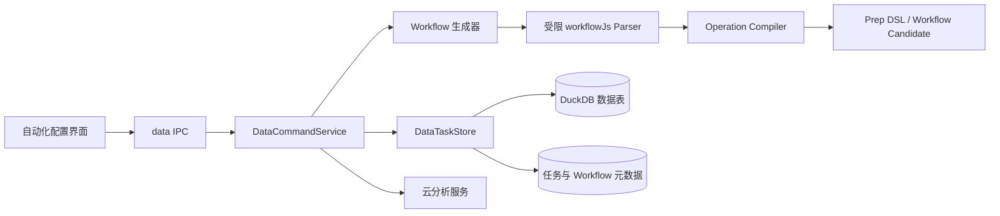
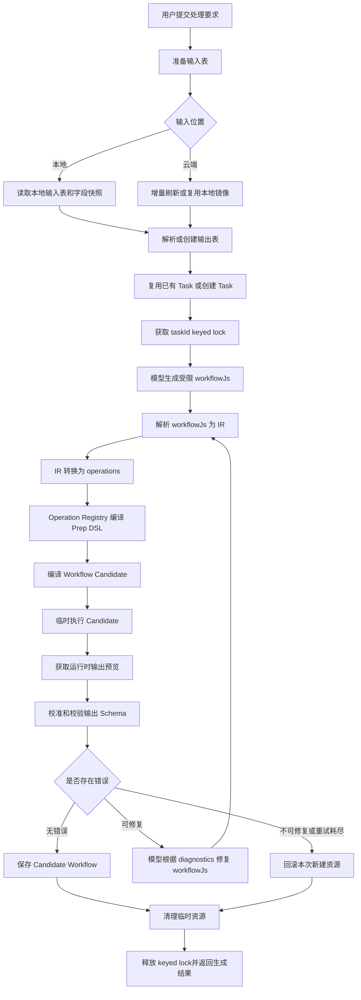
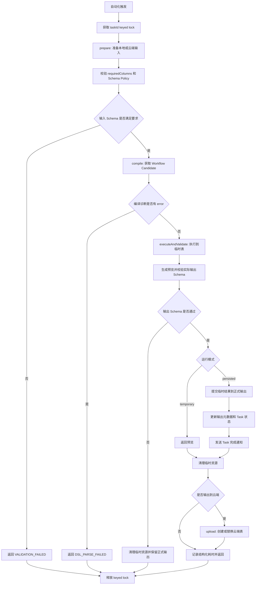

# 自动化－数据处理任务 RP v1.0

## 1. 文档目的

本文描述当前自动化数据处理任务的后端设计和运行语义。系统把用户在配置期输入的自然语言处理要求转换为可保存、可重复执行的确定性 Workflow；自动化运行期复用该 Workflow，不再调用大模型重新生成处理逻辑。

当前设计重点解决四类问题：

- 正确性：错误 Workflow 不污染正式输出和正式 Task 状态。
- 一致性：同一 Task 的生成、保存和执行不会相互覆盖。
- 性能：减少重复编译和不必要的云端镜像重建。
- 可观测性：能够识别 Workflow 版本并定位各阶段耗时。

## 2. 核心原则

1. AI 只参与配置期生成，不参与每次自动化执行。
2. 模型输出不直接落库，必须经过解析、编译和临时执行验证。
3. 正式输出采用“临时执行、校验、提交”的流程。
4. `saveWorkflow=true` 仅在执行成功后保存 Workflow。
5. 同一 Task 的生成、修改和执行使用 keyed lock 串行化。
6. 临时执行结束后主动清理临时表和临时缓存。
7. 网络、权限、超时等基础设施错误不交给模型修复。

## 3. 系统边界

### 3.1 配置期

用户选择输入表、输出位置并描述处理要求，系统调用大模型生成 Workflow，完成编译和临时验证后保存为数据任务。

### 3.2 运行期

定时任务或自动化节点根据 `taskId` 和已保存的 `workflowDsl` 执行确定性数据处理，必要时将结果上传到云分析空间。

### 3.3 非目标

- 不引入草稿、预览、发布和不可变版本绑定 UI。
- 不在每次自动化运行时重新调用模型。
- 不允许模型输出的任意 JavaScript、SQL 或 DSL 未经校验直接执行。
- 本阶段不扩展复杂多输入 DAG、条件分支和分布式任务调度。

## 4. 总体架构



主要代码：

- `src/renderer/components/settings/schedule/editorPanels.tsx`
- `src/main/data/ipc/data-tasks-ipc.ts`
- `src/main/data/data-command-service.ts`
- `src/main/data/data-task-store.ts`
- `src/main/data/workflow/dsl-generator.ts`
- `src/main/data/workflow/js-parser.ts`
- `src/main/data/workflow/operation-compiler.ts`
- `src/shared/prep-dsl`

## 5. 配置期生成流程

### 5.1 完整流程



### 5.2 输入准备

本地输入表直接从 `DataTaskStore` 读取，同时生成字段名称和类型快照。

云端输入表会映射为稳定命名的本地镜像：

```text
<云端表名>_自动化镜像_<tableId 前缀>
```

镜像刷新规则：

1. 如果请求携带云端 `updatedAt`，并且与镜像持久化的 `sourceVersion` 一致，直接复用本地镜像，不下载数据。
2. 无版本信息或版本变化时，下载 CSV 并计算 SHA-256 内容 Hash。
3. Hash 与已保存的 `contentHash` 一致时，跳过 DuckDB 表重建。
4. Hash 变化时才重新导入并更新镜像元数据。

镜像刷新通过 `cloud-mirror:<mirrorName>` keyed lock 串行，避免相同云端表被并发重复导入。

### 5.3 模型输出协议

主路径要求模型返回受限的 `workflowJs`，而不是任意 JavaScript：

```json
{
  "workflowJs": "workflow().inputDataset(INPUT_TABLE_ID, \"src\").filter(col(\"Profit\").gte(lit(0))).sort(col(\"Profit\"), \"asc\").outputTable(OUTPUT_TABLE_NAME, { mode: \"replace\" })",
  "requiredColumns": [{ "name": "Profit" }]
}
```

`js-parser.ts` 只接受白名单化的 `workflow()` API 链，并把它转换为内部 IR。IR 再转换为 operation 列表，由 operation compiler 生成 Prep DSL。模型代码不会作为通用 JavaScript 执行。

示例结果：

```text
input source dataset "<inputTableId>" as src
  | filter [Profit] >= 0
  | sort by [Profit] asc
  | output table "<outputTableName>" mode replace
```

### 5.4 Operation Registry

Registry 负责把标准化 operation 编译为确定的 Prep DSL，当前覆盖过滤、排序、字段选择、删除、重命名、派生、类型转换和聚合等操作。

Registry 的价值：

- 模型只表达意图，DSL 语法由后端控制。
- 字段引用统一校验。
- 操作参数经过白名单和类型检查。
- 新操作可以在 Registry 中独立扩展。

### 5.5 Candidate 编译和 LRU 缓存

Prep DSL 依次经过：

```text
parsePrepDsl
  -> compilePrepWorkflowToFlow
  -> applyWorkflowResourceBindings
  -> Workflow Candidate
```

Candidate 缓存键由以下内容的稳定 Hash 组成：

```text
workflowDsl + inputTableId + inputAlias + outputTableId
```

缓存采用最大 100 项的 LRU：

- 命中后提升为最近使用项。
- 相同并发编译复用同一个 Promise。
- 超出容量淘汰最久未使用项。
- 编译失败立即删除缓存项。
- 返回 Candidate 副本，避免调用方修改缓存内容。

一次生成中得到的 Candidate 会继续用于临时验证和最终保存，不重复编译。

### 5.6 临时验证

Candidate 不会直接保存。系统先调用 `validateTaskWorkflow`，在 `temp_task_*` 表中执行，再基于真实运行结果完成：

- 执行诊断收集。
- 输出预览生成。
- 实际字段名称和类型校验。
- `expectedOutputSchema` 校准。
- lineage 和 required columns 契约校验。

临时验证不更新正式 Task 的 `running/completed/failed` 状态，也不发送 Task 完成通知。

### 5.7 诊断修复分类

只有模型可能解决的问题才进入修复循环，例如：

- DSL 或 workflowJs 语法问题。
- 字段引用问题。
- 类型不兼容。
- 操作参数或结构错误。

以下错误直接返回，不调用模型修复：

- 网络或连接错误。
- 认证、权限错误。
- 超时或取消。
- 文件、表或其他资源不存在。
- 磁盘及运行环境错误。

### 5.8 生成失败回滚

如果生成、编译、临时执行或校验失败：

- 删除本次新建的 Task 元数据。
- 删除本次新建的输出 Dataset 和物理表。
- 复用的 Task 不删除。
- 复用的输出表不删除。
- 清理临时输出表和临时节点缓存。

Task 回滚使用“仅删除 Task 元数据”的专用路径，避免误删绑定的已有输出表。

## 6. 自动化运行流程



### 6.1 正式输出提交

运行期始终先产生临时输出：

```text
输入数据 -> 临时执行 -> 输出 Schema 校验 -> 正式提交
```

只有校验成功才调用 `commitValidatedTaskOutput`，把临时结果替换到正式输出表，并更新：

- Task 状态。
- `sourceDatasetId`。
- 输出物理表名。
- 行数和列数。
- `lastRunAt` 和错误状态。
- 输出 Dataset 元数据。

Schema 校验失败时，正式输出表保持原样。

### 6.2 `saveWorkflow=true` 语义

普通数据任务执行携带新 DSL 时，顺序为：

```text
编译 Candidate -> 使用 Candidate 执行 -> 执行成功 -> 保存 Workflow
```

执行失败不会保存新 Workflow，因此不会出现“正式 Workflow 已更新，但输出仍来自旧 Workflow”的提前保存问题。

### 6.3 临时资源清理

临时资源包括：

- `temp_task_*` 最终输出表。
- 临时中间节点缓存表。
- `data_workflow_node_caches` 中 `cache_scope = temporary` 的记录。

成功、预览失败、Schema 失败和提交异常都进入清理逻辑。清理按 Task 执行；同一 Task 已由 keyed lock 串行，不会删除另一次并发运行仍在使用的临时资源。

## 7. 并发与状态一致性

`DataCommandService` 使用 `task:<taskId>` keyed lock 串行化同一 Task 的以下操作：

- 生成或重新生成 Workflow。
- 保存完整 Workflow DSL。
- 配置输入、处理和输出节点。
- 普通临时或正式运行。
- 自动化数据处理运行。

不同 Task 使用不同 key，仍可并发执行。`DataTaskStore` 内部保留 DuckDB 级别的互斥，负责数据库连接和事务安全；Service keyed lock 负责业务层的同 Task 顺序一致性。

## 8. 生成结果和运行结果

配置期生成结果核心字段：

```ts
interface DataGenerateTaskFromRequirementResult {
  taskId: string;
  taskName: string;
  outputTableId: string;
  outputTableName: string;
  workflowDsl: string;
  workflowHash: string;
  requiredColumns: DataAutomationColumnSnapshot[];
  expectedOutputSchema: DataAutomationColumnSnapshot[];
  lineage: DataAutomationLineageEntry[];
  columnsSnapshot: DataAutomationColumnSnapshot[];
  sourceSummaryHash: string;
  version: number;
  generatedAt: number;
}
```

运行结果额外包含：

```ts
interface RunGeneratedTaskResult {
  workflowHash: string;
  stageDurationsMs: {
    prepare: number;
    compile: number;
    executeAndValidate: number;
    upload: number;
    total: number;
  };
}
```

`workflowHash` 是 `workflowDsl` 的 SHA-256，可用于区分同一 Task 的不同 Workflow，并关联日志、运行结果和性能指标。

## 9. 可观测性

自动化完成日志包含：

- `taskId`
- `workflowHash`
- 输入和输出位置
- `prepareDurationMs`
- `compileDurationMs`
- `runDurationMs`
- `uploadDurationMs`
- `totalDurationMs`

阶段解释：

| 阶段                 | 内容                            | 耗时异常时优先排查                    |
| -------------------- | ------------------------------- | ------------------------------------- |
| `prepare`            | 输入解析、云镜像刷新、字段快照  | 云端下载、文件预览、镜像导入          |
| `compile`            | DSL 解析、编译和资源绑定        | 缓存命中率、复杂 Workflow、元数据查询 |
| `executeAndValidate` | DuckDB 执行、预览和 Schema 校验 | 聚合、Join、数据量、磁盘 IO           |
| `upload`             | 本地结果上传云端                | 网络、云端导入任务                    |
| `total`              | 端到端处理                      | 各阶段合计及调度等待                  |

## 10. 错误语义

| 错误码               | 典型场景                         | 是否保存 Workflow | 是否修改正式输出           |
| -------------------- | -------------------------------- | ----------------- | -------------------------- |
| `INVALID_ARGUMENT`   | 缺少输入表、输出目录等参数       | 否                | 否                         |
| `RESOURCE_NOT_FOUND` | Task、表或文件不存在             | 否                | 否                         |
| `DSL_PARSE_FAILED`   | workflowJs/DSL 解析或编译失败    | 否                | 否                         |
| `VALIDATION_FAILED`  | 字段漂移、输出 Schema 不符合契约 | 否                | 否                         |
| `GENERATION_FAILED`  | 模型调用或生成协议失败           | 否                | 否                         |
| `RUN_FAILED`         | DuckDB 或运行环境执行失败        | 否                | 否；正式运行按失败状态记录 |

## 11. 性能特征

- 相同 Workflow 和资源绑定优先命中 Candidate LRU。
- 同一云表优先按版本复用镜像，版本不可用时按内容 Hash 避免重导入。
- 生成、临时验证和保存复用同一个 Candidate。
- 临时表及时清理，避免依赖 TTL 长时间占用存储。
- keyed lock 仅限制同一 Task，不限制不同 Task 的业务并发。

## 12. 已知约束和后续方向

- Candidate LRU 是进程内缓存，应用重启后重新构建。
- 如果云端调用方不提供 `updatedAt`，仍需要下载内容后才能做 Hash 判断。
- 正式输出提交涉及 DuckDB 数据和任务元数据两个存储层，当前通过顺序提交和失败补偿保证业务一致性，不是跨数据库的分布式事务。
- 当前没有不可变 Workflow 版本绑定；重新生成会更新同一 Task 的 Workflow。
- 后续可增加缓存命中率、阶段耗时分位数、失败码计数和临时资源清理数量等指标。

## 13. 验收标准

- 模型输出受限 `workflowJs`，并由 Parser、IR 和 Operation Registry 编译成 Prep DSL。
- 生成 Candidate 必须通过临时执行和运行时 Schema 校验后才能保存。
- 生成失败能清理新建 Task、输出表和临时资源，且不删除复用资源。
- 同一 Task 的生成、保存、配置和执行按 keyed lock 串行。
- `saveWorkflow=true` 在执行成功后保存，执行失败保持旧 Workflow。
- 临时执行不更新正式 Task 状态、不发送完成通知，并在结束后主动清理。
- Candidate LRU 能复用相同 DSL 和资源绑定的编译结果。
- 云端镜像支持版本命中和内容 Hash 命中，未变化时不重建本地表。
- 生成和运行结果包含稳定的 `workflowHash`。
- 自动化运行记录结构化阶段耗时。
- 输入或输出 Schema 漂移不会覆盖正式输出表。

## 14. 测试与验证

当前聚焦测试覆盖：

- Workflow 生成、修复和字段契约校验。
- Candidate 编译复用。
- 同一 Task 并发串行。
- 执行失败不保存 Workflow。
- 临时资源主动清理。
- 生成失败资源回滚及复用输出保护。
- 输出 Schema 失败不污染正式输出。
- 云端镜像稳定复用和版本命中。
- `workflowHash` 和结构化阶段耗时。

主要测试文件：

- `tests/data-command-service.test.ts`
- `tests/data-duckdb-store.test.ts`
- `tests/data-operator-dsl-execution.test.ts`
