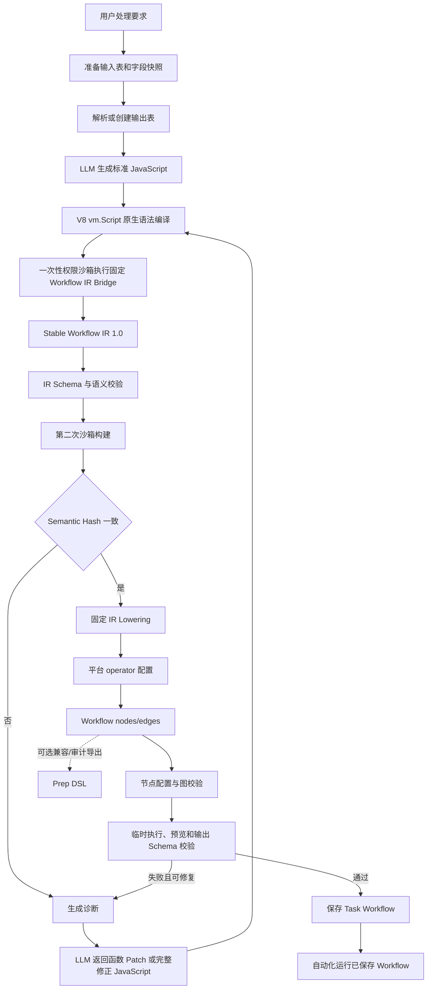

# 自动化－数据处理任务设计

## 1. 文档目的

本文描述当前自动化数据处理任务唯一有效的生成、验证、保存和运行链路。配置期由大模型生成标准 JavaScript；运行期执行已经保存的 Workflow nodes/edges，不再调用大模型。

本文以当前代码为准，不保留历史的整段 JavaScript/TypeScript AST → Workflow IR 编译前端、模型直出 DSL 或多语言 frontend 方案。实现仍使用 TypeScript Compiler API 对 `expr(row => ...)` 内的受限表达式做静态类型检查和确定性 lowering；它不是 Workflow 源语言前端，也不负责构建 Workflow IR。

## 2. 核心原则

1. 大模型只参与配置期生成和定向修复。
2. 大模型必须返回标准 JavaScript 源码，不允许直接返回 Prep DSL、Operations JSON 或 Workflow IR。
3. 整段 JavaScript 程序的语法准入由 Node/V8 原生编译器完成；V8 通过后，`expr(row => ...)` 内的受限表达式另由 TypeScript Compiler API 做静态能力和类型检查。
4. JavaScript 只能在一次性权限沙箱中通过固定、操作无关的 Workflow IR Bridge 构建 IR。
5. Stable Workflow IR 是生成链路的稳定协议，当前来源语言固定为 `javascript`。
6. IR 到平台 operator 配置和 Workflow nodes/edges 的 lowering 完全确定，不调用大模型；Prep DSL 仅作为兼容和审计导出。
7. 同一份 JavaScript 构建两次 IR，并比较 Semantic Hash，拒绝非确定性结果。
8. 辅助函数可以按一个内聚业务意图顺序产生多个 Workflow operation；中间 Workflow value 必须使用具名 `const` 串联并保持线性数据流，`main()` 负责输入、辅助函数调用和输出编排。
9. 编译或运行错误必须携带函数名、行号和列号；源码结构有效且诊断明确指向函数时，模型只返回该函数的受控 Patch，其他源码保持不变。
10. 生成结果必须经过平台节点配置校验、临时执行和输出 Schema 校验后才能保存；兼容 Prep DSL 导出失败不阻断保存和运行。
11. 自动化运行期只执行已保存 Workflow，不重新生成处理逻辑。
12. 预览降级、回滚和临时资源清理失败必须记录日志。

## 3. 唯一生产链路



不存在以下生产旁路：

- JavaScript → 自定义静态 AST 编译器 → Workflow IR。
- JavaScript → TypeScript Compiler → Workflow IR。
- TypeScript/Python/Java → Workflow IR。
- LLM → Prep DSL。
- LLM → Operations JSON。
- LLM → Workflow IR。
- 编译失败后回退到旧 Parser 或旧 DSL 生成器。

## 4. 配置期输入准备

### 4.1 本地输入

系统读取本地输入表和字段快照。调用方未提供字段快照时，尝试从受限行数的数据预览推断；预览失败会记录日志，并继续交由后续契约校验处理。

### 4.2 云端输入

云端表先刷新到稳定命名的本地镜像。若云表版本未变化则复用镜像；版本变化时更新镜像。镜像操作在 keyed lock 内串行执行，避免同一云表并发覆盖。

### 4.3 输出和 Task

系统复用调用方指定的 Task/输出表，或创建新的 Task/输出表。生成失败时回滚本次新建资源；回滚失败只作为附加日志记录，原始生成异常继续返回给调用方。

## 5. JavaScript 生成协议

模型返回严格 JSON：

```json
{
  "javascriptSource": "function cleanAmount(input) { ... }\nfunction main() { ... }"
}
```

JavaScript 使用普通函数声明和固定 Workflow IR Bridge：

```javascript
function cleanTicker(input) {
  const withoutCount = workflow.step(input, 'drop', {
    columns: ['记录数'],
  });
  const normalized = workflow.step(withoutCount, 'derive', {
    column: 'ticker',
    expression: expr((row) => upper(row['ticker'])),
  });
  return normalized;
}

function main() {
  const source = workflow.input(INPUT_TABLE_ID, { alias: 'src' });
  const normalized = cleanTicker(source);
  return workflow.output(normalized, OUTPUT_TABLE_NAME, { mode: 'replace' });
}
```

约束如下：

- 必须声明具名 `main()`。
- 数据处理只能通过注入的 `workflow.input()`、`workflow.step()`、`workflow.output()` Bridge API。
- operation type 和 payload 必须来自统一操作注册表。
- 辅助函数可以为一个内聚业务意图产生多个顺序 operation；每一步必须接收前一步返回的 Workflow value，中间值使用描述性的具名 `const`，不得分支或读取中间数据。
- `main()` 创建输入、调用辅助函数并输出结果。
- 不允许 import/export、Node API、网络、文件、子进程和动态代码生成。
- 当前自动化只有一个输入数据集，不开放 join 和集合运算。
- JavaScript 是标准语法；上述限制由 Prompt、函数结构检查、沙箱能力和 IR 契约共同实现，不由自定义语言编译器实现。
- Prompt 中“禁止循环、可变变量和在 `main()` 中直接创建 operation”等属于生成规范；安全边界仍由沙箱超时、最小注入能力和最终 IR 校验保证。

## 6. V8 编译和源码定位

`compileWorkflowJavaScript()` 使用：

```typescript
new vm.Script(source, { filename: 'generated-workflow.js' });
```

该调用由 V8 完成 JavaScript 解析和编译，不执行生成代码。语法错误被转换为统一 diagnostic：

- `code`
- `message`
- `line`
- `column`
- `functionName`

系统使用 Acorn 解析标准 JavaScript，仅获取顶层具名函数的名称和 `start/end` 范围，用于错误归属、结构约束和受控 Patch。Acorn AST 不解释 Workflow 业务语义，也不生成 IR；最终源码仍必须由 V8 编译。

`javascript-expression-compiler.ts` 使用 TypeScript Compiler API 对 `expr(row => ...)` 回调内的受限表达式进行静态检查，并将其确定性 lowering 为平台 expression。该步骤只处理 operation payload 中的表达式，不执行源码、不创建 Workflow operation，也不存在 JavaScript → TypeScript Compiler → Workflow IR 的旁路。

## 7. 沙箱与固定 Workflow IR Bridge

生成代码在一次性独立 Node 子进程中运行：

- 启用 Node Permission Model。
- 不授予文件系统、网络、子进程或 Worker 权限。
- 禁止动态字符串代码和 WASM。
- 限制 old-space、执行时间和输出大小。
- 仅注入固定 Bridge、表达式构造器、输入表 ID 和输出表名。
- 子进程完成一次 IR 构建后退出。

Bridge 不处理真实数据，也不包含 `drop`、`filter`、`pivot` 等逐操作 SDK 方法。固定 API 为：

```javascript
workflow.input(inputTableId, options);
workflow.step(input, operationType, payload);
workflow.output(input, outputTableName, options);
```

`workflow.step()` 只校验 operation type 是否在注册表允许集合中，然后追加结构化 operation，并记录 provenance：

```json
{
  "operationId": "normalize-ticker",
  "type": "derive",
  "inputOperationId": "remove-count",
  "column": "ticker",
  "expression": {
    "kind": "function",
    "name": "upper"
  }
}
```

provenance 保存 operation 对应的 JavaScript 函数、行号和列号。

具体 payload 规则不在 Bridge 中实现，由 `workflow-ir-operation-registry.ts` 校验。例如 `drop.columns` 必须是非空字符串数组，`sort.direction` 必须为 `asc` 或 `desc`。因此新增 IR operation 不需要修改 Bridge，只需扩展 IR 操作注册表及其确定性的 lowering 规则。

## 8. Stable Workflow IR

当前协议版本为 `1.0`，来源语言固定为 `javascript`。Validator 检查：

- IR 版本和 kind。
- 输入、输出边界。
- operation 类型、字段和嵌套 expression。
- operationId 格式和唯一性。
- inputOperationId 引用完整性。
- operation 图无环。
- provenance 与 operationId 一致。
- sourceLanguage 和 provenance language 均为 `javascript`。

IR 的 Semantic Hash 排除源码行列等非语义信息。相同源码连续执行两次产生不同 Hash 时，返回 `NON_DETERMINISTIC_WORKFLOW_BUILD`，不进入 lowering。

## 9. 内聚辅助函数和受控源码修复

IR provenance 为每个 operation 保存来源函数和源码位置。同一辅助函数可以对应多个线性 operation；校验重点是 Workflow 图、operation payload、表达式能力和字段语义，而不是限制每个函数只能产生一个 operation。

诊断包含具体函数名和源码位置。原源码能被 Acorn 定位且诊断明确指向函数时，修复响应返回：

```json
{
  "javascriptPatch": {
    "functionName": "extractYearMonth",
    "replacementSource": "function extractYearMonth(...) {...}"
  }
}
```

修复规则：

- `functionName` 必须与系统指定的目标函数完全一致。
- `replacementSource` 必须保留目标函数，可以增加名称不冲突的辅助函数。
- 非 `main` Patch 不允许包含 `main()`，也不允许覆盖其他已有函数。
- 系统通过 Acorn AST 范围只替换目标函数区间，区间外源码保持字节级不变。
- Patch 后的完整源码必须先通过 V8 编译，再重新执行完整 Bridge、IR、lowering 和 dry-run 流程。
- 原源码存在语法错误、诊断没有明确函数名或无法安全定位时，模型返回包含全部辅助函数和 `main()` 的完整 `javascriptSource`。
- Acorn 不参与 JavaScript → IR 转换，也不回退到整段 DSL。

## 10. IR → 平台操作配置 → 原生节点

`workflow-ir-lowerer.ts` 中的 `lowerGeneratedWorkflowIrSemantics()` 负责：

- 再次校验并规范化 IR。
- 将 IR operation 转换为平台 operator 配置。
- 推断必需输入字段、输出 Schema 和字段血缘。
- 保留 operation 到 JavaScript 源码位置的映射。

一个 IR operation 可以确定性地展开成多个平台 operators，例如覆盖原字段的类型转换：

```text
calculate_field → field_select → field_mapping
```

这种展开由固定 lowerer 完成，不由模型生成，也不在 AI 层生成完整 Prep DSL。生成链路以平台 nodes/edges 为执行与保存的 source of truth；由 nodes/edges 导出的 Prep DSL 仅用于兼容和审计，导出失败会记录日志但不会使已通过原生图校验的 candidate 失败。

## 11. 原生节点校验与临时验证

生成的 Workflow candidate 必须经过：

1. Stable Workflow IR 校验和确定性 lowering。
2. 输入、输出资源绑定。
3. Workflow nodes/edges 与节点配置校验。
4. 临时 Task 执行。
5. 小样本预览。
6. 输出 Schema 校验和校准。
7. diagnostic 汇总。

Prep DSL parser 只用于用户显式提交 DSL、运行调试 override 等兼容入口，不是 AI 生成 Workflow 的保存门禁。兼容 DSL 会从已生成的 nodes/edges 尽力导出，`workflowDslAvailable` 表示导出是否成功。

只有无 error diagnostic 的 candidate 才能保存。网络、权限、超时、文件不存在等基础设施错误不交给模型修复；明确关联到 JavaScript helper 的语法、SDK、IR 或字段语义错误可以进入受控源码修复。

## 12. 保存与运行

配置期验证成功后保存 Workflow。运行期：

```text
读取已保存的 Workflow nodes/edges
→ 数据任务执行引擎运行节点图
→ 正式提交输出
→ 可选上传云端
→ 清理临时资源
```

运行期不调用大模型，不重新生成 JavaScript，也不重新构建 IR。

`saveWorkflow=true` 只有在执行成功后才保存调用方提供的新 Workflow；失败时保留旧 Workflow。

## 13. 并发、缓存和清理

- 相同 Task 的生成、编辑和运行使用 `task:<taskId>` keyed lock。
- 云镜像刷新使用独立 keyed lock。
- 显式 DSL 编译入口的 candidate 使用有界 LRU 缓存。
- 临时执行结束后清理临时表和缓存。
- 锁等待会忽略前一个调用已经向其调用方返回的异常，以保证后续请求继续取得锁。
- 其他预览降级、回滚和清理失败都必须记录结构化日志。

## 14. 主要代码

- `src/main/data/data-command-service.ts`：保持 IPC/Tool 公共命令契约的轻量门面。
- `src/main/data/task-command-service.ts`：任务列表、创建和更新。
- `src/main/data/workflow-authoring-command-service.ts`：Workflow 查询、DSL 应用/导出和节点配置。
- `src/main/data/generated-task-command-service.ts`：需求分析、生成、诊断修复、候选校验、保存和回滚。
- `src/main/data/task-execution-command-service.ts`：普通任务和自动生成任务的执行、提交、云端交付及完成通知。
- `src/main/data/automation-input-resolver.ts`：本地输入解析与云表镜像刷新、复用。
- `src/main/data/generated-output-resolver.ts`：自动生成任务的本地输出表查找或创建。
- `src/main/data/workflow-dsl-compiler.ts`：显式 Prep DSL 编译、资源绑定和共享 LRU 缓存。
- `src/main/data/workflow-preview-service.ts`：Workflow/数据集预览与降级策略。
- `src/main/data/data-command-resources.ts`：任务、输入表、输出表的统一查询和存在性/唯一性校验。
- `src/main/data/data-command-lock-coordinator.ts`：跨业务服务共享的 keyed lock。
- `src/main/data/data-command-utils.ts`：纯转换、诊断、错误映射、日志和语义哈希工具。
- `src/main/data/data-task-store.ts`
- `src/main/data/ipc/data-tasks-ipc.ts`
- `src/main/data/workflow/workflow-generator.ts`
- `src/main/data/workflow/javascript-runtime.ts`
- `src/main/data/workflow/javascript-expression-compiler.ts`
- `src/main/data/workflow/workflow-ir-operation-registry.ts`
- `src/main/data/workflow/workflow-model.ts`
- `src/main/data/workflow/workflow-ir.ts`
- `src/main/data/workflow/workflow-ir-lowerer.ts`
- `src/main/data/workflow/schema-inferencer.ts`
- `src/main/data/workflow/utils.ts`
- `src/shared/prep-dsl`

## 15. 验收标准

- LLM 生成标准 JavaScript，V8 在沙箱执行前返回精确语法诊断。
- 生产代码中不存在整段 JavaScript/TypeScript AST → Workflow IR 编译器；TypeScript Compiler API 只用于 `expr(row => ...)` 的受限静态表达式检查和 lowering。
- 生产代码中不存在模型直出 DSL、Operations JSON 或 IR 的回退入口。
- Bridge 只包含固定的 `input/step/output`，不存在逐 operation SDK 方法。
- 新增 operation 不需要修改 JavaScript Bridge。
- IR 只接受 `sourceLanguage: "javascript"`。
- 同一源码的 IR Semantic Hash 稳定。
- 多 operation helper 的中间 Workflow value 使用具名 `const` 保持线性数据流。
- 诊断能定位函数并通过 Acorn 范围 Patch 修复，其他源码保持不变。
- 平台 operator 配置和 nodes/edges 完全由固定 lowerer 产生；兼容 Prep DSL 由 nodes/edges 确定性导出。
- 保存前必须完成原生节点配置校验、临时执行和输出 Schema 校验；兼容 DSL 导出失败不阻断保存。
- 运行期不调用大模型。
- 预览降级、回滚和清理失败有日志。
- TypeScript 类型检查和数据任务相关测试通过。
