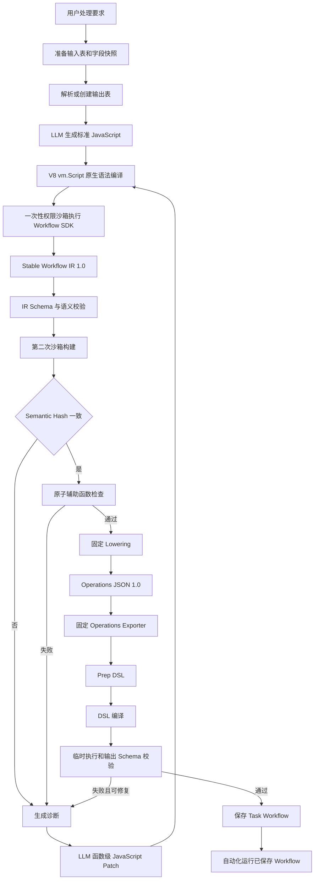

# 自动化－数据处理任务设计

## 1. 文档目的

本文描述当前自动化数据处理任务唯一有效的生成、验证、保存和运行链路。配置期由大模型生成标准 JavaScript；运行期执行已经保存的 Prep DSL，不再调用大模型。

本文以当前代码为准，不保留历史 AST 编译器、TypeScript 编译前端、模型直出 DSL 或多语言 frontend 方案。

## 2. 核心原则

1. 大模型只参与配置期生成和定向修复。
2. 大模型必须返回标准 JavaScript 源码，不允许直接返回 Prep DSL、Operations JSON 或 Workflow IR。
3. JavaScript 语法只由 Node/V8 原生编译器检查。
4. JavaScript 只能在一次性权限沙箱中通过 Workflow SDK 构建 IR。
5. Stable Workflow IR 是生成链路的稳定协议，当前来源语言固定为 `javascript`。
6. IR 到 Operations JSON、Prep DSL 的转换完全确定，不调用大模型。
7. 同一份 JavaScript 构建两次 IR，并比较 Semantic Hash，拒绝非确定性结果。
8. 每个辅助函数最多产生一个 Workflow operation；`main()` 负责数据流编排。
9. 编译或运行错误必须携带函数名、行号和列号，优先执行函数级局部修复。
10. 生成结果必须经过 Prep DSL 编译、临时执行和输出 Schema 校验后才能保存。
11. 自动化运行期只执行已保存 Workflow，不重新生成处理逻辑。
12. 预览降级、回滚和临时资源清理失败必须记录日志。

## 3. 唯一生产链路



不存在以下生产旁路：

- JavaScript → 自定义静态 AST 编译器 → Workflow IR。
- JavaScript → TypeScript Compiler → Workflow IR。
- TypeScript/Python/Java → Workflow IR。
- LLM → Prep DSL。
- LLM → Operations JSON。
- LLM → Workflow IR。
- 编译失败后回退到旧 Parser 或旧 DSL 生成器。

## 4. 配置期输入准备

### 4.1 本地输入

系统读取本地输入表和字段快照。调用方未提供字段快照时，尝试从受限行数的数据预览推断；预览失败会记录日志，并继续交由后续契约校验处理。

### 4.2 云端输入

云端表先刷新到稳定命名的本地镜像。若云表版本未变化则复用镜像；版本变化时更新镜像。镜像操作在 keyed lock 内串行执行，避免同一云表并发覆盖。

### 4.3 输出和 Task

系统复用调用方指定的 Task/输出表，或创建新的 Task/输出表。生成失败时回滚本次新建资源；回滚失败只作为附加日志记录，原始生成异常继续返回给调用方。

## 5. JavaScript 生成协议

模型返回严格 JSON：

```json
{
  "javascriptSource": "function cleanAmount(input) { ... }\nfunction main() { ... }"
}
```

JavaScript 使用普通函数声明和正式 Workflow SDK：

```javascript
function removeCount(input) {
  return drop(input, '记录数');
}

function normalizeTicker(input) {
  return derive(input, 'ticker', fn.upper(col('ticker')));
}

function main() {
  const source = inputDataset(INPUT_TABLE_ID, 'src');
  const withoutCount = removeCount(source);
  const normalized = normalizeTicker(withoutCount);
  return outputTable(normalized, OUTPUT_TABLE_NAME, { mode: 'replace' });
}
```

约束如下：

- 必须声明具名 `main()`。
- 数据处理只能通过注入的 Workflow SDK。
- 辅助函数最多产生一个 operation。
- `main()` 创建输入、调用辅助函数并输出结果。
- 不允许 import/export、Node API、网络、文件、子进程和动态代码生成。
- 当前自动化只有一个输入数据集，不开放 join 和集合运算。
- JavaScript 是标准语法；上述限制属于 Workflow SDK 和沙箱执行契约，不由自定义语言编译器实现。

## 6. V8 编译和源码定位

`compileWorkflowJavaScript()` 使用：

```typescript
new vm.Script(source, { filename: 'generated-workflow.js' });
```

该调用由 V8 完成 JavaScript 解析和编译，不执行生成代码。语法错误被转换为统一 diagnostic：

- `code`
- `message`
- `line`
- `column`
- `functionName`

系统保留轻量函数位置索引，只用于错误归属和函数级补丁定位。它不构建 JavaScript AST、不解释业务语义，也不生成 IR。

## 7. 沙箱与 Workflow SDK

生成代码在一次性独立 Node 子进程中运行：

- 启用 Node Permission Model。
- 不授予文件系统、网络、子进程或 Worker 权限。
- 禁止动态字符串代码和 WASM。
- 限制 old-space、执行时间和输出大小。
- 仅注入 Workflow SDK、输入表 ID 和输出表名。
- 子进程完成一次 IR 构建后退出。

Workflow SDK 不处理真实数据。每次 SDK 调用只追加结构化 operation，并记录 provenance：

```json
{
  "operationId": "normalize-ticker",
  "type": "derive",
  "inputOperationId": "remove-count",
  "column": "ticker",
  "expression": {
    "kind": "call",
    "name": "upper"
  }
}
```

provenance 保存 operation 对应的 JavaScript 函数、行号和列号。

## 8. Stable Workflow IR

当前协议版本为 `1.0`，来源语言固定为 `javascript`。Validator 检查：

- IR 版本和 kind。
- 输入、输出边界。
- operation 类型、字段和嵌套 expression。
- operationId 格式和唯一性。
- inputOperationId 引用完整性。
- operation 图无环。
- provenance 与 operationId 一致。
- sourceLanguage 和 provenance language 均为 `javascript`。

IR 的 Semantic Hash 排除源码行列等非语义信息。相同源码连续执行两次产生不同 Hash 时，返回 `NON_DETERMINISTIC_WORKFLOW_BUILD`，不进入 lowering。

## 9. 原子辅助函数和局部修复

IR 构建后按 provenance 聚合 operation。非 `main` 辅助函数产生多个 operation 时返回：

```text
NON_ATOMIC_WORKFLOW_HELPER
```

诊断包含具体函数名和源码位置。修复响应优先使用：

```json
{
  "javascriptPatch": {
    "functionName": "extractYearMonth",
    "replacement": "function extractYear(...) {...}\nfunction extractMonth(...) {...}\nfunction extractYearMonth(...) {...}"
  }
}
```

补丁规则：

- 必须保留目标函数。
- 可以新增名称不冲突的原子辅助函数。
- 辅助函数补丁不能替换 `main()`。
- 不允许覆盖其他已有函数。
- 补丁先通过 V8 编译，再重新执行完整 SDK、IR、lowering 和 dry-run 流程。
- 不执行 AST 自动改写，也不回退到整段 DSL。

## 10. IR → Operations JSON → Prep DSL

`lowerWorkflowIrToOperations()` 负责：

- 再次校验并规范化 IR。
- 绑定运行时输入表 ID 和输出表名。
- 输出版本化 `WorkflowOperationsV1`。

Operations exporter 调用固定 operation compiler 生成 Prep DSL。一个 IR operation 可以展开成多条 DSL，例如覆盖原字段的类型转换：

```text
| derive [__sophron_cast_price] = TRY_CAST(...)
| drop [price]
| map [__sophron_cast_price] to [price]
```

这种展开是固定转换器行为，不是新的生成链路。

## 11. DSL 编译与临时验证

生成的 Prep DSL 必须经过：

1. Prep DSL parser。
2. Workflow AST → nodes/edges 编译。
3. 输入、输出资源绑定。
4. 临时 Task 执行。
5. 小样本预览。
6. 输出 Schema 校验和校准。
7. diagnostic 汇总。

只有无 error diagnostic 的 candidate 才能保存。网络、权限、超时、文件不存在等基础设施错误不交给模型修复；明确关联到 JavaScript helper 的语法、SDK、IR 或字段语义错误可以进入局部修复。

## 12. 保存与运行

配置期验证成功后保存 Workflow。运行期：

```text
读取已保存 workflowDsl
→ Prep DSL 编译或读取缓存 candidate
→ 临时执行
→ 输出 Schema 校验
→ 正式提交输出
→ 可选上传云端
→ 清理临时资源
```

运行期不调用大模型，不重新生成 JavaScript，也不重新构建 IR。

`saveWorkflow=true` 只有在执行成功后才保存调用方提供的新 Workflow；失败时保留旧 Workflow。

## 13. 并发、缓存和清理

- 相同 Task 的生成、编辑和运行使用 `task:<taskId>` keyed lock。
- 云镜像刷新使用独立 keyed lock。
- Prep DSL candidate 使用有界 LRU 缓存。
- 临时执行结束后清理临时表和缓存。
- 锁等待会忽略前一个调用已经向其调用方返回的异常，以保证后续请求继续取得锁。
- 其他预览降级、回滚和清理失败都必须记录结构化日志。

## 14. 主要代码

- `src/main/data/data-command-service.ts`
- `src/main/data/data-task-store.ts`
- `src/main/data/ipc/data-tasks-ipc.ts`
- `src/main/data/workflow/workflow-generator.ts`
- `src/main/data/workflow/javascript-runtime.ts`
- `src/main/data/workflow/workflow-sdk.ts`
- `src/main/data/workflow/workflow-generation-pipeline.ts`
- `src/main/data/workflow/javascript-capabilities.ts`
- `src/main/data/workflow/workflow-model.ts`
- `src/main/data/workflow/workflow-ir.ts`
- `src/main/data/workflow/workflow-lowering.ts`
- `src/main/data/workflow/workflow-operations.ts`
- `src/main/data/workflow/operation-compiler.ts`
- `src/shared/prep-dsl`

## 15. 验收标准

- LLM 生成标准 JavaScript，V8 在沙箱执行前返回精确语法诊断。
- 生产代码中不存在 JavaScript/TypeScript AST → Workflow IR 编译器。
- 生产代码中不存在模型直出 DSL、Operations JSON 或 IR 的回退入口。
- IR 只接受 `sourceLanguage: "javascript"`。
- 同一源码的 IR Semantic Hash 稳定。
- 非原子 helper 能定位函数并通过 JavaScript Patch 修复。
- Operations JSON 与 Prep DSL 完全由固定转换器产生。
- 保存前必须完成 DSL 编译、临时执行和输出 Schema 校验。
- 运行期不调用大模型。
- 预览降级、回滚和清理失败有日志。
- TypeScript 类型检查和数据任务相关测试通过。
