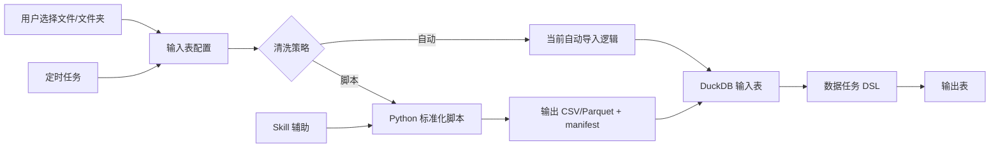

# 输入表 Skill 辅助标准化设计文档 v0.1

## 1. 文档目标

本文档设计一套输入表标准化方案，用于处理“文件或文件夹下的 Excel 无法直接解析成标准二维表”的场景。

核心目标是把输入表流程调整为：

```text
选择文件/文件夹 -> 清洗策略 -> 自动 / 脚本
```

其中：

- `自动` 模式沿用当前输入表导入能力，适合标准 Excel、CSV 和结构稳定的文件夹。
- `脚本` 模式提供 Python 处理能力，适合复杂 Excel、多表头、合并单元格、跨 Sheet、模板化报表等非标准二维表。
- `Skill` 用于辅助用户分析样例文件并生成/维护 Python 脚本，但定时任务和生产运行不依赖 LLM。

本文档只设计输入表标准化阶段。标准化后的数据任务清洗、输出表发布和调度运行仍沿用数据任务 DSL、输出表和任务运行能力。

---

## 2. 背景与问题

当前输入表适合处理已经接近二维表的文件：

- CSV / TSV。
- 单 Sheet Excel。
- 文件夹中结构一致的 Excel 或 CSV。

但业务中常见的 Excel 往往不是标准二维表：

- 标题、说明、汇总行混在数据区域中。
- 多行表头、合并单元格、横向分组表头。
- 一个文件包含多个 Sheet，每个 Sheet 的有效区域不同。
- 文件夹中不同 Excel 模板版本不完全一致。
- 需要先抽取固定单元格、展开区块、补齐上下文字段后才能形成二维表。

这类处理不适合直接放入数据任务 DSL，因为 DSL 的输入前提是标准二维表。更合理的边界是：

```text
复杂文件 -> 输入表标准化 -> 标准二维表 -> 数据任务 DSL
```

---

## 3. 设计原则

### 3.1 输入表负责“入表适配”

输入表的职责是把外部文件变成 DuckDB 可读取的标准二维表。

脚本模式只负责解析和规整复杂文件，不负责业务清洗、聚合、输出发布。

### 3.2 数据任务负责“二维表清洗”

标准化后的结果进入数据任务 DSL：

```text
input source dataset "<inputTableId>" as src
  | cast [金额] as double on_error null
  | filter [订单号] is not null
  | output table "清洗后订单表" mode replace
```

### 3.3 Skill 负责“生成和维护脚本”

Skill 可以参与：

- 分析样例文件结构。
- 生成 Python 标准化脚本。
- 根据错误日志修复脚本。
- 解释脚本输出 schema。

Skill 不参与：

- 每次定时生产运行。
- 无人工确认的脚本自动覆盖。
- 绕过权限直接读取未授权文件。

### 3.4 生产运行必须确定性

保存后的输入表脚本必须作为固定版本执行：

```text
定时触发 -> 扫描文件夹 -> 执行固定 Python 脚本 -> 导入二维表 -> 运行数据任务 -> 写输出表
```

---

## 4. 总体架构



---

## 5. 输入表配置模型

### 5.1 顶层结构

建议把输入表配置扩展为：

```ts
type InputTableNormalizeMode = 'auto' | 'python_script';

interface InputTableConfig {
  source: InputTableSourceConfig;
  normalization: InputTableNormalizationConfig;
}

interface InputTableSourceConfig {
  kind: 'excel' | 'csv' | 'folder';
  path: string;
  filePattern?: string;
  recursive?: boolean;
}

type InputTableNormalizationConfig =
  | AutoNormalizationConfig
  | PythonScriptNormalizationConfig;
```

### 5.2 自动模式

自动模式与当前能力一致，只是归入 `normalization.mode = 'auto'`。

```ts
interface AutoNormalizationConfig {
  mode: 'auto';
  header?: boolean;
  sheet?: string;
  encoding?: string;
  mergeMode?: 'append_by_name' | 'append_by_position';
  schemaStrategy?: 'infer' | 'first_file' | 'union';
  fileRange?: 'top_level' | 'recursive';
  skipEmptyFiles?: boolean;
  keepSourceFileName?: boolean;
}
```

### 5.3 脚本模式

脚本模式通过 Python 将复杂文件标准化为一个二维表文件。

```ts
interface PythonScriptNormalizationConfig {
  mode: 'python_script';
  scriptId: string;
  scriptVersionId: string;
  entrypoint: string;
  timeoutMs: number;
  outputFormat: 'csv' | 'parquet';
  expectedSchema?: InputTableExpectedColumn[];
  onSchemaChange?: 'fail' | 'warn' | 'accept';
}

interface InputTableExpectedColumn {
  name: string;
  type: 'string' | 'integer' | 'double' | 'boolean' | 'date' | 'timestamp';
  nullable?: boolean;
}
```

### 5.4 脚本实体

脚本应作为可版本化资源保存。

```ts
interface InputTableNormalizerScript {
  id: string;
  name: string;
  description?: string;
  sourceKind: 'excel' | 'csv' | 'folder';
  language: 'python';
  activeVersionId: string;
  createdAt: number;
  updatedAt: number;
}

interface InputTableNormalizerScriptVersion {
  id: string;
  scriptId: string;
  version: number;
  code: string;
  codeHash: string;
  dependencies: string[];
  createdBy: 'user' | 'skill';
  createdAt: number;
  notes?: string;
}
```

输入表引用固定的 `scriptVersionId`，避免脚本更新影响已经发布的生产任务。

---

## 6. Python 脚本执行契约

### 6.1 启动方式

执行器向脚本传入上下文 JSON，并要求脚本输出 manifest JSON。

```bash
python normalizer.py --context context.json --manifest manifest.json
```

### 6.2 输入 context

```json
{
  "sourceKind": "folder",
  "sourcePath": "/Users/demo/orders",
  "files": [
    {
      "path": "/Users/demo/orders/2026-01.xlsx",
      "name": "2026-01.xlsx",
      "size": 182031,
      "mtime": 1767225600000
    }
  ],
  "workDir": "/tmp/sophron-input-normalize/run-xxx",
  "outputDir": "/tmp/sophron-input-normalize/run-xxx/output",
  "config": {
    "filePattern": "*.xlsx",
    "recursive": false
  },
  "expectedSchema": [
    { "name": "订单号", "type": "string" },
    { "name": "金额", "type": "double" }
  ]
}
```

### 6.3 输出 manifest

```json
{
  "ok": true,
  "output": {
    "path": "/tmp/sophron-input-normalize/run-xxx/output/normalized.csv",
    "format": "csv"
  },
  "schema": [
    { "name": "订单号", "type": "string", "nullable": false },
    { "name": "金额", "type": "double", "nullable": true }
  ],
  "stats": {
    "files": 12,
    "rows": 3200,
    "columns": 8
  },
  "warnings": [],
  "errors": []
}
```

失败时：

```json
{
  "ok": false,
  "errors": [
    {
      "code": "MISSING_REQUIRED_SHEET",
      "message": "未找到 sheet: 销售明细",
      "file": "/Users/demo/orders/2026-01.xlsx"
    }
  ]
}
```

### 6.4 Python 模板

```python
import argparse
import json
from pathlib import Path

import pandas as pd


def transform(context):
    rows = []
    for file in context["files"]:
        path = file["path"]
        workbook = pd.ExcelFile(path)
        # TODO: 按业务模板解析 sheet、表头、数据区和上下文字段。
        frame = pd.read_excel(workbook, sheet_name=0, header=0)
        frame["_source_file"] = file["name"]
        rows.append(frame)

    result = pd.concat(rows, ignore_index=True) if rows else pd.DataFrame()
    output_path = Path(context["outputDir"]) / "normalized.csv"
    result.to_csv(output_path, index=False)

    return {
        "ok": True,
        "output": {"path": str(output_path), "format": "csv"},
        "schema": [{"name": str(col), "type": "string"} for col in result.columns],
        "stats": {
            "files": len(context["files"]),
            "rows": len(result),
            "columns": len(result.columns),
        },
        "warnings": [],
        "errors": [],
    }


def main():
    parser = argparse.ArgumentParser()
    parser.add_argument("--context", required=True)
    parser.add_argument("--manifest", required=True)
    args = parser.parse_args()

    with open(args.context, "r", encoding="utf-8") as f:
        context = json.load(f)

    manifest = transform(context)

    with open(args.manifest, "w", encoding="utf-8") as f:
        json.dump(manifest, f, ensure_ascii=False, indent=2)


if __name__ == "__main__":
    main()
```

---

## 7. UI 设计

输入表编辑页调整为三段式。

### 7.1 选择文件

控件：

- 来源类型：Excel / CSV / 文件夹。
- 文件或文件夹路径。
- 文件匹配：例如 `*.xlsx`。
- 是否递归子目录。

### 7.2 清洗策略

使用分段控件：

```text
自动 | 脚本
```

自动模式展示当前已有配置。

脚本模式展示：

- 脚本选择器。
- 脚本版本。
- Python 代码查看/编辑入口。
- 运行预览。
- 输出 schema。
- 运行日志。
- 使用 Skill 生成脚本。

### 7.3 Skill 辅助生成脚本

用户点击“使用 Skill 生成脚本”后：

1. 选择样例文件或样例文件夹。
2. 系统提取安全的文件结构摘要，例如文件名、Sheet 名、行列范围、前若干行预览。
3. LLM 调用 `excel-normalizer` skill 生成 Python 脚本草稿。
4. 用户预览脚本输出。
5. 用户确认后保存脚本版本。

注意：Skill 生成脚本后必须经过用户确认和预览，不能直接进入生产调度。

---

## 8. Skill 设计

建议新增内置或可安装 skill：`excel-normalizer`。

Skill 内容：

- `SKILL.md`：说明何时使用该 skill。
- `templates/normalizer.py`：Python 脚本模板。
- `references/manifest-contract.md`：输入输出契约。
- `references/excel-patterns.md`：复杂 Excel 模板解析经验。
- `examples/`：多表头、合并单元格、跨 Sheet 示例。

Skill 提示原则：

- 只生成把复杂文件变成标准二维表的脚本。
- 不在脚本里做业务聚合和输出表发布。
- 输出必须符合 manifest 契约。
- 对不确定的模板区域生成待确认项，而不是猜测。
- 优先使用 `pandas` / `openpyxl`，避免网络依赖。

---

## 9. 输入表刷新执行流程

```text
刷新输入表
  -> 读取输入表配置
  -> 扫描文件/文件夹
  -> mode=auto: 执行当前自动导入逻辑
  -> mode=python_script: 执行固定脚本版本
  -> 校验 manifest
  -> 校验输出二维表
  -> 导入 DuckDB 临时表
  -> 原子替换输入表物理表
  -> 保存行数、列数、脚本版本、运行日志
```

关键要求：

- 脚本输出必须是一个二维表文件。
- 导入 DuckDB 前先创建临时表，成功后再替换正式输入表。
- schema 变化根据 `onSchemaChange` 决定失败、告警或接受。
- 每次运行记录 `scriptVersionId` 和 `codeHash`。

---

## 10. 调度与输出表发布

数据任务调度应调用确定性链路：

```text
定时触发
  -> 刷新输入表
  -> 运行数据任务 DSL
  -> mode=persisted 写入输出表
  -> 记录运行结果
```

调度配置建议：

```ts
interface DataTaskScheduleConfig {
  inputTableId: string;
  dataTaskId: string;
  outputTableId: string;
  refreshInputBeforeRun: boolean;
  runMode: 'temporary' | 'persisted';
  schedule: {
    kind: 'daily' | 'weekly';
    times: string[];
    weekdays?: number[];
  };
}
```

生产调度不应每次调用 Skill。Skill 只在创建或维护脚本时使用。

---

## 11. 安全与权限

### 11.1 文件权限

- 只能读取用户明确选择或授权的文件/文件夹。
- `context.files` 必须由应用扫描生成，脚本不能自行扩大读取范围。
- 输出只能写入 `outputDir`。

### 11.2 Python 沙箱

默认策略：

- 禁止网络访问。
- 限制执行时间。
- 限制输出文件大小。
- 限制可写目录。
- 记录 stdout/stderr，但需要裁剪超长日志。

### 11.3 依赖管理

MVP 内置常用依赖：

- `pandas`
- `openpyxl`
- `pyarrow`，如果支持 Parquet

后续可支持项目级依赖声明，但必须经过用户确认。

---

## 12. 错误处理

常见错误码：

| 错误码 | 说明 |
| --- | --- |
| `NO_INPUT_FILES` | 未找到匹配文件 |
| `SCRIPT_TIMEOUT` | 脚本执行超时 |
| `SCRIPT_FAILED` | 脚本进程异常退出 |
| `INVALID_MANIFEST` | manifest 缺失或格式错误 |
| `OUTPUT_FILE_MISSING` | manifest 指向的输出文件不存在 |
| `OUTPUT_NOT_TABULAR` | 输出不是可导入二维表 |
| `SCHEMA_CHANGED` | 输出 schema 与预期不一致 |
| `FILE_ACCESS_DENIED` | 脚本读取了未授权路径 |

错误展示应包含：

- 失败阶段。
- 错误码。
- 用户可读描述。
- 相关文件。
- 可复制的日志片段。
- “使用 Skill 修复脚本”入口。

---

## 13. 运行记录

每次输入表刷新记录：

```ts
interface InputTableRefreshRun {
  id: string;
  inputTableId: string;
  status: 'completed' | 'failed';
  mode: 'auto' | 'python_script';
  scriptVersionId?: string;
  codeHash?: string;
  sourceFileCount: number;
  rowCount: number;
  columnCount: number;
  warnings: string[];
  error?: string;
  startedAt: number;
  finishedAt: number;
}
```

用于：

- UI 展示最近刷新状态。
- 调度失败排查。
- 复现某次输出。
- 判断是否需要重新运行数据任务。

---

## 14. 与数据任务 DSL 的边界

脚本模式不新增数据任务算子。

输入表标准化完成后，数据任务只看到一个普通输入表：

```text
input source dataset "<inputTableId>" as src
  | select [订单号], [金额], [来源文件]
  | cast [金额] as double on_error null
  | output table "标准订单明细" mode replace
```

这样可以避免 DSL 承担复杂文件解析职责，也能保证输出表发布链路统一。

---

## 15. 测试计划

### 15.1 单元测试

- 自动/脚本配置序列化和迁移。
- manifest schema 校验。
- 脚本输出路径必须位于 `outputDir`。
- schema change 策略：`fail` / `warn` / `accept`。
- 错误码映射。

### 15.2 集成测试

- 文件夹 Excel -> Python 标准化 -> DuckDB 输入表。
- 多 Sheet Excel -> 单个标准二维表。
- 脚本失败时不替换旧输入表。
- 调度触发刷新输入表后运行数据任务并写入输出表。

### 15.3 Skill 回归测试

- 给定样例结构摘要，生成脚本必须包含 manifest 输出。
- 生成脚本不能写入未授权路径。
- 修复脚本时必须保留输入输出契约。

---

## 16. 分阶段落地

### Phase 1：脚本模式 MVP

- 输入表配置支持 `auto` / `python_script`。
- 保存 Python 脚本和版本。
- 手动运行预览。
- manifest 校验。
- 导入 CSV 输出。

### Phase 2：Skill 辅助

- 新增 `excel-normalizer` skill。
- 从样例文件提取结构摘要。
- 生成脚本草稿。
- 支持根据错误日志修复脚本。

### Phase 3：调度集成

- 数据任务调度支持刷新输入表。
- 运行数据任务并写入输出表。
- 记录调度运行日志。

### Phase 4：生产增强

- Parquet 输出。
- 脚本依赖管理。
- 脚本版本发布/回滚。
- 文件增量扫描。
- schema drift 可视化对比。

---

## 17. 验收标准

- 用户可以选择复杂 Excel 文件夹作为输入表来源。
- 用户可以选择自动或脚本清洗策略。
- 脚本模式可以把复杂 Excel 转成标准二维表。
- 标准化结果可以被数据任务 DSL 作为普通输入表读取。
- 输出表发布不依赖 LLM。
- 定时运行使用固定脚本版本，结果可审计、可复现。
- Skill 可以辅助生成和修复脚本，但不会在生产定时运行中被隐式调用。
