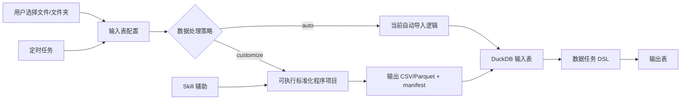

# 输入表 Skill 辅助标准化设计文档 v0.11

## 1. 文档目标

本文档设计一套输入表标准化方案，用于处理“文件或文件夹下的 Excel 无法直接解析成标准二维表”的场景。

核心目标是把输入表流程调整为：

```text
选择文件/文件夹 -> 数据处理策略 -> auto / customize
```

其中：

- `auto` 策略沿用当前输入表自动导入能力，适合标准 Excel、CSV 和结构稳定的文件夹。
- `customize` 策略通过一个自定义标准化程序项目处理复杂输入，适合复杂 Excel、多表头、合并单元格、跨 Sheet、模板化报表等非标准二维表。项目必须包含入口命令、模块、依赖声明、测试样例和 manifest 输出契约。
- `Skill` 用于辅助用户分析样例文件并生成/维护标准化程序，但定时任务和生产运行不依赖 LLM。
- 当前阶段暂不把语言 runtime 打包进应用安装包。标准化程序项目支持 Python 和 Node.js，在执行阶段依赖用户环境或系统路径提供的 runtime，应用负责检测、校验和记录版本。

本文档只设计输入表标准化阶段。标准化后的数据任务清洗、输出表发布和调度运行仍沿用数据任务 DSL、输出表和任务运行能力。

---

## 2. 背景与问题

当前输入表适合处理已经接近二维表的文件：

- CSV / TSV。
- 单 Sheet Excel。
- 文件夹中结构一致的 Excel 或 CSV。

但业务中常见的 Excel 往往不是标准二维表：

- 标题、说明、汇总行混在数据区域中。
- 多行表头、合并单元格、横向分组表头。
- 一个文件包含多个 Sheet，每个 Sheet 的有效区域不同。
- 文件夹中不同 Excel 模板版本不完全一致。
- 需要先抽取固定单元格、展开区块、补齐上下文字段后才能形成二维表。

这类处理不适合直接放入数据任务 DSL，因为 DSL 的输入前提是标准二维表。更合理的边界是：

```text
复杂文件 -> 输入表标准化 -> 标准二维表 -> 数据任务 DSL
```

---

## 3. 设计原则

### 3.1 输入表负责“入表适配”

输入表的职责是把外部文件变成 DuckDB 可读取的标准二维表。

标准化程序只负责解析和规整复杂文件，不负责业务清洗、聚合、输出发布。

### 3.2 数据任务负责“二维表清洗”

标准化后的结果进入数据任务 DSL：

```text
input source dataset "<inputTableId>" as src
  | cast [金额] as double on_error null
  | filter [订单号] is not null
  | output table "清洗后订单表" mode replace
```

### 3.3 Skill 负责“生成和维护标准化程序”

Skill 可以参与：

- 分析样例文件结构。
- 生成一个可执行 Python 或 Node.js 标准化程序项目。
- 根据错误日志修复程序代码、依赖声明或入口命令。
- 解释程序输出 schema。

Skill 不参与：

- 每次定时生产运行。
- 无人工确认的程序版本自动覆盖。
- 绕过权限直接读取未授权文件。

### 3.4 生产运行必须确定性

保存后的输入表标准化程序必须作为固定版本执行：

```text
定时触发 -> 扫描文件夹 -> 执行固定标准化程序版本 -> 导入二维表 -> 运行数据任务 -> 写输出表
```

---

## 4. 总体架构



---

## 5. 输入表配置模型

### 5.1 顶层结构

建议把输入表配置扩展为：

```ts
type InputTableProcessingStrategy = 'auto' | 'customize';

interface InputTableConfig {
  source: InputTableSourceConfig;
  dataProcessing: InputTableDataProcessingConfig;
}

interface InputTableSourceConfig {
  kind: 'excel' | 'csv' | 'folder';
  path: string;
  filePattern?: string;
  recursive?: boolean;
}

type InputTableDataProcessingConfig = AutoDataProcessingConfig | CustomizeDataProcessingConfig;
```

### 5.2 auto 策略

`auto` 策略与当前能力一致，只是归入 `dataProcessing.strategy = 'auto'`。

```ts
interface AutoDataProcessingConfig {
  strategy: 'auto';
  header?: boolean;
  sheet?: string;
  encoding?: string;
  mergeMode?: 'append_by_name' | 'append_by_position';
  schemaStrategy?: 'infer' | 'first_file' | 'union';
  fileRange?: 'top_level' | 'recursive';
  skipEmptyFiles?: boolean;
  keepSourceFileName?: boolean;
}
```

### 5.3 customize 策略

`customize` 策略通过一个固定版本的可执行标准化程序项目将复杂文件标准化为一个二维表文件。

标准化程序必须是完整项目形态，例如包含语言对应的项目清单、源码目录、测试样例、README 和入口命令。即使项目很小，也应保留项目目录结构和 manifest 契约，避免后续维护时从零散代码片段膨胀成不可治理的实现。

`rulePrompt` 是用户对转换规则的自然语言描述，用于驱动 Skill 生成或修复标准化程序项目。它是可编辑配置，但已发布版本会保存当时的规则描述快照；后续修改 `rulePrompt` 只会影响新草稿版本，不会自动修改已发布代码。

运行时只关心：如何解包项目、如何校验外部 runtime、如何准备项目依赖、如何执行入口命令、如何读取 manifest。

```ts
interface CustomizeDataProcessingConfig {
  strategy: 'customize';
  rulePrompt: string;
  artifactId: string;
  artifactVersionId: string;
  runtime: NormalizerRuntime;
  entrypoint: NormalizerEntrypoint;
  timeoutMs: number;
  outputFormat: 'csv' | 'parquet';
  expectedSchema?: InputTableExpectedColumn[];
  onSchemaChange?: 'fail' | 'warn' | 'accept';
}

type NormalizerRuntime =
  | {
      language: 'python';
      pythonVersion?: string;
      environment: 'system' | 'venv';
      executable?: string;
    }
  | { language: 'node'; nodeVersion?: string; environment: 'system' | 'npm'; executable?: string };

interface NormalizerEntrypoint {
  cwd?: string;
  command: string[];
}

interface NormalizerDependencyPrepareConfig {
  steps: Array<{
    cwd?: string;
    command: string[];
  }>;
  preparedRuntime?: string;
  lockFiles: string[];
}

interface InputTableExpectedColumn {
  name: string;
  type: 'string' | 'integer' | 'double' | 'boolean' | 'date' | 'timestamp';
  nullable?: boolean;
}
```

示例：

```ts
{
  strategy: 'customize',
  rulePrompt: '读取文件夹内所有销售 Excel，抽取销售明细 sheet，展开多行表头，保留订单号、客户、月份、金额，并添加来源文件列。',
  artifactId: 'norm_01H...',
  artifactVersionId: 'normv_01H...',
  runtime: { language: 'python', environment: 'venv', executable: 'python3' },
  dependencyPrepare: {
    steps: [
      { command: ['${runtime}', '-m', 'venv', '${envDir}'] },
      { command: ['${envPython}', '-m', 'pip', 'install', '-r', 'requirements.lock'] }
    ],
    preparedRuntime: '${envPython}',
    lockFiles: ['requirements.lock']
  },
  entrypoint: {
    cwd: '.',
    command: ['${preparedRuntime}', '-m', 'normalizer.cli', '--context', '${context}', '--manifest', '${manifest}']
  },
  timeoutMs: 120000,
  outputFormat: 'csv',
  onSchemaChange: 'warn'
}
```

### 5.4 标准化程序实体

标准化程序应作为可版本化项目资源保存。每个版本都是完整项目快照。

```ts
interface InputTableNormalizerArtifact {
  id: string;
  name: string;
  description?: string;
  sourceKind: 'excel' | 'csv' | 'folder';
  primaryLanguage: 'python' | 'node';
  activeVersionId: string;
  createdAt: number;
  updatedAt: number;
}

interface InputTableNormalizerArtifactVersion {
  id: string;
  artifactId: string;
  version: number;
  status: 'draft' | 'published' | 'archived';
  files: NormalizerProjectFile[];
  fileTreeHash: string;
  rulePrompt: string;
  sourceSummaryHash?: string;
  entrypoint: NormalizerEntrypoint;
  dependencyPrepare?: NormalizerDependencyPrepareConfig;
  runtime: NormalizerRuntime;
  dependencies: NormalizerDependencySpec[];
  dependencyLockHash?: string;
  createdBy: 'user' | 'skill';
  parentVersionId?: string;
  previewRunId?: string;
  publishedAt?: number;
  publishedBy?: string;
  archivedAt?: number;
  createdAt: number;
  notes?: string;
}

interface NormalizerProjectFile {
  path: string;
  content: string;
  executable?: boolean;
}

type NormalizerDependencySpec =
  | { ecosystem: 'python'; name: string; versionRange?: string }
  | { ecosystem: 'node'; name: string; versionRange?: string };
```

输入表引用固定的 `artifactVersionId`，避免代码更新影响已经发布的生产任务。

### 5.5 版本控制与发布流程

标准化程序项目采用应用内版本控制，不依赖外部 Git 仓库。每次由用户编辑、Skill 生成或 Skill 修复产生的代码变更，都必须保存为新的 `InputTableNormalizerArtifactVersion`。

版本状态：

- `draft`：草稿版本。可以继续编辑、预览和修复，不能被生产调度引用。
- `published`：已发布版本。必须通过预览校验，输入表只能引用已发布版本。
- `archived`：归档版本。保留审计和回滚信息，不再作为新配置默认选择。

创建版本：

1. 从当前 `activeVersionId` 复制完整项目快照。
2. 记录 `parentVersionId`。
3. 记录本次使用的 `rulePrompt`。
4. 如由 Skill 生成，记录文件结构摘要 hash。
5. 应用用户编辑或 Skill 生成的文件变更。
6. 计算 `fileTreeHash`。
7. 记录 `runtime`、`entrypoint`、`dependencyPrepare` 和依赖声明。
8. 将完整项目源码物理写入应用数据目录下的 `data/input-table-normalizers/projects/<artifactId>/<versionId>/`。
9. 保存为 `draft`。

预览版本：

1. 将草稿版本解包到应用数据目录下的 `data/input-table-normalizers/runs/<artifactId>/<versionId>/<runId>/`，不使用系统临时目录保存生成代码。
2. 如有外部依赖，执行 `dependencyPrepare.steps`。
3. 生成或校验 `dependencyLockHash`。
4. 执行 `entrypoint.command`。
5. 校验 manifest、输出文件、schema 和路径权限。
6. 保存 `previewRunId`、行列统计、warnings 和日志摘要。

发布版本：

- 只有最近一次预览成功的草稿版本才能发布。
- 发布时将 `status` 置为 `published`，写入 `publishedAt`、`publishedBy`。
- 将标准化程序的 `activeVersionId` 更新为新版本。
- 输入表配置可选择是否立即切换到该版本。
- 发布不会修改已有输入表正在引用的旧 `artifactVersionId`，除非用户明确确认切换。

生产引用：

- 输入表配置保存固定 `artifactVersionId`。
- 调度运行只读取该固定版本，不读取 `activeVersionId`。
- 运行记录必须保存 `artifactVersionId`、`fileTreeHash`、`dependencyLockHash`、`runtime`、`actualRuntimeVersion` 和 `entrypoint`。
- 如果版本被归档，已绑定该版本的历史运行仍可审计；新配置不应默认选择归档版本。

回滚：

- 回滚不是覆盖代码，而是把输入表配置重新指向某个历史 `published` 版本。
- 回滚后需要重新预览或刷新一次输入表，确认当前文件输入仍兼容该版本。
- 回滚操作记录操作者、时间、旧版本、新版本和原因。

版本对比：

- UI 应支持按版本查看文件树 diff。
- 重点显示规则描述、结构摘要 hash、入口命令、依赖声明、锁文件、runtime 要求和 manifest 契约变化。
- 对 Skill 修复版本，应展示错误来源和修复摘要。

保留与清理：

- `published` 版本和被历史运行引用的版本不能删除，只能归档。
- 未发布且无引用的 `draft` 可以由用户删除。
- 依赖环境缓存可以清理，但清理后下次预览或维护需要重新执行 `dependencyPrepare.steps`。

### 5.6 推荐项目结构

Python 标准化程序项目建议保存为：

```text
pyproject.toml
requirements.lock
README.md
normalizer/
  __init__.py
  cli.py
  transform.py
tests/
  fixtures/
    context.json
  test_normalizer.py
```

项目代码应能在应用提供的隔离工作目录中解包运行。项目内可以包含 helper 模块、测试样例、配置文件和 README，但生产入口仍必须输出统一 manifest。

Node.js 标准化程序项目建议保存为：

```text
package.json
package-lock.json
README.md
src/
  cli.mjs
  transform.mjs
tests/
  fixtures/
    context.json
  normalizer.test.mjs
```

Python 和 Node.js 项目都必须通过统一入口命令接收 context 和 manifest，并输出 CSV 或 Parquet。差异只体现在项目依赖和入口命令，不改变输入表刷新链路。

Python 和 Node.js 项目模板需要保持最小同构模块边界：

- `cli`：负责参数解析、读取 context、调用 transform、校验输出路径、写出数据文件和 manifest。
- `transform`：只负责业务模板解析，返回标准二维表行、schema 和 warnings。
- `tests/fixtures/context.json`：保存最小可运行样例 context，方便预览和 Skill 回归测试。

如项目变复杂，可以自行拆分 `io`、`schema`、`manifest` 等 helper 模块，但执行器和 Skill 只强制要求 `cli` 与 `transform` 两个边界。

## 6. 标准化程序执行契约

### 6.1 启动方式

执行器向标准化程序传入上下文 JSON，并要求程序输出 manifest JSON。

执行器流程：

1. 将固定 `artifactVersionId` 的项目文件解包到应用数据目录下的隔离运行目录。
2. 校验版本状态必须为 `published`。
3. 校验解包后的 `fileTreeHash` 和版本记录一致。
4. 如有依赖锁，校验 `dependencyLockHash` 和版本记录一致。
5. 写入 `context.json`。
6. 按版本记录中的 `runtime` 检测外部运行时是否存在，并记录实际版本。
7. 替换入口命令中的占位符，例如 `${runtime}`、`${preparedRuntime}`、`${context}`、`${manifest}`、`${outputDir}`。
8. 在声明的 `entrypoint.cwd` 下执行入口命令。
9. 读取并校验 `manifest.json`。

当前阶段不下载、不安装、不内置语言 runtime。执行前必须完成：

- Python：通过 `python` / `python3` / 用户配置路径检测版本。
- Node.js：通过 `node` / 用户配置路径检测版本。
- Python / Node.js runtime 不存在或版本不满足要求时，刷新直接失败，并提示用户配置运行环境。

Python 项目入口命令可以是：

```bash
${preparedRuntime} -m normalizer.cli --context context.json --manifest manifest.json
```

Node.js 项目入口命令可以是：

```bash
${runtime} src/cli.mjs --context context.json --manifest manifest.json
```

### 6.2 输入 context

```json
{
  "sourceKind": "folder",
  "sourcePath": "/Users/demo/orders",
  "files": [
    {
      "path": "/Users/demo/orders/2026-01.xlsx",
      "name": "2026-01.xlsx",
      "size": 182031,
      "mtime": 1767225600000
    }
  ],
  "workDir": "/Users/demo/Library/Application Support/sophron/data/input-table-normalizers/runs/artifact-id/version-id/run-id",
  "outputDir": "/Users/demo/Library/Application Support/sophron/data/input-table-normalizers/runs/artifact-id/version-id/run-id/output",
  "config": {
    "filePattern": "*.xlsx",
    "recursive": false
  },
  "expectedSchema": [
    { "name": "订单号", "type": "string" },
    { "name": "金额", "type": "double" }
  ]
}
```

### 6.3 输出 manifest

```json
{
  "ok": true,
  "output": {
    "path": "/tmp/sophron-input-normalize/run-xxx/output/normalized.csv",
    "format": "csv"
  },
  "schema": [
    { "name": "订单号", "type": "string", "nullable": false },
    { "name": "金额", "type": "double", "nullable": true }
  ],
  "stats": {
    "files": 12,
    "rows": 3200,
    "columns": 8
  },
  "warnings": [],
  "errors": []
}
```

失败时：

```json
{
  "ok": false,
  "errors": [
    {
      "code": "MISSING_REQUIRED_SHEET",
      "message": "未找到 sheet: 销售明细",
      "file": "/Users/demo/orders/2026-01.xlsx"
    }
  ]
}
```

### 6.4 标准化程序入口约定

入口命令必须满足：

- 接受 `--context` 和 `--manifest` 参数，或通过 `NORMALIZER_CONTEXT` / `NORMALIZER_MANIFEST` 环境变量读取。
- 成功时写入 `ok: true` 的 manifest。
- 失败时尽量写入 `ok: false` 的 manifest；如果进程异常退出，执行器会生成 `NORMALIZER_FAILED` 错误。
- 输出文件必须位于 `context.outputDir` 下。
- 不得假设当前工作目录是源文件目录；所有输入文件由 `context.files` 明确给出。

### 6.5 外部依赖与执行命令

标准化程序项目允许声明外部依赖，但依赖准备必须发生在用户触发的预览、维护或发布流程中，生产调度只执行已经准备好的环境。

建议在标准化程序版本中保存 `dependencyPrepare` 和 `entrypoint` 两类命令：前者只在预览、维护或发布阶段执行，后者用于生产刷新。

Python 依赖准备示例：

```ts
{
  steps: [
    { command: ['${runtime}', '-m', 'venv', '${envDir}'] },
    { command: ['${envPython}', '-m', 'pip', 'install', '-r', 'requirements.lock'] }
  ],
  preparedRuntime: '${envPython}',
  lockFiles: ['requirements.lock']
}
```

Python 执行命令使用准备后的解释器：

```bash
${envPython} -m normalizer.cli --context context.json --manifest manifest.json
```

其中 `${preparedRuntime}` 在依赖准备完成后解析为 `${envPython}`；没有声明 `dependencyPrepare` 时，`${preparedRuntime}` 等同于 `${runtime}`。

Node.js 依赖准备示例：

```ts
{
  steps: [
    { cwd: '.', command: ['${packageManager}', 'ci'] }
  ],
  preparedRuntime: '${runtime}',
  lockFiles: ['package-lock.json']
}
```

Node.js 执行命令在项目根目录运行，依赖由本地 `node_modules` 解析：

```bash
${runtime} src/cli.mjs --context context.json --manifest manifest.json
```

依赖命令约束：

- `${packageManager}` 默认解析为 `npm`，后续可支持用户配置为 `pnpm` / `yarn`。
- `${envDir}`、`${envPython}`、`${preparedRuntime}` 由执行器在项目版本和运行平台下生成，不能由标准化程序自行决定。
- 依赖准备命令必须按 `steps` 顺序执行，不拼接 shell 字符串。
- 依赖准备成功后保存 `dependencyLockHash` 和准备环境摘要。
- 生产调度发现依赖环境缺失或 `dependencyLockHash` 不匹配时，返回 `DEPENDENCY_INSTALL_FAILED` 或 `DEPENDENCY_LOCK_MISSING`，不自动安装。

### 6.6 Python 项目模板

Python 模板只保留两个必需模块：

- `normalizer/cli.py`：入口，负责 context/manifest、输出路径和错误 manifest。
- `normalizer/transform.py`：业务解析，返回 `rows`、`schema`、`warnings`。

```text
pyproject.toml
requirements.lock
normalizer/
  __init__.py
  cli.py
  transform.py
tests/
  fixtures/context.json
  test_normalizer.py
```

`normalizer/transform.py` 返回结构：

```python
def transform(context):
    return {
        "rows": [{"来源文件": "demo.xlsx"}],
        "schema": [{"name": "来源文件", "type": "string", "nullable": False}],
        "warnings": [],
    }
```

`normalizer/cli.py` 最小职责：

```python
# 读取 --context -> 调用 transform(context)
# 将 rows 写入 context.outputDir/normalized.csv
# 将 ok/output/schema/stats/warnings/errors 写入 --manifest
# 捕获异常并写入 ok=false manifest
```

### 6.7 Node.js 项目模板

Node.js 模板只保留两个必需模块：

- `src/cli.mjs`：入口，负责 context/manifest、输出路径和错误 manifest。
- `src/transform.mjs`：业务解析，返回 `rows`、`schema`、`warnings`。

```text
package.json
package-lock.json
src/
  cli.mjs
  transform.mjs
tests/
  fixtures/context.json
  normalizer.test.mjs
```

`src/transform.mjs` 返回结构：

```js
export async function transform(context) {
  return {
    rows: [{ 来源文件: 'demo.xlsx' }],
    schema: [{ name: '来源文件', type: 'string', nullable: false }],
    warnings: [],
  };
}
```

`src/cli.mjs` 最小职责：

```js
// 读取 --context -> 调用 transform(context)
// 将 rows 写入 context.outputDir/normalized.csv
// 将 ok/output/schema/stats/warnings/errors 写入 --manifest
// 捕获异常并写入 ok=false manifest
```

## 7. UI 设计

输入表编辑页调整为三段式。

### 7.1 选择文件

控件：

- 来源类型：Excel / CSV / 文件夹。
- 文件或文件夹路径。
- 文件匹配：例如 `*.xlsx`。
- 是否递归子目录。

### 7.2 数据处理策略

使用分段控件：

```text
auto | customize
```

`auto` 策略展示当前已有配置。

`customize` 策略展示：

- 规则描述提示词文本输入。
- 标准化程序选择器。
- 程序版本。
- 版本状态：草稿 / 已发布 / 已归档。
- 版本历史、diff、发布、回滚入口。
- 文件树和代码查看/编辑入口。
- 入口命令和运行目录。
- 运行环境和依赖声明。
- runtime 检测状态和配置入口。
- 运行预览。
- 输出 schema。
- 运行日志。
- 使用 Skill 生成或修复标准化程序。

规则描述提示词用于描述“如何将文件或文件夹内的文件转换成标准二维表”，应作为生成标准化程序项目的主要业务输入。输入框建议支持多行文本，保存到 `dataProcessing.rulePrompt`，并在每个生成版本中记录快照。

规则描述示例：

```text
读取所选文件夹下所有 .xlsx 文件。
每个文件读取“销售明细”sheet。
前两行是多级表头，需要合并成一行字段名。
只保留订单号、客户名称、月份、金额四个字段。
月份列如果横向展开，需要转换成长表结构。
每行补充来源文件名。
输出字段顺序为：来源文件、订单号、客户名称、月份、金额。
金额无法解析时置空，并在 warnings 中记录。
```

### 7.3 项目编辑与预览

编辑面板只面向标准化程序项目：

- 展示项目文件树、入口文件、依赖文件、README、测试样例。
- 支持在项目文件树中新增、删除和重命名文件。
- 入口命令必须可视化展示，避免用户误以为保存代码就等于确定执行方式。
- 预览运行时应显示输入摘要、stdout/stderr、manifest、输出表前若干行和 schema diff。
- 保存版本前必须明确提示本次变更会形成新的草稿 `artifactVersionId`。
- 发布版本前必须展示最近一次预览结果、依赖锁、入口命令和文件树 hash。

### 7.4 Skill 辅助生成标准化程序

用户点击“使用 Skill 生成标准化程序”后：

1. 选择样例文件或样例文件夹。
2. 用户填写或修改规则描述提示词。
3. 应用使用内置 Node 读取器读取真实的文件或文件夹，生成安全的结构探测结果。探测结果应包含文件名、Sheet 名、行列范围、前约 20 行预览、候选表头、Excel 合并单元格范围与合并值等信息。
4. LLM 先基于规则描述和结构探测结果输出结构分析 JSON，例如应读取哪些 Sheet、哪些行组成表头、数据从哪一行开始、合并单元格如何参与表头或行值、重复列名如何处理。
5. LLM 再基于结构分析 JSON、规则描述和项目模板生成最终标准化程序项目草稿，包括入口命令、依赖声明、README 和必要测试样例。
6. 用户查看项目文件树、入口命令、依赖声明、规则描述快照、结构探测结果和结构分析结果。
7. 用户预览输出表和 manifest。
8. 用户确认后保存为新的草稿标准化程序版本。

注意：Skill 生成的标准化程序项目必须经过用户确认和预览，不能直接进入生产调度。

---

## 8. Skill 设计

建议新增内置或可安装 skill：`excel-normalizer`。

Skill 内容：

- `SKILL.md`：说明何时使用该 skill。
- `templates/python-project/`：可执行 Python 项目模板，包含 `pyproject.toml`、包目录、入口模块和测试目录。
- `templates/node-project/`：可执行 Node.js 项目模板，包含 `package.json`、入口模块和测试目录。
- `references/manifest-contract.md`：输入输出契约。
- `references/project-artifact-contract.md`：标准化程序项目、入口命令、依赖声明和版本化契约。
- `references/versioning-contract.md`：草稿、预览、发布、回滚、归档和审计规则。
- `references/runtime-requirements.md`：Python、Node.js 外部 runtime 检测和版本要求。
- `references/excel-patterns.md`：复杂 Excel 模板解析经验。
- `examples/`：多表头、合并单元格、跨 Sheet 示例。

Skill 提示原则：

- 只生成把复杂文件变成标准二维表的标准化程序。
- 生成代码必须同时参考用户填写的规则描述提示词和系统提取的文件结构摘要。
- 当规则描述与样例结构冲突时，应在待确认项中说明冲突，不能静默猜测。
- 规则描述必须随草稿版本保存，后续修复和重新生成应默认继承该描述。
- 始终生成包含模块、依赖声明、测试样例和入口命令的可执行项目。
- 生成 Python / Node.js 项目时必须保持最小标准边界：`cli`、`transform` 和 `tests/fixtures/context.json`。
- `transform` 不得直接写文件或 manifest；只能返回标准化结果。
- `cli` 必须集中处理输出路径校验，保证所有输出都位于 `context.outputDir`。
- 语言选择优先级：Python 适合复杂数据清洗，Node.js 适合轻量工程集成。
- 不在标准化程序里做业务聚合和输出表发布。
- 输出必须符合 manifest 契约。
- 标准化程序项目必须声明入口命令和运行目录。
- Skill 生成或修复代码时只能创建草稿版本，不能直接发布或覆盖已发布版本。
- 对不确定的模板区域生成待确认项，而不是猜测。
- 优先使用成熟、可锁定版本的本地依赖，例如 Python 的 `pandas` / `openpyxl`、Node.js 的 `xlsx`。
- 修复已有标准化程序项目时必须保留 manifest 契约、入口命令和用户已确认的版本边界。

---

## 9. 输入表刷新执行流程

```text
刷新输入表
  -> 读取输入表配置
  -> 扫描文件/文件夹
  -> strategy=auto: 执行当前自动导入逻辑
  -> strategy=customize: 解包并执行固定标准化程序版本
  -> 校验 manifest
  -> 校验输出二维表
  -> 导入 DuckDB 临时表
  -> 原子替换输入表物理表
  -> 保存行数、列数、程序版本、文件树哈希、运行日志
```

关键要求：

- 标准化程序输出必须是一个二维表文件。
- 导入 DuckDB 前先创建临时表，成功后再替换正式输入表。
- schema 变化根据 `onSchemaChange` 决定失败、告警或接受。
- 每次运行记录 `artifactVersionId`、版本状态快照、`fileTreeHash`、`dependencyLockHash` 和入口命令。
- 生产刷新只执行已确认的固定版本，不在刷新时请求 LLM 重新生成代码。
- 生产刷新只能执行 `published` 版本；草稿版本只能预览。

---

## 10. 调度与输出表发布

数据任务调度应调用确定性链路：

```text
定时触发
  -> 刷新输入表
  -> 运行数据任务 DSL
  -> mode=persisted 写入输出表
  -> 记录运行结果
```

调度配置建议：

```ts
interface DataTaskScheduleConfig {
  inputTableId: string;
  dataTaskId: string;
  outputTableId: string;
  refreshInputBeforeRun: boolean;
  runMode: 'temporary' | 'persisted';
  schedule: {
    kind: 'daily' | 'weekly';
    times: string[];
    weekdays?: number[];
  };
}
```

生产调度不应每次调用 Skill。Skill 只在创建、修复或维护标准化程序时使用。

---

## 11. 安全与权限

### 11.1 文件权限

- 只能读取用户明确选择或授权的文件/文件夹。
- `context.files` 必须由应用扫描生成，标准化程序不能自行扩大读取范围。
- 输出只能写入 `outputDir`。
- 标准化程序项目只能访问自己的项目根目录、`context.files` 列出的输入文件和 `outputDir`。

### 11.2 运行沙箱

默认策略：

- 禁止网络访问。
- 限制执行时间。
- 限制输出文件大小。
- 限制可写目录。
- 隔离项目运行目录和临时输出目录。
- 记录 stdout/stderr，但需要裁剪超长日志。

### 11.3 依赖管理

当前阶段不随应用内置语言 runtime，也不在生产调度时隐式安装依赖。项目级依赖必须经过用户确认：

- 项目依赖保存到标准化程序项目版本中。
- Python 依赖通过 `pyproject.toml` / `requirements.txt` / 锁文件描述。
- Node.js 依赖通过 `package.json` 和 lockfile 描述。
- 依赖准备命令保存到 `dependencyPrepare.steps`，执行命令保存到 `entrypoint.command`。
- 依赖解析结果保存 `dependencyLockHash`，没有锁文件时应提示用户先完成依赖锁定。
- 依赖安装或更新只能在用户触发的预览/维护流程中发生，不能在生产调度中隐式发生。
- 不同标准化程序版本应使用隔离的依赖缓存、虚拟环境或 `node_modules`。

### 11.4 Runtime 配置

应用设置中应提供运行时检测和路径配置：

- Python：显示 `python` / `python3` / 自定义路径、版本、可用性。
- Node.js：显示 `node` / 自定义路径、版本、可用性。
- 输入表配置保存期望版本，运行记录保存实际执行版本。
- runtime 缺失时，UI 提供错误说明和配置入口，但不自动下载 runtime。

---

## 12. 错误处理

常见错误码：

| 错误码                        | 说明                                     |
| ----------------------------- | ---------------------------------------- |
| `NO_INPUT_FILES`              | 未找到匹配文件                           |
| `NORMALIZER_TIMEOUT`          | 标准化程序执行超时                       |
| `NORMALIZER_FAILED`           | 标准化程序进程异常退出                   |
| `RUNTIME_NOT_FOUND`           | 未找到标准化程序声明的语言 runtime       |
| `RUNTIME_VERSION_UNSUPPORTED` | runtime 版本不满足项目要求               |
| `INVALID_ENTRYPOINT`          | 入口命令或运行目录不可执行               |
| `DEPENDENCY_INSTALL_FAILED`   | 依赖准备失败                             |
| `DEPENDENCY_LOCK_MISSING`     | 项目缺少必要依赖锁定信息                 |
| `VERSION_NOT_PUBLISHED`       | 输入表引用了未发布的标准化程序版本       |
| `VERSION_HASH_MISMATCH`       | 版本文件树或依赖锁 hash 与发布记录不一致 |
| `INVALID_MANIFEST`            | manifest 缺失或格式错误                  |
| `OUTPUT_FILE_MISSING`         | manifest 指向的输出文件不存在            |
| `OUTPUT_NOT_TABULAR`          | 输出不是可导入二维表                     |
| `SCHEMA_CHANGED`              | 输出 schema 与预期不一致                 |
| `PROJECT_FILE_ACCESS_DENIED`  | 标准化程序访问了未授权路径               |

兼容迁移时可以把旧的 `SCRIPT_TIMEOUT` / `SCRIPT_FAILED` / `FILE_ACCESS_DENIED` 映射到新的标准化程序错误码。

错误展示应包含：

- 失败阶段。
- 错误码。
- 用户可读描述。
- 相关文件。
- 可复制的日志片段。
- “使用 Skill 修复标准化程序”入口。

---

## 13. 运行记录

每次输入表刷新记录：

```ts
interface InputTableRefreshRun {
  id: string;
  inputTableId: string;
  status: 'completed' | 'failed';
  strategy: 'auto' | 'customize';
  artifactId?: string;
  artifactVersionId?: string;
  artifactVersionStatus?: 'draft' | 'published' | 'archived';
  fileTreeHash?: string;
  dependencyLockHash?: string;
  runtime?: NormalizerRuntime;
  actualRuntimeVersion?: string;
  entrypoint?: NormalizerEntrypoint;
  dependencyPrepare?: NormalizerDependencyPrepareConfig;
  sourceFileCount: number;
  rowCount: number;
  columnCount: number;
  warnings: string[];
  error?: string;
  startedAt: number;
  finishedAt: number;
}
```

用于：

- UI 展示最近刷新状态。
- 调度失败排查。
- 复现某次输出。
- 判断是否需要重新运行数据任务。

---

## 14. 与数据任务 DSL 的边界

`customize` 策略不新增数据任务算子。

输入表标准化完成后，数据任务只看到一个普通输入表：

```text
input source dataset "<inputTableId>" as src
  | select [订单号], [金额], [来源文件]
  | cast [金额] as double on_error null
  | output table "标准订单明细" mode replace
```

这样可以避免 DSL 承担复杂文件解析职责，也能保证输出表发布链路统一。

---

## 15. 测试计划

### 15.1 单元测试

- `auto` / `customize` 配置序列化和迁移。
- manifest schema 校验。
- 入口命令占位符替换。
- 依赖准备命令占位符替换和多步执行。
- 版本状态流转：`draft` -> `published` -> `archived`。
- 文件树 hash、依赖锁 hash 和版本记录一致性校验。
- Python / Node.js runtime 检测和版本校验。
- 标准化程序输出路径必须位于 `outputDir`。
- 项目文件访问必须限制在授权范围内。
- 缺少 runtime 或依赖锁时必须返回明确错误码。
- schema change 策略：`fail` / `warn` / `accept`。
- 错误码映射。

### 15.2 集成测试

- 文件夹 Excel -> Python 标准化程序项目 -> DuckDB 输入表。
- 多 Sheet Excel -> Node.js 标准化程序项目 -> 单个标准二维表。
- 项目解包、入口命令执行、manifest 读取和输出导入全链路。
- 带外部依赖项目先执行维护阶段依赖准备，生产刷新复用已准备环境。
- `dependencyLockHash` 不匹配时生产刷新不自动安装依赖。
- 草稿版本只能预览，不能被生产刷新执行。
- 输入表固定引用旧发布版本时，新发布版本不会自动影响历史配置。
- 回滚到历史发布版本后运行记录保存回滚后的 `artifactVersionId`。
- 标准化程序失败时不替换旧输入表。
- runtime 缺失时不进入项目执行阶段。
- 调度触发刷新输入表后运行数据任务并写入输出表。

### 15.3 Skill 回归测试

- 给定样例结构摘要，生成的标准化程序项目必须包含 manifest 输出。
- 给定规则描述提示词和样例结构摘要，生成结果必须能在版本中记录 `rulePrompt` 和 `sourceSummaryHash`。
- 规则描述缺失时，Skill 生成入口应提示用户补充，不能只根据样例预览生成生产代码。
- 规则描述与样例结构冲突时，生成结果必须包含待确认项。
- 生成项目必须包含入口命令、依赖声明、runtime 要求和必要说明。
- Python / Node.js 两种模板都必须符合 manifest 契约。
- Python / Node.js 模板必须包含 `cli` 和 `transform` 标准模块。
- Python / Node.js 的 `transform` 模块不得直接写输出文件或 manifest。
- Python / Node.js 的 `cli` 模块必须校验输出路径位于 `context.outputDir`。
- 生成的标准化程序项目不能读取或写入未授权路径。
- 修复标准化程序时必须保留输入输出契约。
- 从错误日志修复后必须形成新的待确认版本，不能覆盖已发布版本。
- Skill 生成和修复只能创建 `draft` 版本。

---

## 16. 分阶段落地

### Phase 1：标准化程序 MVP

- 输入表配置支持 `auto` / `customize` 数据处理策略。
- 保存 Python 标准化程序项目和版本。
- 支持外部 Python runtime 检测和自定义路径配置。
- 手动运行预览。
- manifest 校验。
- 导入 CSV 输出。

### Phase 2：Node.js 运行时支持

- 支持 Node.js 标准化程序项目。
- 支持 Python / Node.js 两种 runtime 的设置页检测。
- 运行记录保存期望 runtime 和实际 runtime 版本。

### Phase 3：项目编辑与版本治理

- 支持完整代码项目文件树。
- 支持入口命令、运行目录和项目依赖声明。
- 支持项目预览运行和输出 schema diff。
- 保存 `fileTreeHash` 和 `dependencyLockHash`。
- 支持草稿、发布、归档、版本 diff 和回滚。

### Phase 4：Skill 辅助

- 新增 `excel-normalizer` skill。
- 从样例文件提取结构摘要。
- 生成 Python / Node.js 可执行代码项目草稿。
- 支持根据错误日志修复标准化程序。

### Phase 5：调度集成

- 数据任务调度支持刷新输入表。
- 运行数据任务并写入输出表。
- 记录调度运行日志。

### Phase 6：生产增强

- Parquet 输出。
- 项目依赖缓存和隔离环境。
- 可选支持应用内置 runtime，但需要单独评估安装包体积、平台适配和授权。
- 标准化程序版本发布/回滚。
- 文件增量扫描。
- schema drift 可视化对比。

---

## 17. 验收标准

- 用户可以选择复杂 Excel 文件夹作为输入表来源。
- 用户可以选择 `auto` 或 `customize` 数据处理策略。
- `customize` 策略只使用完整可执行标准化程序项目。
- 标准化程序项目支持 Python 和 Node.js。
- 应用暂不内置语言 runtime，runtime 缺失时能清晰提示和引导配置。
- 标准化程序可以把复杂 Excel 转成标准二维表。
- 标准化结果可以被数据任务 DSL 作为普通输入表读取。
- 输出表发布不依赖 LLM。
- 定时运行使用固定标准化程序版本，结果可审计、可复现。
- 新生成或修复的代码必须先作为草稿预览，再由用户发布后才能生产运行。
- 已发布版本不可被覆盖，只能发布新版本或回滚引用。
- Skill 可以辅助生成和修复标准化程序，但不会在生产定时运行中被隐式调用。
