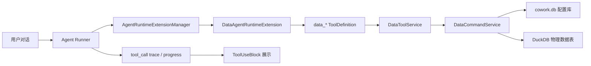

# 数据页面 CLI 化与数据任务 Tool Call 化设计文档 v0.1

## 1. 背景

当前数据页面已经具备以下核心能力：

- 数据任务：创建、编辑、保存工作流、运行工作流、删除。
- 输入表：新增 Excel/CSV/文件夹输入表、编辑配置、预览、删除。
- 输出表：新增输出表、编辑来源输入表、预览、删除。
- 数据任务算子：输入、DSL 算子、输出算子配置，工作流节点和连线保存。
- 执行层：`DataTaskStore.runTask` 可以按工作流连线从输入算子执行到输出算子，并写入临时或正式 DuckDB 表。
- DSL 层：`src/shared/prep-dsl` 已支持任务级和单算子级 DSL 解析、导出、校验和工作流编译。

但这些能力主要通过 UI 和 Electron IPC 暴露。为了让自动化、脚本、LLM agent 和后续远程控制都能稳定复用数据能力，需要把数据页面所有操作抽象为统一命令能力，并进一步注册为可被 LLM `tool_call` 调用的数据处理工具。

本文设计两个目标：

1. 数据页面所有操作 CLI 化，支持 CLI 完成当前 UI 能完成的全部事情。
2. 数据任务处理能力 Tool 化，让任务中的 LLM 可以通过 `tool_call` 调用数据处理、预览、配置和执行能力。

---

## 2. 目标与非目标

### 2.1 目标

- 提供稳定的 `sophron data ...` CLI 命令族，覆盖数据任务、输入表、输出表、工作流和算子配置。
- CLI 不依赖浏览器或界面点击，不通过 GUI 自动化模拟用户操作。
- CLI 与 UI、tool_call 共享同一套数据应用服务，避免出现三套业务逻辑。
- 所有写配置的操作继续写入 `cowork.db`。只有导入后的物理表、临时结果表、正式结果表写入 DuckDB。
- 支持 JSON 输出，便于脚本和 LLM 消费。
- 支持 dry-run、validate、preview、run 等安全工作流。
- 将数据处理能力以 agent custom tools 方式注册给 LLM，必要时也可以作为 MCP server 暴露给外部 agent。
- 支持 LLM 通过 tool_call 执行以下典型任务：
  - 查询有哪些输入表、输出表、数据任务。
  - 基于用户选择或授权的本地文件/文件夹创建输入表。
  - 创建输出表，供后续数据任务写入或复用。
  - 创建或修改数据任务。
  - 为输入算子选择输入表。
  - 修改非输入/输出算子的 DSL。
  - 为输出算子选择输出表或自动输出表名称。
  - 运行任务并读取结果预览。
  - 对输入表或中间 DSL 做临时预览，不污染正式输出表。

### 2.2 非目标

- 不设计新的通用 SQL 编辑器。
- 不把 LLM tool 设计成任意文件读写工具。
- 不绕过现有权限模型直接给 LLM 任意访问本机文件系统。
- 不用 CLI 替代 UI，只保证两者能力等价、状态一致。
- 不在本轮设计分布式调度或远程多用户协作。

---

## 3. 设计原则

### 3.1 一个业务核心，三个入口

数据操作必须收敛到同一层服务：

```text
UI IPC
CLI
LLM tool_call
        |
        v
DataCommandService / DataTaskToolService
        |
        v
DataTaskStore + prep-dsl + DuckDB runner
```

禁止在 CLI 或 tool_call 中重新实现导入、保存、运行、预览逻辑。

### 3.2 CLI 输出稳定优先

CLI 默认可以输出人类可读表格，但必须支持 `--json`。所有自动化、LLM 和测试都应使用 JSON。

```bash
sophron data input list --json
sophron data task run --id task_xxx --json
```

JSON 字段要稳定，新增字段允许，删除和改名需要版本化。

### 3.3 配置写 SQLite，数据写 DuckDB

- 数据任务、输入表、输出表、工作流节点、连线、算子配置：写入 `cowork.db`。
- 输入表导入后的物理表、输出表物理表、任务临时结果表：写入 DuckDB。
- tool_call 和 CLI 都不能直接写 UI 内存状态，必须走持久化或临时运行结果协议。

### 3.4 Tool 要小而可控

LLM 工具不应暴露一个万能 `execute_data_command` 作为主要接口。应提供粒度合适、可审计、可权限控制的工具。

允许提供一个低层 escape hatch：

```text
data_cli_command
```

但默认不暴露给普通 agent，或者标记为高风险需要用户确认。

### 3.5 临时运行和正式运行明确区分

LLM 和 CLI 都必须显式区分：

- `temporary`：写入临时结果表，不改工作流，不覆盖正式输出表。
- `persisted`：使用已保存配置执行，写入正式输出表。

这与当前 `runTask(..., outputMode)` 语义保持一致。

---

## 4. 当前能力边界

### 4.1 数据层已有入口

`src/main/data/data-task-store.ts` 已有核心方法：

| 能力                 | 方法                |
| -------------------- | ------------------- |
| 创建数据任务         | `createTask`        |
| 更新数据任务         | `updateTask`        |
| 删除数据任务         | `deleteTask`        |
| 运行数据任务         | `runTask`           |
| 导入输入表           | `importDataset`     |
| 更新输入表           | `updateDataset`     |
| 删除输入表           | `deleteDataset`     |
| 预览输入表或输出表   | `previewDataset`    |
| 预览未保存输入表配置 | `previewInputTable` |
| 创建输出表           | `createOutputTable` |
| 更新输出表           | `updateOutputTable` |
| 获取工作流           | `getTaskWorkflow`   |
| 保存工作流           | `saveTaskWorkflow`  |

### 4.2 DSL 能力

`src/shared/prep-dsl` 提供：

- `parsePrepDsl`
- `compilePrepWorkflowToFlow`
- `parsePrepOperatorDsl`
- `exportPrepWorkflowDsl`
- `exportPrepOperatorDsl`

CLI 和 tool_call 应直接复用这些能力完成 DSL 校验、导入、导出和单算子配置。

### 4.3 Agent 工具基础

当前 agent runtime 已支持：

- MCP 工具桥接为 SDK `ToolDefinition`。
- 本地 custom tool 形态，例如 memory tools。
- 权限请求和 tool_call 进度事件。
- tool use/result UI 展示。

数据工具可以采用相同 custom tool 注册方式进入 agent，不必先实现为 MCP server。后续若要给外部 agent 使用，再补 MCP server。

---

## 5. 总体架构

### 5.1 新增模块

```text
src/main/data/
  data-command-service.ts
  data-command-types.ts
  data-cli-runtime.ts
  data-tool-service.ts
  data-tool-definitions.ts

src/cli/
  data-cli.ts

src/main/mcp/
  data-mcp-server.ts        # 可选二期
```

### 5.2 服务职责

#### DataCommandService

面向 UI IPC、CLI 和 tool_call 的统一业务门面。

职责：

- 参数校验和规范化。
- 将高层命令转换为 `DataTaskStore` 调用。
- 统一返回结构。
- 统一错误码。
- 统一 dry-run 和 validate 逻辑。
- 统一审计事件。

示意接口：

```ts
interface DataCommandService {
  listTasks(input: ListTasksInput): Promise<ListTasksResult>;
  createTask(input: CreateTaskCommand): Promise<TaskResult>;
  updateTask(input: UpdateTaskCommand): Promise<TaskResult>;
  deleteTask(input: DeleteTaskCommand): Promise<DeleteResult>;
  runTask(input: RunTaskCommand): Promise<RunTaskResult>;

  listInputTables(input: ListInputTablesInput): Promise<ListInputTablesResult>;
  createInputTable(input: CreateInputTableCommand): Promise<InputTableResult>;
  updateInputTable(input: UpdateInputTableCommand): Promise<InputTableResult>;
  deleteInputTable(input: DeleteInputTableCommand): Promise<DeleteResult>;
  previewInputTable(input: PreviewInputTableCommand): Promise<TablePreviewResult>;

  listOutputTables(input: ListOutputTablesInput): Promise<ListOutputTablesResult>;
  createOutputTable(input: CreateOutputTableCommand): Promise<OutputTableResult>;
  updateOutputTable(input: UpdateOutputTableCommand): Promise<OutputTableResult>;
  deleteOutputTable(input: DeleteOutputTableCommand): Promise<DeleteResult>;
  previewOutputTable(input: PreviewOutputTableCommand): Promise<TablePreviewResult>;

  getWorkflow(input: GetWorkflowCommand): Promise<WorkflowResult>;
  saveWorkflow(input: SaveWorkflowCommand): Promise<WorkflowResult>;
  importWorkflowDsl(input: ImportWorkflowDslCommand): Promise<WorkflowResult>;
  exportWorkflowDsl(input: ExportWorkflowDslCommand): Promise<TextResult>;
  updateOperatorDsl(input: UpdateOperatorDslCommand): Promise<WorkflowResult>;
  configureInputOperator(input: ConfigureInputOperatorCommand): Promise<WorkflowResult>;
  configureOutputOperator(input: ConfigureOutputOperatorCommand): Promise<WorkflowResult>;
}
```

#### DataCliRuntime

职责：

- 解析命令行参数。
- 解析 app 数据目录和工作区数据库路径。
- 创建 `DataTaskStore` 和 metadata DB 连接。
- 调用 `DataCommandService`。
- 格式化 stdout/stderr。
- 控制退出码。

#### DataToolService

职责：

- 把 agent tool 参数映射为 `DataCommandService` 命令。
- 加权限标签。
- 压缩返回内容，避免把大表数据塞进上下文。
- 对长任务提供进度事件。
- 对危险操作加确认策略。

---

## 6. CLI 设计

### 6.1 命令入口

建议提供一个主命令：

```bash
sophron data <resource> <action> [options]
```

也可提供别名：

```bash
sophron-data <resource> <action> [options]
```

打包后在 `package.json` 中声明 bin：

```json
{
  "bin": {
    "sophron-data": "dist/cli/data-cli.js"
  }
}
```

开发期可通过：

```bash
npm run data -- task list
```

### 6.2 通用参数

| 参数                 | 说明                                      |
| -------------------- | ----------------------------------------- |
| `--json`             | 输出 JSON                                 |
| `--pretty`           | JSON 缩进                                 |
| `--workspace <path>` | 指定工作区数据目录，默认使用应用 userData |
| `--cowork-db <path>` | 指定 SQLite 配置库                        |
| `--duckdb <path>`    | 指定 DuckDB 数据库                        |
| `--yes`              | 跳过删除、覆盖等确认                      |
| `--dry-run`          | 只校验和展示计划，不落库                  |
| `--quiet`            | 仅输出结果 id 或必要信息                  |
| `--limit <n>`        | 列表或预览条数                            |
| `--offset <n>`       | 分页偏移                                  |

### 6.3 退出码

| 退出码 | 含义               |
| ------ | ------------------ |
| `0`    | 成功               |
| `1`    | 通用失败           |
| `2`    | 参数错误           |
| `3`    | 校验失败           |
| `4`    | 资源不存在         |
| `5`    | 权限或路径访问失败 |
| `6`    | 数据执行失败       |
| `7`    | 并发锁失败         |

### 6.4 输出结构

所有 `--json` 输出统一为：

```json
{
  "ok": true,
  "command": "task.run",
  "result": {},
  "diagnostics": [],
  "meta": {
    "durationMs": 120,
    "workspace": "...",
    "timestamp": 1780000000000
  }
}
```

失败输出：

```json
{
  "ok": false,
  "command": "workflow.importDsl",
  "error": {
    "code": "DSL_PARSE_FAILED",
    "message": "DSL parse failed",
    "details": {}
  },
  "diagnostics": [
    {
      "code": "invalidQualifiedField",
      "message": "Invalid field reference [orders.customer_id]; use [orders].[customer_id]",
      "range": { "start": 42, "end": 62 }
    }
  ]
}
```

---

## 7. CLI 命令全集

### 7.1 数据任务

#### 列表

```bash
sophron data task list
sophron data task list --query "销售" --limit 20 --json
```

#### 创建

```bash
sophron data task create --name "销售数据清洗"
```

输出：

```json
{
  "task": {
    "id": "task_xxx",
    "name": "销售数据清洗",
    "status": "draft"
  }
}
```

#### 改名

```bash
sophron data task update --id task_xxx --name "销售数据清洗 v2"
```

#### 删除

```bash
sophron data task delete --id task_xxx --yes
```

#### 查看详情

```bash
sophron data task show --id task_xxx --json
```

返回：

- 任务元信息。
- workflow 节点和边。
- 最近运行状态。
- 关联输出表。

#### 运行

```bash
sophron data task run --id task_xxx
sophron data task run --id task_xxx --mode persisted --json
sophron data task run --id task_xxx --mode temporary --dsl-file ./draft.prep --json
```

参数：

| 参数                | 说明                                        |
| ------------------- | ------------------------------------------- |
| `--mode persisted`  | 使用保存的 workflow，写正式输出表           |
| `--mode temporary`  | 使用传入 workflow 或保存 workflow，写临时表 |
| `--dsl <text>`      | 临时 DSL                                    |
| `--dsl-file <path>` | 临时 DSL 文件                               |
| `--wait`            | 等待运行完成，MVP 默认等待                  |
| `--preview <n>`     | 运行后返回前 n 行                           |

### 7.2 输入表

#### 列表

```bash
sophron data input list
sophron data input list --source excel --json
```

#### 新增 Excel 输入表

```bash
sophron data input create \
  --name "ABC分析数据" \
  --kind excel \
  --file ./ABC分析数据.xlsx \
  --sheet Sheet1 \
  --header smart
```

#### 新增 CSV 输入表

```bash
sophron data input create \
  --name "客户信息表" \
  --kind csv \
  --file ./客户信息表.csv
```

#### 新增文件夹输入表

```bash
sophron data input create \
  --name "市场调研原始数据" \
  --kind folder \
  --folder ./market \
  --file-range excel_csv \
  --merge append \
  --schema align_by_name \
  --skip-empty \
  --keep-source-file-name
```

#### 更新配置

```bash
sophron data input update \
  --id dataset_xxx \
  --name "客户信息表 2026" \
  --kind csv \
  --file ./customers_2026.csv
```

#### 预览

```bash
sophron data input preview --id dataset_xxx --limit 100 --offset 0 --json
```

#### 删除

```bash
sophron data input delete --id dataset_xxx --yes
```

### 7.3 输出表

#### 列表

```bash
sophron data output list --json
```

#### 新增

```bash
sophron data output create --name "销售清洗结果"
```

#### 绑定输入表

```bash
sophron data output update \
  --id output_xxx \
  --name "客户明细输出" \
  --source-input dataset_xxx
```

#### 预览

```bash
sophron data output preview --id output_xxx --limit 100
```

#### 删除

```bash
sophron data output delete --id output_xxx --yes
```

### 7.4 工作流

#### 查看工作流

```bash
sophron data workflow show --task task_xxx --json
```

#### 导出 DSL

```bash
sophron data workflow export-dsl --task task_xxx
```

#### 导入 DSL 并保存

```bash
sophron data workflow import-dsl --task task_xxx --file ./workflow.prep
```

#### 校验 DSL

```bash
sophron data workflow validate-dsl --file ./workflow.prep --json
```

### 7.5 算子节点

#### 列出节点

```bash
sophron data node list --task task_xxx
```

#### 新增算子

```bash
sophron data node add --task task_xxx --type filter --label "筛选有效订单"
```

#### 删除算子

```bash
sophron data node delete --task task_xxx --node node_xxx --yes
```

#### 重命名算子

```bash
sophron data node update --task task_xxx --node node_xxx --label "筛选订单"
```

#### 配置输入算子

输入算子只允许选择输入表：

```bash
sophron data node input-config \
  --task task_xxx \
  --node node_input \
  --input-table dataset_xxx
```

保存后的节点配置：

```json
{
  "source": "dataset",
  "datasetId": "dataset_xxx",
  "inputTableName": "客户信息表",
  "name": "客户信息表"
}
```

#### 配置输出算子

自动输出表：

```bash
sophron data node output-config \
  --task task_xxx \
  --node node_output \
  --strategy auto \
  --name "销售清洗结果"
```

输出到已有表：

```bash
sophron data node output-config \
  --task task_xxx \
  --node node_output \
  --strategy existing \
  --output-table output_xxx
```

#### 配置 DSL 算子

```bash
sophron data node set-dsl \
  --task task_xxx \
  --node node_filter \
  --dsl 'filter [revenue] > 0'
```

或：

```bash
sophron data node set-dsl --task task_xxx --node node_agg --file ./aggregate.prep
```

CLI 必须校验：

- DSL 语法正确。
- 单节点 DSL 的算子类型与节点类型匹配。
- 解析后的 `operator.config` 写回节点配置。
- 保留 `config.dsl`。

#### 连接算子

```bash
sophron data edge add \
  --task task_xxx \
  --from node_input \
  --to node_filter \
  --from-handle output \
  --to-handle input
```

Join 连接：

```bash
sophron data edge add --task task_xxx --from node_orders --to node_join --to-handle left
sophron data edge add --task task_xxx --from node_customers --to node_join --to-handle right
```

删除连接：

```bash
sophron data edge delete --task task_xxx --edge edge_xxx --yes
```

### 7.6 Prep DSL 算子与 DuckDB 能力设计

CLI、UI 和 LLM tool_call 必须共用同一套 Prep DSL 算子定义。设计文档可以描述目标能力，但运行时不能读取源码目录中的设计文档作为 DSL 参考；打包应用中的 LLM 工具调用文档必须来自运行时内嵌定义，例如 `src/shared/prep-dsl/reference.ts`。后续修改 DSL 语法时，应同时更新：

- `src/shared/prep-dsl/ast.ts`
- `src/shared/prep-dsl/parser.ts`
- `src/shared/prep-dsl/exporter.ts`
- `src/shared/prep-dsl/reference.ts`
- `src/shared/prep-dsl/validator.ts`
- `src/main/data/data-task-store.ts`
- `src/renderer/types/index.ts`
- `src/renderer/components/DataView.tsx`
- DSL parser/compiler/exporter/runtime tests

#### 7.6.1 DSL 版本策略

当前运行时版本保持：

```text
prep-dsl/v1
```

新增算子优先以向后兼容方式扩展 `prep-dsl/v1`。只有出现破坏性语法调整、字段引用规则调整、执行语义不兼容时，才升级到 `prep-dsl/v2`。

LLM 生成 DSL 时必须遵守：

- 只输出 Prep DSL，不输出 SQL。
- 字段使用 `[field_name]`，带来源别名时使用 `[alias].[field_name]`。
- 不使用 `[alias.field_name]`。
- 先用 `data_get_workflow_dsl_reference` 获取运行时 DSL 文档，再生成 DSL。
- 不从源码设计文档读取 DSL 语法。
- 对新建输入表、输出表、数据任务，优先把 `inputTableId`、`outputTableId` 作为 tool 参数传入，避免猜测节点 ID。

#### 7.6.2 目标算子目录

目标算子分为三类：

- `implemented`：当前 DSL/执行层已具备基础能力。
- `complete-current`：语法已部分支持，但执行层或文档需要补齐。
- `new`：对齐 DuckDB 能力后建议新增的算子。

| 算子       | 内部类型          | DSL 关键字                          | 状态             | DuckDB 映射                                       |
| ---------- | ----------------- | ----------------------------------- | ---------------- | ------------------------------------------------- |
| 输入源     | `input_source`    | `input source`                      | implemented      | 注册输入 relation                                 |
| 输出       | `output`          | `output`                            | implemented      | 写正式/临时 DuckDB 表或文件                       |
| 字段选择   | `field_select`    | `select` / `drop`                   | implemented      | `SELECT cols` / `SELECT * EXCLUDE`                |
| 字段映射   | `field_mapping`   | `map` / `rename`                    | implemented      | `SELECT col AS new_col`                           |
| 行过滤     | `filter`          | `filter`                            | implemented      | `WHERE expr`                                      |
| 派生字段   | `calculate_field` | `derive`                            | implemented      | `SELECT *, expr AS col`                           |
| 类型转换   | `type_convert`    | `cast`                              | complete-current | `CAST` / `TRY_CAST` / `strptime` / `try_strptime` |
| 缺失值处理 | `missing_value`   | `missing value`                     | complete-current | `COALESCE`、`CASE`、窗口函数、聚合补值            |
| 去重       | `deduplicate`     | `deduplicate`                       | implemented      | `DISTINCT` / `ROW_NUMBER() OVER (...)`            |
| 排序       | `sort`            | `sort by`                           | implemented      | `ORDER BY`                                        |
| 聚合       | `aggregate`       | `aggregate`                         | complete-current | `GROUP BY` + aggregate functions                  |
| 连接       | `join`            | `join`                              | implemented      | `JOIN` / `EXISTS` / `ASOF` fallback               |
| 限制行数   | `limit`           | `limit` / `top`                     | new              | `LIMIT` / `OFFSET` / `ORDER BY ... LIMIT`         |
| 透视       | `pivot`           | `pivot`                             | new              | `PIVOT`                                           |
| 反透视     | `unpivot`         | `unpivot`                           | new              | `UNPIVOT`                                         |
| 集合操作   | `set_op`          | `union` / `intersect` / `except`    | new              | set operations                                    |
| 嵌套展开   | `unnest`          | `unnest` / `explode`                | new              | `unnest` / JSON table functions                   |
| 高级分组   | `aggregate` 扩展  | `grouping sets` / `rollup` / `cube` | new              | `GROUPING SETS` / `ROLLUP` / `CUBE`               |

字符串清洗、日期拆分、正则提取等能力默认先通过 `derive`、`filter`、`missing value` 和 `cast` 表达；如果后续 UI 需要更低门槛的表单配置，再引入 `text_clean`、`date_time` 这类语法糖算子，但它们仍应编译为表达式型 SQL。

#### 7.6.3 通用 DSL 结构

任务级 DSL：

```text
input source dataset "<inputTableId-or-name>" as src

from src
  | <operator>
  | <operator>
  | output table "<outputTableId-or-name>" mode replace
```

多输入任务：

```text
input source dataset "<ordersInputTableId>" as orders
input source dataset "<customersInputTableId>" as customers

from orders
  | join left customers
      on [orders].[customer_id] = [customers].[customer_id]
      keep left *, [customers].[name] as [customer_name]
  | output table "Orders with customers" mode replace
```

节点级 DSL：

```text
filter [amount] > 0
aggregate by [region] metrics sum([amount]) as [total_amount]
```

表达式规则：

- 字段引用：`[amount]`、`[orders].[customer_id]`。
- 字符串字面量：`"华东"` 或 `'华东'`，导出时规范化为当前 exporter 的形式。
- 数值和布尔：`123`、`12.5`、`true`、`false`。
- 条件：`=`, `!=`, `>`, `>=`, `<`, `<=`, `in (...)`, `is null`, `is not null`, `and`, `or`。
- 函数：允许 DuckDB 安全标量函数，例如 `split_part`、`regexp_extract`、`regexp_replace`、`date_part`、`date_trunc`、`try_strptime`、`lower`、`trim`。
- 聚合函数只允许出现在 `aggregate` 中；如果聚合函数带 `over(...)`，可作为窗口聚合出现在 `derive`。
- 窗口函数不作为独立算子，只允许出现在 `derive [field] = <window_expr> over(...)` 中。

#### 7.6.4 已有算子 DSL 规范

##### input_source

```text
input source task as src
input source dataset "<inputTableId-or-name>" as src
input source file "/authorized/path/file.csv" format csv header true as src
```

配置：

```json
{
  "type": "input_source",
  "config": {
    "source": "dataset",
    "datasetId": "dataset_xxx",
    "alias": "src"
  }
}
```

约束：

- `file` 来源只允许用户选择或明确授权的路径。
- 在 LLM tool_call 中，固定任务优先使用 `dataset`，文件导入应先通过 `data_create_input_table`。

##### field_select

```text
select [order_id], [region], [amount]
drop [debug_flag], [internal_note]
```

配置：

```json
{
  "type": "field_select",
  "config": {
    "mode": "include",
    "columns": ["order_id", "region", "amount"]
  }
}
```

##### field_mapping

```text
map [old_name] to [new_name]
rename [客户编号] as [customer_id], [订单金额] as [amount]
```

配置：

```json
{
  "type": "field_mapping",
  "config": {
    "mappings": [{ "source": "old_name", "target": "new_name" }]
  }
}
```

##### filter

```text
filter [amount] > 0
filter [region] in ("华东", "华南") and [status] != "refund"
filter [deleted_at] is null
```

配置：

```json
{
  "type": "filter",
  "config": {
    "condition": "[amount] > 0"
  }
}
```

##### calculate_field

```text
derive [margin] = [profit] / [revenue]
derive [size_l] = CAST(split_part([包装尺寸CM], 'x', 1) AS INTEGER)
derive [month] = date_trunc('month', [order_date])
derive [sku_prefix] = regexp_extract([sku], '^([A-Z]+)-', 1)
derive [rn] = row_number() over(partition by [region] order by [amount] desc)
derive [running_amount] = sum([amount]) over(partition by [region] order by [created_at] rows between unbounded preceding and current row)
```

配置：

```json
{
  "type": "calculate_field",
  "config": {
    "calculations": [{ "field": "margin", "expression": "[profit] / [revenue]" }]
  }
}
```

窗口分析语法仍使用 `derive ... over(...)`，不新增独立 `window` 算子。推荐支持：

| 类别 | 函数                                                                     |
| ---- | ------------------------------------------------------------------------ |
| 排名 | `row_number`, `rank`, `dense_rank`, `percent_rank`, `cume_dist`, `ntile` |
| 偏移 | `lag`, `lead`, `first_value`, `last_value`, `nth_value`                  |
| 累计 | `sum`, `avg`, `min`, `max`, `count` over window                          |
| 补值 | `fill`，以及 `lag/lead ignore nulls` 的前后填充语义                      |

执行映射：

```sql
SELECT
  *,
  LAG("amount", 1) OVER (PARTITION BY "customer_id" ORDER BY "order_date" ASC) AS "prev_amount"
FROM input
```

##### type_convert

```text
cast [amount] as double on_error null
cast [order_date] as date format "%Y-%m-%d" on_error null
cast [created_at] as timestamp format "%Y-%m-%d %H:%M:%S" timezone "Asia/Shanghai" on_error null
cast [quantity] as int on_error fail
```

配置：

```json
{
  "type": "type_convert",
  "config": {
    "conversions": [
      {
        "column": "order_date",
        "type": "date",
        "format": "%Y-%m-%d",
        "onError": "null",
        "timezone": "Asia/Shanghai"
      }
    ]
  }
}
```

执行要求：

- `on_error null` 使用 `TRY_CAST` 或 `try_strptime`。
- `on_error fail` 使用 `CAST` 或 `strptime`，失败时让任务运行失败。
- `format` 对 date/timestamp 使用 DuckDB `strptime` / `try_strptime`。
- `timezone` 只在目标类型和 DuckDB 环境支持时生效，不支持时返回诊断。

##### missing_value

```text
missing value row drop when all_null
missing value row drop when any_null in [order_id], [order_date]
missing value [region] nullify values ("", "N/A", "-")
missing value [region] fill "UNKNOWN"
missing value [amount] fill 0
missing value [event_time] fill forward order by [created_at]
missing value [event_time] fill backward order by [created_at]
missing value [score] fill mean
missing value [score] fill median
missing value [category] fill mode
missing value [device_id] drop rows
```

配置：

```json
{
  "type": "missing_value",
  "config": {
    "strategy": "by_column",
    "rules": [
      {
        "column": "region",
        "method": "nullify_values",
        "values": ["", "N/A", "-"]
      },
      {
        "column": "score",
        "method": "mean_fill"
      }
    ]
  }
}
```

执行要求：

- `literal_fill` 使用 `COALESCE`。
- `nullify_values` 使用 `CASE WHEN col IN (...) THEN NULL ELSE col END`。
- `drop rows` 使用 `WHERE col IS NOT NULL`。
- `mean_fill`、`median_fill`、`mode_fill` 使用聚合子查询或窗口聚合。
- `forward_fill`、`backward_fill` 使用窗口函数；如果缺少 `order by`，必须返回校验诊断或要求用户指定顺序字段。

##### deduplicate

```text
deduplicate
deduplicate by [id] keep first
deduplicate by [id] keep last order by [updated_at] desc
```

配置：

```json
{
  "type": "deduplicate",
  "config": {
    "strategy": "by_columns",
    "columns": ["id"],
    "keep": "last",
    "orderBy": [{ "column": "updated_at", "direction": "desc" }]
  }
}
```

##### sort

```text
sort by [created_at] desc nulls last
sort by [region] asc, [amount] desc nulls last
```

配置：

```json
{
  "type": "sort",
  "config": {
    "keys": [{ "column": "created_at", "direction": "desc", "nulls": "last" }]
  }
}
```

##### aggregate

```text
aggregate all metrics count(*) as [row_count]
aggregate by [region] metrics sum([revenue]) as [total_revenue], count(*) as [row_count]
aggregate by [region] metrics count_distinct([customer_id]) as [customer_count]
aggregate by [region] metrics median([amount]) as [median_amount], quantile_cont([amount], 0.9) as [p90_amount]
aggregate by [region] metrics string_agg([sku], "," order by [sku]) as [sku_list]
```

配置：

```json
{
  "type": "aggregate",
  "config": {
    "groupBy": ["region"],
    "metrics": [
      {
        "function": "sum",
        "expression": "[revenue]",
        "alias": "total_revenue"
      }
    ]
  }
}
```

建议支持的聚合函数：

| 类别        | 函数                                                                                                   |
| ----------- | ------------------------------------------------------------------------------------------------------ |
| 基础        | `count`, `count_distinct`, `sum`, `avg`, `min`, `max`                                                  |
| 统计        | `median`, `mode`, `quantile_cont`, `quantile_disc`, `stddev_samp`, `stddev_pop`, `var_samp`, `var_pop` |
| 字符串/列表 | `string_agg`, `list`, `first`, `last`                                                                  |
| 近似        | `approx_count_distinct`, `approx_quantile`, `approx_top_k`                                             |

##### aggregate grouping 扩展

高级分组不新增内部类型，作为 `aggregate` 的扩展配置：

```text
aggregate by rollup([country], [city]) metrics sum([amount]) as [amount_sum]
aggregate by cube([region], [category]) metrics count(*) as [row_count]
aggregate by grouping sets (([region], [category]), ([region]), ()) metrics sum([amount]) as [amount_sum]
```

配置：

```json
{
  "type": "aggregate",
  "config": {
    "groupingMode": "rollup",
    "groupBy": ["country", "city"],
    "metrics": [{ "function": "sum", "expression": "[amount]", "alias": "amount_sum" }]
  }
}
```

##### join

```text
join inner customers on [orders].[customer_id] = [customers].[customer_id]
join left customers on [orders].[customer_id] = [customers].[customer_id] keep left *, [customers].[name] as [customer_name]
join semi blacklist on [orders].[customer_id] = [blacklist].[customer_id]
join anti blacklist on [orders].[customer_id] = [blacklist].[customer_id]
join cross regions keep left *, [regions].[region_name] as [region_name]
```

ASOF join：

```text
join asof prices
  on [trades].[trade_time] >= [prices].[price_time]
  by [trades].[symbol] = [prices].[symbol]
  tolerance "1 hour"
  keep left *, [prices].[price] as [latest_price]
```

配置：

```json
{
  "type": "join",
  "config": {
    "joinType": "left",
    "rightInput": "customers",
    "conditions": [
      { "left": "orders.customer_id", "operator": "=", "right": "customers.customer_id" }
    ],
    "keep": [
      { "side": "left", "column": "*" },
      { "side": "right", "column": "name", "alias": "customer_name" }
    ]
  }
}
```

#### 7.6.5 新增算子 DSL 规范

##### limit / top

```text
limit 100
limit 100 offset 200
limit 10 percent
top 10 by [amount] desc
top 5 by [updated_at] desc nulls last
```

配置：

```json
{
  "type": "limit",
  "config": {
    "mode": "top",
    "limit": 10,
    "orderBy": [{ "column": "amount", "direction": "desc" }]
  }
}
```

执行映射：

```sql
SELECT * FROM input ORDER BY "amount" DESC LIMIT 10
```

##### pivot

```text
pivot on [month] using sum([revenue]) group by [region]
pivot on [year], [quarter] using sum([amount]) as [amount_sum] group by [category]
pivot on [status] in ("paid", "refund") using count(*) group by [region]
```

配置：

```json
{
  "type": "pivot",
  "config": {
    "on": ["month"],
    "using": [{ "function": "sum", "expression": "[revenue]", "alias": "revenue_sum" }],
    "groupBy": ["region"],
    "values": []
  }
}
```

执行映射：

```sql
PIVOT input ON "month" USING sum("revenue") GROUP BY "region"
```

约束：

- 动态 pivot 会让输出列集合依赖数据内容；运行结果必须回写实际 schema。
- 对 LLM 生成 DSL，优先要求指定 `in (...)`，以减少输出 schema 不稳定。

##### unpivot

```text
unpivot [jan], [feb], [mar] into name [month] value [sales]
unpivot columns except [id], [region] into name [metric] value [value]
unpivot include nulls [q1], [q2], [q3], [q4] into name [quarter] value [amount]
```

配置：

```json
{
  "type": "unpivot",
  "config": {
    "columns": ["jan", "feb", "mar"],
    "nameColumn": "month",
    "valueColumn": "sales",
    "includeNulls": false
  }
}
```

执行映射：

```sql
FROM input
UNPIVOT (
  "sales" FOR "month" IN ("jan", "feb", "mar")
)
```

##### set_op

集合操作是多输入算子，连接方式类似 `join`，但语义是纵向合并或集合差异。

```text
union returns mode all by name
union returns by name
intersect returns
except blacklist
```

更完整语法：

```text
union <right_alias> [mode all|distinct] [by name|by position]
intersect <right_alias> [mode all|distinct]
except <right_alias> [mode all|distinct]
```

配置：

```json
{
  "type": "set_op",
  "config": {
    "operation": "union",
    "rightInput": "returns",
    "mode": "all",
    "match": "by_name"
  }
}
```

执行映射：

```sql
SELECT * FROM left_input
UNION ALL BY NAME
SELECT * FROM right_input
```

约束：

- `by position` 要求左右列数兼容。
- `by name` 允许缺失列补 `NULL`，适合多文件、多来源追加。

##### unnest / explode

```text
unnest [items] as [item]
unnest [items] as [item] with index [item_index]
unnest [payload_struct] recursive true keep parent names true
explode json [payload] path "$.items" as [item]
```

配置：

```json
{
  "type": "unnest",
  "config": {
    "column": "items",
    "alias": "item",
    "withIndex": "item_index",
    "recursive": false
  }
}
```

执行映射：

```sql
SELECT *, unnest("items") AS "item"
FROM input
```

约束：

- `unnest` 会改变行数，运行统计必须记录 `inputRows`、`outputRows`。
- 多列同时展开时，要明确 side-by-side 还是笛卡尔展开；MVP 先只支持单列展开。

#### 7.6.6 DuckDB 表达式能力与算子边界

以下 DuckDB 能力不必一开始都新增独立算子，可以作为表达式能力暴露：

| 能力       | 推荐 DSL            | 示例                                                                            |
| ---------- | ------------------- | ------------------------------------------------------------------------------- |
| 文本清洗   | `derive` / `filter` | `derive [sku_clean] = upper(trim([sku]))`                                       |
| 正则提取   | `derive`            | `derive [code] = regexp_extract([text], '([A-Z]+)', 1)`                         |
| 正则替换   | `derive`            | `derive [name] = regexp_replace([name], '\\s+', ' ', 'g')`                      |
| 字符串拆分 | `derive`            | `derive [part1] = split_part([size], 'x', 1)`                                   |
| 日期截断   | `derive`            | `derive [month] = date_trunc('month', [order_date])`                            |
| 日期部件   | `derive`            | `derive [year] = date_part('year', [order_date])`                               |
| 日期解析   | `cast` 或 `derive`  | `cast [order_date] as date format "%Y-%m-%d"`                                   |
| 窗口分析   | `derive`            | `derive [rn] = row_number() over(partition by [region] order by [amount] desc)` |

新增独立算子的判断标准：

- 会改变行数，例如 `limit`、`unpivot`、`unnest`。
- 会改变列集合且不适合单表达式描述，例如 `pivot`。
- 需要多输入边，例如 `join`、`set_op`。
- 需要 UI 表单配置和 LLM 明确工具文档，例如后续 `text_clean`。

#### 7.6.7 CLI 与 tool_call 的 DSL 操作命令

##### 查看运行时 DSL 文档

```bash
sophron data workflow dsl-reference
sophron data workflow dsl-reference --topic operators
sophron data workflow dsl-reference --topic derive_window --json
```

对应 LLM 工具：

```text
data_get_workflow_dsl_reference
```

返回必须来自运行时内嵌 DSL reference，不读取设计文档或源码 Markdown。

##### 校验 DSL

```bash
sophron data workflow validate-dsl --file ./workflow.prep --json
sophron data node validate-dsl --type calculate_field --dsl 'derive [rn] = row_number() over(partition by [id] order by [ts])' --json
```

输出：

```json
{
  "ok": true,
  "result": {
    "version": "prep-dsl/v1",
    "operators": [
      {
        "type": "calculate_field",
        "dsl": "derive [rn] = row_number() over(partition by [id] order by [ts])"
      }
    ],
    "diagnostics": []
  }
}
```

##### 应用 DSL

```bash
sophron data workflow import-dsl --task task_xxx --file ./workflow.prep --dry-run --json
sophron data workflow import-dsl --task task_xxx --file ./workflow.prep --json
sophron data node set-dsl --task task_xxx --node node_derive --dsl 'derive [rn] = row_number() over(partition by [id] order by [ts])'
```

应用规则：

- `--dry-run` 只解析、校验、编译工作流节点和边，不写库。
- 非 dry-run 会保存工作流或节点配置。
- 新增算子未接执行层前，允许解析和导出，但保存时必须返回 `UNSUPPORTED_OPERATOR_EXECUTION` 或要求明确 feature flag。
- 单节点 DSL 必须和节点类型一致。

##### 导出 DSL

```bash
sophron data workflow export-dsl --task task_xxx
sophron data node export-dsl --task task_xxx --node node_derive
```

导出规则：

- 导出 DSL 使用规范关键字，例如字段计算统一导出为 `derive`。
- 输出顺序必须稳定。
- 能往返：导出的 DSL 再导入应得到等价节点和边。

#### 7.6.8 与 DuckDB 官方能力的对应关系

设计依据只使用 DuckDB 官方文档，后续实现时也应按当前打包 DuckDB 版本验证：

| 能力                          | DuckDB 官方文档                                                     |
| ----------------------------- | ------------------------------------------------------------------- |
| Window functions              | https://duckdb.org/docs/current/sql/functions/window_functions.html |
| PIVOT                         | https://duckdb.org/docs/sql/statements/pivot.html                   |
| UNPIVOT                       | https://duckdb.org/docs/current/sql/statements/unpivot.html         |
| LIMIT/OFFSET                  | https://duckdb.org/docs/current/sql/query_syntax/limit.html         |
| Set operations                | https://duckdb.org/docs/1.3/sql/query_syntax/setops.html            |
| JSON functions                | https://duckdb.org/docs/stable/data/json/json_functions             |
| Unnesting                     | https://duckdb.org/docs/current/sql/query_syntax/unnest.html        |
| Aggregates                    | https://duckdb.org/docs/stable/sql/functions/aggregates.html        |
| GROUPING SETS / ROLLUP / CUBE | https://duckdb.org/docs/current/sql/query_syntax/grouping_sets      |
| Text functions                | https://duckdb.org/docs/current/sql/functions/text.html             |
| Date part functions           | https://duckdb.org/docs/current/sql/functions/datepart.html         |
| Timestamp parsing             | https://duckdb.org/docs/stable/sql/functions/timestamp              |

#### 7.6.9 落地优先级

第一批先补齐当前 DSL 承诺：

- `missing_value` 执行层支持 `forward_fill`、`backward_fill`、`mean_fill`、`median_fill`、`mode_fill`。
- `type_convert` 执行层支持 `format`、`on_error fail/null`、date/timestamp 解析。
- `aggregate` 明确函数白名单、参数规则和错误诊断。

第二批新增低成本高价值算子：

- `limit`
- `top`
- `derive ... over(...)` 窗口表达式：`row_number`、`rank`、`lag`、`lead`、累计 `sum/avg/count`。

第三批新增结构变换算子：

- `pivot`
- `unpivot`
- `aggregate` 的 `rollup`、`cube`、`grouping sets`。

第四批新增复杂数据和多输入能力：

- `set_op`
- `unnest` / `explode`

每一批都必须同步更新运行时 DSL reference，使 LLM tool_call 和用户文档使用同一套定义。

---

## 8. Tool Call 设计

### 8.1 工具注册方式

MVP 不新增一套孤立的工具调用通道，而是接入当前应用已经存在的 Agent/LLM custom tools 体系。

当前应用内已经存在三类 LLM 工具来源：

1. 内置 coding tools：由 agent runner 创建，负责文件、命令、搜索等基础能力。
2. MCP tools：由 `buildMcpCustomTools(mcpManager)` 桥接到 SDK `ToolDefinition`。
3. extension custom tools：由 `AgentRuntimeExtensionManager.beforeSessionRun(...)` 汇总，每个运行时扩展可以返回 `promptPrefix` 和 `customTools`。

数据模块推荐作为 `AgentRuntimeExtension` 注册，和现有 extension custom tools 合流。这样有几个好处：

- 不需要改造 Agent 主循环；agent runner 已经会把 MCP tools 和 extension custom tools 合并后交给 LLM。
- 可以复用现有 tool trace、远程工具进度、权限确认和工具结果展示链路。
- 数据工具可以通过 `promptPrefix` 给当前会话补充路由规则，让 LLM 仅在固定/可复用数据处理流程中使用 `data_*` 工具；一次性探索分析不自动创建或运行数据任务。
- 未来如果需要开放给外部 agent，再把同一组 `DataToolService` 包装成 MCP server。

接入点：

```text
src/main/extensions/agent-runtime-extension-manager.ts
  DataAgentRuntimeExtension.beforeSessionRun(...)

src/main/agent/agent-runner.ts
  customTools = [...mcpCustomTools, ...extensionCustomTools]
```

后续外部 agent 需要时，再把同一组工具包装为：

```text
src/main/mcp/data-mcp-server.ts
```

### 8.2 与现有 LLM 工具调用体系集成

#### 8.2.1 运行时结构



新增组件：

```text
src/main/data/data-tool-service.ts
src/main/data/data-agent-extension.ts
src/main/data/data-tool-prompt.ts
src/main/data/data-tool-types.ts
```

`DataToolService` 只封装对话工具能力，不直接越过 `DataCommandService` 访问存储。所有 UI、CLI、tool_call 最终都走同一套命令服务，保证行为一致。

#### 8.2.2 AgentRuntimeExtension 注册

数据扩展实现当前扩展体系已有的 `beforeSessionRun` 入口：

```ts
export function createDataAgentRuntimeExtension(
  dataToolService: DataToolService
): AgentRuntimeExtension {
  return {
    name: 'data-tools',
    async beforeSessionRun(context) {
      return {
        promptPrefix: buildDataToolPrompt(context),
        customTools: createDataCustomTools(dataToolService, context),
      };
    },
  };
}
```

注册位置应和已有运行时扩展保持一致，在 agent runtime 初始化时注入：

```ts
agentRuntimeExtensionManager.register(createDataAgentRuntimeExtension(dataToolService));
```

注意：

- 工具名必须使用稳定的 `data_*` 前缀，避免和 MCP 工具、内置工具重名。当前扩展管理器会按工具名去重，重名会导致后注册工具被忽略。
- 工具 `parameters` 使用 TypeBox 描述，和现有 memory tools、MCP bridge 的风格一致。
- 工具 `execute(...)` 返回 SDK custom tool 标准结果：`content: [{ type: 'text', text }]`，并可在 `details` 中放机器可读数据，供 UI 后续增强展示。

示例：

```ts
const dataPreviewTableTool: AgentRuntimeCustomTool = {
  name: 'data_preview_table',
  label: 'Data -> preview table',
  description: 'Preview rows from a configured input table, output table, or temporary run result.',
  parameters: Type.Object({
    tableKind: Type.Union([
      Type.Literal('input'),
      Type.Literal('output'),
      Type.Literal('temporary'),
    ]),
    id: Type.String(),
    limit: Type.Optional(Type.Number({ minimum: 1, maximum: 100 })),
    offset: Type.Optional(Type.Number({ minimum: 0 })),
  }),
  async execute(toolCallId, params, signal, onUpdate, context) {
    return dataToolService.previewTable({
      actor: createToolActor(context),
      toolCallId,
      params,
      signal,
      onUpdate,
    });
  },
};
```

#### 8.2.3 对话上下文绑定

数据工具需要从 Agent 会话中拿到当前工作区和可选的数据上下文：

```ts
interface DataConversationContext {
  workspaceId: string;
  conversationId: string;
  selectedDataTaskId?: string;
  selectedInputTableId?: string;
  selectedOutputTableId?: string;
}
```

工具调用规则：

- LLM 可以显式传入 `taskId`、`inputTableId`、`outputTableId`。
- 当用户在数据任务编辑页或输入/输出表编辑页发起对话时，可以由 `DataConversationContext` 提供当前选中对象，工具允许传 `current: true` 使用当前对象。
- 如果用户只给了自然语言表名，LLM 必须先调用 `data_list_input_tables` 或 `data_list_output_tables` 做候选解析，不能直接猜测表 ID。
- 如果候选超过一个，工具返回 `AMBIGUOUS_DATA_RESOURCE`，由 LLM 追问用户或展示候选。
- 对需要沉淀为固定/可复用流程的复杂数据处理，LLM 应构造数据任务 DSL 并调用 `data_run_task` 临时试算。对一次性探索分析，不应自动创建任务或运行工作流，应先询问用户是否要保存为可复用数据任务。

#### 8.2.4 Prompt Prefix、工具调用文档与工具路由

`DataAgentRuntimeExtension` 需要追加一段短 prompt，让 LLM 知道什么时候调用数据工具，以及如何正确创建输入表、输出表和数据任务。

详细注入内容、动态上下文结构、工具调用配方和裁剪策略见：

```text
design/toolcall/data-tool-context-injection-design.md
```

最小注入语义如下：

```text
Use data_* workflow tools only when the user asks to create, manage, save, run, or modify a fixed reusable data-processing workflow.
Do not automatically create a data task or run a workflow for one-off exploration, casual analysis, or simple questions.

Before referencing a table by name in a fixed workflow, list matching input/output tables and use the returned IDs.
Do not load entire tables into the chat. Use previews, schema, metadata, and temporary task runs.
For creating input tables, use data_create_input_table only with user-selected or explicitly authorized local files/folders.
For creating reusable output targets, use data_create_output_table before binding output operators.
For creating data tasks, use data_create_task, validate workflow DSL with dryRun, then save only after confirmation.
Within a fixed workflow, run in temporary mode first. Persist workflow or output tables only when the user asks or confirms.
For write, delete, persisted run, file import, or output overwrite operations, request permission through the normal tool permission flow.
```

这段 prompt 只描述工具使用策略、核心调用顺序和当前数据上下文，不包含完整业务表内容。具体表、任务、字段都通过工具实时读取，避免 prompt 过大或过期。

#### 8.2.5 权限、Trace 和远程协作

数据工具复用当前工具权限与 trace 链路：

- `read` 工具：`data_list_*`、`data_preview_table`、`data_get_task_workflow`、`data_export_workflow_dsl`。可进入只读自动批准名单，但仍要限制返回行数和字段数。
- `write_config` 工具：创建/修改输入表、输出表、任务、节点、边、DSL。需要用户确认或会话级授权。
- `execute` 工具：`data_run_task`。临时运行可降低风险，但仍应展示将读取的输入表和预计输出目标。
- `destructive` 工具：删除配置、覆盖正式输出表、替换物理表。必须明确确认。
- `file_access` 工具：导入本地文件或文件夹。必须走路径权限校验，不允许读取未授权路径。

`data_run_task` 和文件夹导入可能耗时较长，需要使用 custom tool 的 `onUpdate` 输出阶段性进度：

```text
validating workflow -> reading inputs -> executing operators -> writing output -> preparing preview
```

agent runner 已经会把 `tool_call` trace 发送到渲染层和远程协作通道，数据工具只需要提供稳定的 `toolName`、`toolCallId`、`label` 和进度文本。

#### 8.2.6 工具结果展示

现有 `ToolUseBlock` 已能展示通用工具调用结果。为了让数据工具在对话中更易读，需要补充轻量 UI 映射：

```text
src/renderer/components/message/toolHelpers.tsx
  getToolIcon(name)
  getToolLabel(name, input, displayName)
```

建议：

- `data_*` 前缀默认使用数据表/数据库类图标。
- `data_preview_table` 显示为 `预览表：<表名或 ID>`。
- `data_run_task` 显示为 `执行数据任务：<任务名或 ID>`。
- `data_apply_operator_dsl` 显示为 `更新算子 DSL：<节点名或 ID>`。
- 工具结果正文使用紧凑 Markdown，最多展示 20 行预览。
- `details` 中保留结构化结果，后续可以扩展为真正的表格预览卡片。

工具返回格式建议：

```json
{
  "content": [
    {
      "type": "text",
      "text": "已预览输入表「客户信息表」，显示 20/2468 行。"
    }
  ],
  "details": {
    "kind": "data.preview",
    "tableKind": "input",
    "id": "dataset_xxx",
    "columns": ["customer_id", "region"],
    "rows": []
  }
}
```

#### 8.2.7 对话中的准确性约束

为了让智能会话能准确处理复杂数据，LLM 使用数据工具时必须遵守：

1. 固定流程才使用：只有用户表达创建/保存/运行/修改固定数据处理流程、输出表或数据任务时，才使用工作流写入和执行工具。
2. 先发现，再处理：固定流程涉及表名、字段、任务名时，先通过 list/show/schema/preview 工具确认真实对象。
3. 样本不是全量：预览数据只能用于理解结构和少量样例；固定流程中的统计、聚合、连接、去重交给数据任务执行引擎完成。
4. 固定流程内临时优先：先 dry-run 或 `temporary` 运行；用户确认保存后，才写入正式任务和输出表。
5. 不隐式覆盖：任何正式输出表覆盖、删除、替换物理表都要明确说明影响范围并请求确认。
6. 结果可追溯：每次 tool_call 写配置或执行任务，都记录 actor、输入参数、任务 ID、输出表 ID、运行 ID 和时间。

### 8.3 工具命名

工具名应稳定、短、语义明确：

```text
data_list_input_tables
data_create_input_table
data_update_input_table
data_preview_table
data_list_tasks
data_create_task
data_update_pipeline
data_get_task_workflow
data_get_workflow_dsl_reference
data_validate_workflow_dsl
data_apply_workflow_dsl
data_export_workflow_dsl
data_configure_input_operator
data_validate_operator_dsl
data_apply_operator_dsl
data_configure_output_operator
data_run_task
data_get_run_result
data_list_output_tables
data_create_output_table
data_update_output_table
```

### 8.4 工具权限分级

| 等级         | 工具                                                                     | 默认策略                         |
| ------------ | ------------------------------------------------------------------------ | -------------------------------- |
| read         | list、show、preview、export DSL、validate DSL                            | 可自动批准                       |
| write_config | create/update/delete、save workflow、apply DSL、create input/output/task | 需要用户确认或会话授权           |
| execute      | run task、execute temp DSL                                               | 需要用户确认，临时运行可降低风险 |
| destructive  | delete、overwrite output、replace physical table                         | 必须确认                         |
| file_access  | import local file/folder                                                 | 必须确认路径权限                 |

### 8.5 核心工具定义

#### data_list_input_tables

用途：让 LLM 知道当前有哪些输入表可用于输入算子。

输入：

```json
{
  "query": "客户",
  "sourceKind": "all",
  "limit": 20
}
```

输出：

```json
{
  "inputTables": [
    {
      "id": "dataset_xxx",
      "name": "客户信息表",
      "sourceKind": "csv",
      "rowCount": 2468,
      "columnCount": 18
    }
  ]
}
```

#### data_create_input_table

用途：在对话中基于用户选择或明确授权的本地文件/文件夹创建输入表。

输入：

CSV 文件：

```json
{
  "name": "销售明细",
  "sourceKind": "csv",
  "filePath": "/authorized/path/sales.csv",
  "config": {
    "delimiter": ",",
    "encoding": "utf8",
    "header": true
  },
  "previewRows": 20
}
```

Excel 文件：

```json
{
  "name": "客户信息表",
  "sourceKind": "excel",
  "filePath": "/authorized/path/customers.xlsx",
  "config": {
    "sheetName": "Sheet1",
    "headerMode": "auto"
  },
  "previewRows": 20
}
```

文件夹：

```json
{
  "name": "订单文件夹",
  "sourceKind": "folder",
  "folderPath": "/authorized/path/orders",
  "config": {
    "recursive": false,
    "filePattern": "*.csv"
  },
  "previewRows": 20
}
```

行为：

1. 校验 `sourceKind` 和来源配置。
2. 校验文件或文件夹路径权限，未授权时返回 `FILE_ACCESS_DENIED`。
3. 调用 `DataCommandService.createInputTable`，最终复用 `DataTaskStore.importDataset`。
4. 返回输入表 ID、名称、来源类型、行列数和受限预览。
5. 同名输入表不静默覆盖；返回冲突错误或候选，由 LLM 询问用户。

输出：

```json
{
  "inputTable": {
    "id": "dataset_xxx",
    "name": "销售明细",
    "sourceKind": "csv",
    "rowCount": 2468,
    "columnCount": 18
  },
  "preview": {
    "columns": ["order_id", "region", "gmv"],
    "rows": []
  }
}
```

权限：

- 该工具同时属于 `write_config` 和 `file_access`。
- 必须使用用户已选择、已授权或在当前请求中明确给出的路径。
- 不允许 LLM 自行猜测或遍历本机路径。

#### data_update_input_table

用途：在对话中修改已有输入表名称或来源配置。

输入：

```json
{
  "id": "dataset_xxx",
  "name": "销售明细 v2",
  "config": {
    "headerMode": "manual",
    "headerRow": 2
  },
  "previewRows": 20
}
```

行为：

- 只能更新已存在输入表。
- 若修改文件/文件夹路径，必须重新做路径权限确认。
- 更新后返回新的输入表摘要和受限预览。

#### data_preview_table

用途：预览输入表或输出表数据。

输入：

```json
{
  "tableKind": "input",
  "id": "dataset_xxx",
  "limit": 20,
  "offset": 0
}
```

输出必须限制行数，默认最多 20 行，绝不返回整表。

#### data_create_output_table

用途：在对话中创建输出表，供输出算子绑定或后续任务复用。

输入：

```json
{
  "name": "地区 GMV 汇总",
  "sourceInputTableId": "dataset_xxx"
}
```

也允许先创建空的输出目标配置：

```json
{
  "name": "地区 GMV 汇总"
}
```

行为：

1. 校验名称。
2. 如果指定 `sourceInputTableId`，校验输入表存在。
3. 调用 `DataCommandService.createOutputTable`，最终复用 `DataTaskStore.createOutputTable`。
4. 同名输出表不静默覆盖；返回冲突错误或候选，由 LLM 询问是否复用。

输出：

```json
{
  "outputTable": {
    "id": "output_xxx",
    "name": "地区 GMV 汇总",
    "sourceInputTableId": "dataset_xxx",
    "rowCount": 0,
    "columnCount": 0
  }
}
```

#### data_update_output_table

用途：在对话中修改输出表名称或来源输入表配置。

输入：

```json
{
  "id": "output_xxx",
  "name": "地区 GMV 汇总 v2",
  "sourceInputTableId": "dataset_xxx"
}
```

行为：

- 只能更新已存在输出表。
- 不直接覆盖输出表物理数据；覆盖数据只能通过明确的任务运行和输出策略完成。

#### data_create_task

输入：

```json
{
  "name": "销售数据清洗"
}
```

输出：

```json
{
  "task": {
    "id": "task_xxx",
    "name": "销售数据清洗",
    "status": "draft"
  }
}
```

#### data_get_workflow_dsl_reference

用途：让 LLM 获取运行时可用的 Prep DSL 文档、算子目录和示例。该工具必须读取打包在应用内的统一 DSL reference，不能读取源码目录中的 Markdown 设计文档。

输入：

```json
{
  "topic": "operators"
}
```

`topic` 可选：

| topic            | 返回内容                                             |
| ---------------- | ---------------------------------------------------- |
| `overview`       | DSL 版本、工作流结构、字段引用规则                   |
| `operators`      | 当前运行时支持的完整算子列表                         |
| `input_output`   | 输入源和输出语法                                     |
| `cleaning`       | select/drop/filter/map/cast/missing/deduplicate/sort |
| `aggregate_join` | aggregate/join/set_op                                |
| `derive_window`  | `derive ... over(...)` 窗口表达式                    |
| `reshape`        | pivot/unpivot/unnest                                 |

输出：

```json
{
  "version": "prep-dsl/v1",
  "topic": "operators",
  "reference": "Supported pipeline operators:\n- select ...",
  "operators": [
    {
      "type": "filter",
      "dsl": "filter [amount] > 0",
      "status": "implemented"
    }
  ]
}
```

约束：

- LLM 生成数据任务 DSL 前，应先调用该工具读取当前运行时 DSL。
- 如果某个算子仍处于设计态但运行时未支持，reference 必须明确标记为 `planned` 或不返回该算子，不能让 LLM 误以为可直接调用。
- 文档应限制长度，复杂示例按 topic 裁剪。

#### data_validate_workflow_dsl

用途：只校验任务级 DSL，不保存工作流。

输入：

```json
{
  "dsl": "input source dataset \"orders\" as orders\nfrom orders\n  | filter [amount] > 0\n  | output table \"orders_out\" mode replace",
  "inputTableId": "dataset_xxx",
  "outputTableId": "output_xxx"
}
```

输出：

```json
{
  "ok": true,
  "version": "prep-dsl/v1",
  "diagnostics": [],
  "preview": {
    "nodes": 3,
    "edges": 2,
    "operators": ["input_source", "filter", "output"]
  }
}
```

#### data_apply_workflow_dsl

用途：用任务级 DSL 创建或替换数据任务工作流。

输入：

```json
{
  "taskId": "task_xxx",
  "dsl": "input source dataset \"customers\" as customers\nfrom customers\n  | output table \"customers_out\" mode replace",
  "mode": "replace",
  "dryRun": false
}
```

行为：

1. 调用 `parsePrepDsl`。
2. 调用 `compilePrepWorkflowToFlow`。
3. 若 `dryRun=true`，只返回节点、边和诊断。
4. 若 `dryRun=false`，调用 `saveTaskWorkflow`。

#### data_configure_input_operator

用途：配置输入算子，只允许选择输入表。

输入：

```json
{
  "taskId": "task_xxx",
  "nodeId": "node_input",
  "inputTableId": "dataset_xxx"
}
```

输出：

```json
{
  "node": {
    "id": "node_input",
    "type": "input_source",
    "config": {
      "source": "dataset",
      "datasetId": "dataset_xxx",
      "inputTableName": "客户信息表"
    }
  }
}
```

#### data_apply_operator_dsl

用途：修改单个非输入/输出算子。

输入：

```json
{
  "taskId": "task_xxx",
  "nodeId": "node_filter",
  "dsl": "filter [revenue] > 0"
}
```

行为：

- 读取节点类型。
- 调用 `parsePrepOperatorDsl(dsl, node.type)`。
- 类型不匹配时返回 `OPERATOR_TYPE_MISMATCH`。
- 保存解析后的 `config`。

#### data_validate_operator_dsl

用途：只校验单节点 DSL，不保存节点配置。LLM 在修改单个算子前应优先使用该工具做 dry-run。

输入：

```json
{
  "expectedType": "calculate_field",
  "dsl": "derive [rn] = row_number() over(partition by [customer_id] order by [order_date])"
}
```

输出：

```json
{
  "ok": true,
  "operator": {
    "type": "calculate_field",
    "config": {
      "calculations": [
        {
          "field": "rn",
          "expression": "row_number() over(partition by [customer_id] order by [order_date])"
        }
      ]
    }
  },
  "diagnostics": []
}
```

#### data_configure_output_operator

输入：

```json
{
  "taskId": "task_xxx",
  "nodeId": "node_output",
  "strategy": "existing",
  "outputTableId": "output_xxx"
}
```

或：

```json
{
  "taskId": "task_xxx",
  "nodeId": "node_output",
  "strategy": "auto",
  "outputTableName": "销售清洗结果"
}
```

#### data_run_task

用途：运行数据任务。

输入：

```json
{
  "taskId": "task_xxx",
  "mode": "persisted",
  "previewRows": 20
}
```

临时运行：

```json
{
  "taskId": "task_xxx",
  "mode": "temporary",
  "workflowDsl": "input source dataset \"customers\" as customers\nfrom customers\n  | filter [region] = \"华东\"\n  | output table \"tmp\" mode replace",
  "previewRows": 20
}
```

输出：

```json
{
  "task": {
    "id": "task_xxx",
    "status": "completed",
    "outputTable": "output_abcd",
    "rowCount": 120,
    "columnCount": 8
  },
  "preview": {
    "columns": ["order_id", "region"],
    "rows": []
  }
}
```

---

## 9. LLM 数据处理工作流示例

### 9.1 从本地文件创建输入表、任务和输出表

用户输入：

```text
把我选择的 sales.csv 建成输入表“销售明细”，按地区汇总 GMV，输出到“地区 GMV 汇总”。
```

推荐 tool_call 流程：

1. LLM 确认文件路径来自用户选择或当前请求授权。
2. 调用 `data_create_input_table` 创建输入表并返回预览。
3. 调用 `data_create_output_table` 创建输出表。
4. 调用 `data_create_task` 创建数据任务。
5. 调用 `data_apply_workflow_dsl`，用输入表和输出表生成工作流。
6. 调用 `data_run_task`，`mode=persisted`。
7. 调用 `data_preview_table` 预览输出表。

关键约束：

- 创建输入表前必须确认文件/文件夹路径权限。
- 同名输入表或输出表不能静默覆盖，必须让用户选择复用、改名或取消。
- 输出表创建只创建配置；正式数据写入发生在 `data_run_task` 中。

### 9.2 从已有输入表创建任务并运行

1. LLM 调用 `data_list_input_tables` 查找输入表。
2. 调用 `data_create_task` 创建任务。
3. 调用 `data_apply_workflow_dsl` 保存工作流：

```text
input source dataset "销售明细" as sales

from sales
  | cast [revenue] as double on_error null
  | filter [revenue] > 0
  | output table "销售清洗结果" mode replace
```

4. 调用 `data_run_task`，`mode=persisted`。
5. 调用 `data_preview_table` 预览输出表。

### 9.3 临时试算不污染正式输出

1. LLM 读取已有任务 DSL：`data_export_workflow_dsl`。
2. 修改筛选条件。
3. 调用 `data_run_task`，`mode=temporary`，传入 `workflowDsl`。
4. 返回临时表预览。
5. 用户确认后，LLM 再调用 `data_apply_workflow_dsl` 保存。

### 9.4 在会话中准确处理复杂数据问题

用户输入：

```text
帮我看一下销售明细，按地区和月份汇总 GMV，过滤掉退款订单，再输出一张可复用的结果表。
```

推荐 tool_call 流程：

1. 调用 `data_list_input_tables`，用 `query="销售"` 找到候选输入表。
2. 调用 `data_preview_table` 预览小样本，确认字段名、日期字段和退款标记字段。
3. 调用 `data_create_task` 创建数据任务。
4. 调用 `data_apply_workflow_dsl`，先写入包含 `filter`、`derive`、`aggregate`、`output` 的工作流 DSL，`dryRun=true` 验证结构。
5. 调用 `data_run_task`，`mode=temporary` 做临时试算。
6. 调用 `data_preview_table` 预览临时结果，只把摘要和少量样本返回对话。
7. 用户确认后，调用 `data_apply_workflow_dsl` 保存正式工作流，再调用 `data_run_task`，`mode=persisted` 写入正式输出表。

关键约束：

- 不把 Excel/CSV 全量内容读进对话上下文。
- 不用 LLM 自己推断全量统计结果。
- 所有聚合、连接、去重和类型转换都交给数据任务执行引擎。
- 生成正式输出表前，必须让用户知道输出表名称和覆盖策略。

### 9.5 对已有数据任务做会话内修改

用户输入：

```text
把当前任务里的筛选规则改成只保留华东和华南，并先给我看结果。
```

推荐 tool_call 流程：

1. 如果会话上下文存在 `selectedDataTaskId`，调用 `data_get_task_workflow` 读取当前任务；否则先调用 `data_list_tasks` 让用户选择。
2. 找到 `filter` 节点后，调用 `data_apply_operator_dsl` 的 `dryRun` 或校验模式验证：

```text
filter [region] in ("华东", "华南")
```

3. 调用 `data_run_task`，`mode=temporary`，返回临时预览。
4. 用户确认后，再调用 `data_apply_operator_dsl` 持久化节点 DSL。

如果存在多个筛选节点，工具应返回候选节点列表，LLM 需要向用户确认修改哪个节点。

---

## 10. 统一错误码

| 错误码                           | 场景                                                       |
| -------------------------------- | ---------------------------------------------------------- |
| `INVALID_ARGUMENT`               | CLI 或 tool 参数缺失、格式错误                             |
| `RESOURCE_NOT_FOUND`             | task/input/output/node/edge 不存在                         |
| `RESOURCE_ALREADY_EXISTS`        | 创建输入表、输出表或任务时名称冲突，不能静默覆盖           |
| `VALIDATION_FAILED`              | 数据配置校验失败                                           |
| `DSL_PARSE_FAILED`               | DSL 解析失败                                               |
| `OPERATOR_TYPE_MISMATCH`         | 单算子 DSL 类型和节点类型不一致                            |
| `UNSUPPORTED_OPERATOR_EXECUTION` | DSL 语法可识别，但当前运行时尚未支持该算子保存或执行       |
| `AMBIGUOUS_DATA_RESOURCE`        | 通过名称匹配到多个任务、输入表、输出表或节点，需要用户确认 |
| `FILE_ACCESS_DENIED`             | 文件或文件夹路径无权限                                     |
| `UNSUPPORTED_SOURCE_KIND`        | 不支持的输入表来源类型                                     |
| `WORKFLOW_INVALID`               | 工作流缺少输入、输出、连线或存在循环                       |
| `TASK_RUN_FAILED`                | DuckDB 执行失败                                            |
| `PERMISSION_REQUIRED`            | tool_call 需要用户确认                                     |
| `LOCK_TIMEOUT`                   | 数据库锁等待超时                                           |

---

## 11. 并发与锁

CLI 和 Electron app 可能同时访问 `cowork.db` 和 DuckDB。

建议：

- SQLite 使用 WAL。
- 写操作进入 `DataCommandService` 的进程内串行队列。
- CLI 直接模式使用 advisory lock 文件：

```text
<userData>/data/.data-command.lock
```

- 锁超时时返回 `LOCK_TIMEOUT`。
- DuckDB 运行任务时，同一个任务 id 串行执行。
- 不同任务并发执行可作为后续优化，MVP 先全局串行。

---

## 12. 安全与权限

### 12.1 CLI

CLI 是本机用户主动执行，可默认允许读写应用数据。但以下操作仍应提示或要求 `--yes`：

- 删除输入表、输出表、数据任务。
- 覆盖输出表。
- 导入本地文件或文件夹。
- 运行会覆盖正式输出表的数据任务。

### 12.2 Tool Call

tool_call 必须比 CLI 更严格：

- 读操作可默认允许。
- 写配置操作需用户确认，或会话已授权。
- 运行任务需用户确认。
- 导入本地文件或文件夹必须经过文件权限确认。
- 删除操作必须确认。
- 工具返回不得包含任意本机绝对路径，除非用户明确请求或路径来自用户选择。

### 12.3 审计日志

建议新增表：

```sql
CREATE TABLE data_command_events (
  id TEXT PRIMARY KEY,
  actor_type TEXT NOT NULL,       -- ui | cli | tool
  actor_id TEXT,
  command TEXT NOT NULL,
  input_json TEXT,
  result_json TEXT,
  status TEXT NOT NULL,           -- success | failed
  error_code TEXT,
  created_at INTEGER NOT NULL
);
```

---

## 13. 实施计划

### Phase 1：服务层抽取

- 新增 `DataCommandService`。
- 将现有 IPC 中直接调用 `DataTaskStore` 的逻辑逐步迁移到服务层。
- 保持现有 UI 行为不变。
- 增加单元测试覆盖服务层。

验收：

- UI 数据页面所有现有测试通过。
- 服务层能完成任务创建、输入表导入、输出表创建、工作流保存、任务运行。

### Phase 2：CLI MVP

- 新增 `src/cli/data-cli.ts`。
- 支持 `task list/create/update/delete/show/run`。
- 支持 `input list/create/update/delete/preview`。
- 支持 `output list/create/update/delete/preview`。
- 支持 `--json` 和稳定退出码。

验收：

- 使用临时 workspace 运行 CLI 集成测试。
- CLI 可以完整完成：创建输入表 -> 创建任务 -> 导入 DSL -> 运行 -> 预览输出。

### Phase 3：工作流和算子 CLI

- 支持 `workflow import-dsl/export-dsl/validate-dsl`。
- 支持 `node input-config/output-config/set-dsl/add/delete/update`。
- 支持 `edge add/delete`。

验收：

- CLI 可以完成当前数据任务画布中的所有算子配置。
- 单算子 DSL 类型不匹配能正确失败。

### Phase 4：Tool Call MVP

- 新增 `DataToolService`。
- 新增 `DataAgentRuntimeExtension`，通过现有 `AgentRuntimeExtensionManager` 注册数据 custom tools。
- 新增 `buildDataToolPrompt(...)`，把数据工具路由规则注入当前对话 prompt。
- `buildDataToolPrompt(...)` 必须遵循 `design/toolcall/data-tool-context-injection-design.md`，注入创建输入表、输出表和数据任务的工具调用文档。
- 使用 TypeBox 定义 `data_*` 工具 schema，保持和现有 custom tools 一致。
- 接入现有 tool trace、远程工具进度和权限确认链路。
- 在 `toolHelpers.tsx` 中补充 `data_*` 图标和展示标题。
- 加工具返回摘要、结构化 `details` 和预览行数限制。
- 支持通过 tool_call 创建输入表、输出表和数据任务；输入表文件/文件夹导入必须走路径权限确认。

验收：

- LLM 可以通过 tool_call 列出输入表、创建输入表、创建输出表、创建任务、保存 DSL、运行任务、预览输出。
- LLM 只在固定/可复用数据处理流程中使用 `data_*` 工具；一次性探索分析不会自动创建或运行数据任务。
- 工具调用在对话中显示为数据相关标题，并能看到运行进度。
- 写操作、文件导入和运行操作能触发权限确认。

### Phase 5：数据处理增强

- 支持临时 DSL 试算。
- 支持节点级预览：执行到指定节点并返回临时预览。
- 支持运行日志和节点统计。
- 支持取消长任务。
- 补齐当前 DSL 已承诺但执行层未完整支持的能力：`missing value fill forward/backward/mean/median/mode`、`cast format/on_error`、聚合函数白名单和诊断。
- 新增第一批 DuckDB 对齐能力：`limit/top`、`derive ... over(...)` 窗口表达式。
- 新增第二批结构变换算子：`pivot`、`unpivot`、`aggregate rollup/cube/grouping sets`。
- 新增第三批复杂数据算子：`set_op`、`unnest/explode`。
- 每批新增算子都必须同步更新运行时 DSL reference 和 LLM tool 调用文档。

验收：

- LLM 可以先临时试算，再将用户确认后的方案保存为正式任务。
- LLM 调用 `data_get_workflow_dsl_reference` 后，只会生成当前运行时支持的 DSL 算子。
- 新增算子可以通过 CLI `validate-dsl`、`import-dsl --dry-run`、`node set-dsl`、`task run --mode temporary` 跑通。
- 设计态但未实现的算子不会出现在运行时 reference 的可用算子列表中，或会明确标记为 planned 并被保存/执行层拒绝。

### Phase 6：MCP server 可选输出

- 将 `DataToolService` 包装为 MCP server。
- 支持外部 agent 连接本地数据能力。
- 默认关闭，需要用户在设置中启用。

---

## 14. 测试计划

### 14.1 单元测试

- `DataCommandService` 参数校验。
- CLI 参数解析。
- tool schema 校验。
- DSL 导入、导出、单节点配置。
- `data_get_workflow_dsl_reference` 返回运行时内嵌 reference，不读取源码 Markdown。
- DSL reference 中的算子列表和 `PrepOperatorType`、parser、exporter 保持一致。
- 当前已支持算子均覆盖解析、导出、配置 JSON 生成。
- `missing_value` 覆盖 literal/nullify/drop/forward/backward/mean/median/mode。
- `type_convert` 覆盖 `on_error null`、`on_error fail`、date/timestamp `format`。
- 新增算子和表达式能力分批覆盖：`limit/top`、`derive ... over(...)`、`pivot/unpivot/set_op/unnest`。

### 14.2 集成测试

- CLI 使用临时 SQLite/DuckDB 路径完整跑通。
- 输入表 Excel/CSV/文件夹导入。
- 输出表创建和预览。
- 工作流运行写正式表。
- 临时运行不污染正式输出表。
- CLI `workflow dsl-reference`、`workflow validate-dsl`、`workflow import-dsl --dry-run` 可以跑通。
- 新增算子用临时 DuckDB 数据库执行端到端验证。
- 设计态但未实现算子在保存或执行时返回稳定错误码，不静默降级为 `SELECT *`。

### 14.3 Agent Tool 测试

- `DataAgentRuntimeExtension.beforeSessionRun` 能返回 promptPrefix 和完整 `data_*` tools。
- agent runner 合并 MCP tools 和 extension custom tools 后，数据工具不会和已有工具重名。
- 调用 `data_get_workflow_dsl_reference` 获取当前运行时 DSL 文档。
- 调用 `data_validate_workflow_dsl` 校验任务级 DSL。
- 调用 `data_validate_operator_dsl` 校验节点级 DSL。
- 调用 `data_list_input_tables`。
- 调用 `data_create_input_table` 创建 CSV/Excel/文件夹输入表，未授权路径返回 `FILE_ACCESS_DENIED`。
- 调用 `data_create_output_table` 创建输出表，同名时返回冲突或候选。
- 调用 `data_create_task` 创建数据任务。
- 调用 `data_apply_operator_dsl` 修改 filter。
- 调用 `data_run_task` 临时运行并返回 preview。
- `data_preview_table` 默认不超过 20 行，最大不超过 100 行。
- 名称匹配多个表时返回 `AMBIGUOUS_DATA_RESOURCE`。
- 权限拒绝时工具返回 `PERMISSION_REQUIRED` 或用户拒绝错误。
- `toolHelpers.tsx` 能为 `data_*` 工具返回正确图标和标题。
- LLM promptPrefix 中只注入固定流程下使用数据工具的路由规则，不注入源码设计文档。
- LLM 在 reference 未声明某个算子可用时，不应生成该算子的可执行 DSL。

### 14.4 回归测试

建议命令：

```bash
npm run typecheck
npx eslint src/main/data src/cli src/main/agent src/main/mcp tests
npx vitest run tests/data-duckdb-store.test.ts tests/prep-dsl/parser-compiler.test.ts
```

---

## 15. 示例端到端脚本

```bash
sophron data input create \
  --name "销售明细" \
  --kind csv \
  --file ./sales.csv \
  --json

sophron data task create --name "销售清洗" --json

sophron data workflow import-dsl \
  --task task_xxx \
  --file ./sales-clean.prep \
  --json

sophron data task run --id task_xxx --mode persisted --preview 20 --json
```

`sales-clean.prep`：

```text
input source dataset "销售明细" as sales

from sales
  | cast [revenue] as double on_error null
  | filter [revenue] > 0
  | output table "销售清洗结果" mode replace
```

---

## 16. 开放问题

1. CLI 默认 workspace 是否使用 app 的默认 userData，还是要求显式指定。
2. tool_call 的文件导入只允许用户选择或明确授权的路径；仍需细化授权来源如何从 UI/会话传入工具。
3. 外部 MCP server 是否进入首期，还是等 custom tools 稳定后再做。
4. 运行任务是否需要后台任务队列和取消按钮作为首期能力。
5. CLI 是否需要支持批量命令文件，例如 `sophron data apply plan.json`。
