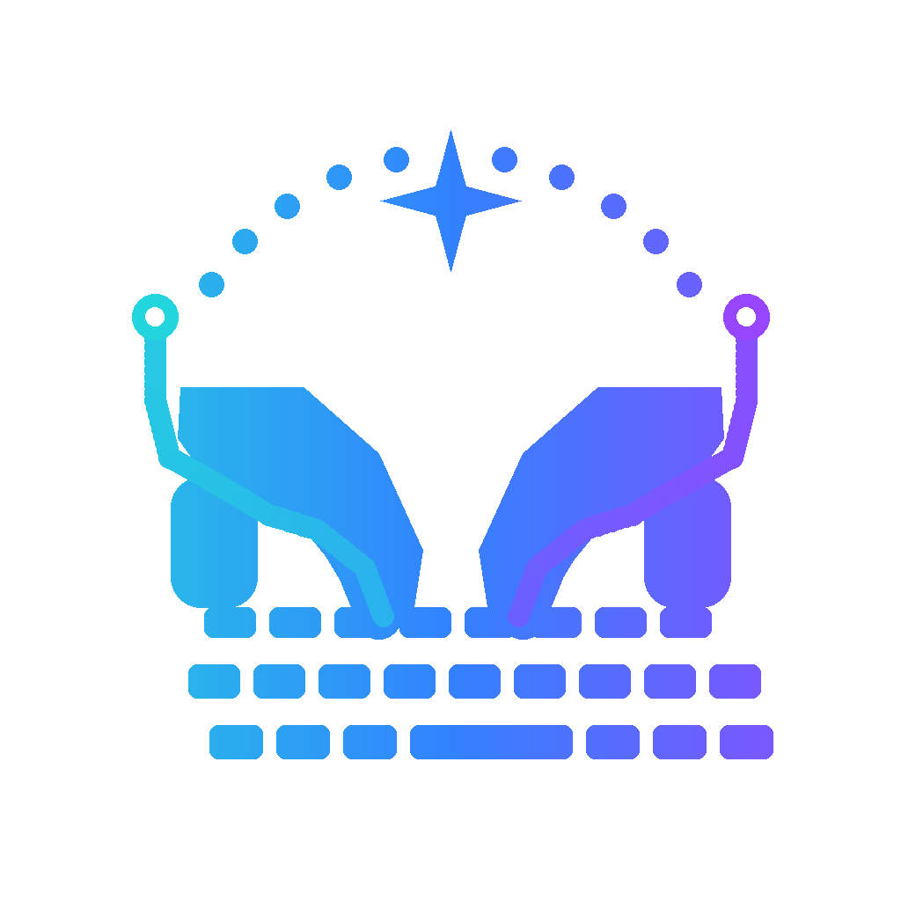
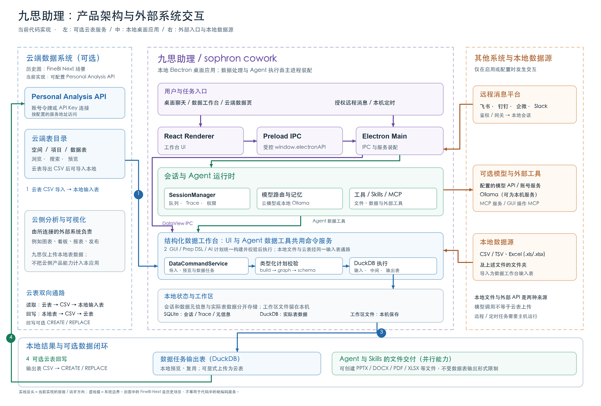

<p align="center"></p>

<h1 align="center">sophron cowork</h1>

<p align="center">A local desktop agent with a built-in data workbench</p>

<p align="center"><a href="./README_zh.md">简体中文</a> · <a href="#what-you-can-do">Capabilities</a> · <a href="#architecture">Architecture</a> · <a href="#comparison">Comparison</a> · <a href="#getting-started">Get started</a></p>

sophron cowork (九思助理 in the Chinese build) is an MIT-licensed Electron app for working with files and structured data on your computer. It combines a chat agent with a data workbench: import tables, preview them, build repeatable cleaning workflows, and produce result tables. The same workspace can use Skills, MCP tools, scheduled tasks, memory, and authorized remote messages. Model inference can come from your own API provider, a local Ollama server, a ChatGPT/Codex subscription login, or the app's account-backed model service where available.

The app is local, but **“local app” does not mean “no network traffic.”** Model requests, MCP connectors, remote channels, optional cloud-table transfers, account login, and updates can contact external services. Review the [data and security boundaries](#data-and-security-boundaries) before using sensitive information.

## What you can do

### Work with an agent

- Select a workspace and ask the agent to read, organize, or create files. Attach files and images to a conversation; inspect streamed responses, tool calls, and traces.
- Choose from presets for DeepSeek, Moonshot, Alibaba Cloud/DashScope, Z.AI, Anthropic, OpenAI, OpenAI Codex subscription, OpenRouter, and Ollama. Provider availability, model capabilities, and charges depend on the service you select. The account-backed built-in model is a separate option where enabled.
- Use the bundled `pptx`, `docx`, `pdf`, `xlsx`, and `skill-creator` Skills; add project or global Skills and manage them in the app.
- Connect MCP servers over stdio, SSE, or Streamable HTTP. Presets include Chrome DevTools, Notion, software-development tools, and the bundled GUI-operation server. GUI actions need platform permissions and a suitable vision-capable model; they are not guaranteed to work in every app.

### Prepare structured data

- Import CSV/TSV and Excel files, or a folder of such files, as raw tables. Configure source reading and preview rows and columns before processing.
- Create data pipelines and result tables with a visual workflow canvas or Prep DSL. Operators cover filtering, selecting and mapping fields, deduplication, missing values, conversions, sorting, joins, aggregation, calculated fields, pivot/unpivot, set operations, unnesting, limits, and output sinks.
- Preview individual workflow nodes, run a pipeline, and inspect the result table. GUI workflows, DSL, and generated plans converge on a versioned typed plan with graph and schema validation before saving or running.
- Ask the agent to list, preview, import, and work with data resources through the same command services used by the UI. Requirement analysis can help generate a task for review; generated workflows are validated before execution.
- Optionally connect a Personal Analysis/cloud-table API to browse or import remote tables and upload local tables. This is an explicit external-data path, not part of local-only processing.

### Reuse and trigger work

- Configure recurring or one-time scheduled tasks in the desktop app. They execute through the local session runtime, so the app and computer must be running when a task is due.
- Enable memory to retrieve relevant context before a session and ingest useful context afterward; inspect and manage stored memory in settings.
- With remote control enabled, route authorized messages from Feishu/Lark, DingTalk, WeCom, Slack, or the gateway WebSocket entry point into agent sessions. Channel setup, pairing/authentication, and a running desktop host are required.

## Architecture

<p align="center"></p>

The diagram keeps the historical image's cloud ↔ local product ↔ local data-source relationship, but updates the facts to the current code. FineBI Next is a historical deployment scenario, not a hard-coded endpoint in this repository. The implemented cloud connection is a configurable Personal Analysis API: it exports a cloud table as CSV for local import, and can upload a selected local table as CSV using CREATE or REPLACE. Cloud-side charts, dashboards, reports, and publishing belong to the connected external system, not this app's native data workbench.

The React workbench reaches Electron's main process through the preload IPC bridge. `SessionManager` handles session queues, traces and permissions; the agent runtime combines model routing, built-in tools, MCP, Skills, memory and data tools. The UI and agent data tools share `DataCommandService`. Local CSV/TSV or Excel files (including folders of them), and selected cloud tables, enter the raw-table path. GUI workflows, Prep DSL and AI-generated plans converge on a typed plan that is graph- and schema-validated before DuckDB execution. SQLite keeps sessions, traces, schedules and data metadata; DuckDB keeps actual table data. A data pipeline produces a previewable, reusable result table, while the agent can separately create document deliverables with tools and Skills. Model, MCP and remote-message connections are independent optional external boundaries; remote and scheduled tasks still enter the local session runtime.

For implementation details, start with the [developer documentation](docs/development/README.md), the [data-workspace guide](docs/development/data-workspace.md), and the [Prep DSL reference](docs/prep-dsl-reference.md).

## Comparison

The old yes/no table understated other products. All three can use tools and Skills, automate recurring work, and—under the right permissions and platform conditions—operate a browser or desktop. The useful distinction is **how the work is hosted and whether structured data preparation is a native product surface**.

| Dimension                   | sophron cowork                                                                                        | Claude Cowork                                                                                                                                                      | OpenClaw                                                                                                                          |
| --------------------------- | ----------------------------------------------------------------------------------------------------- | ------------------------------------------------------------------------------------------------------------------------------------------------------------------ | --------------------------------------------------------------------------------------------------------------------------------- |
| Primary surface             | Local Electron chat **and** table/task workbench                                                      | Claude task workspace across web, desktop, and mobile                                                                                                              | Self-hosted agent Gateway, channels, and tools                                                                                    |
| Structured data preparation | Built-in raw/result tables, visual workflow and Prep DSL, typed validation, DuckDB execution          | Works with spreadsheets and produces deliverables through tasks, plugins, and connected tools; official docs do not describe a comparable built-in Prep canvas/DSL | General agent tools/Skills/plugins; its official capability overview does not describe this project's table/task workflow surface |
| Model choice                | Configured API providers, Ollama, Codex subscription login, or account-backed service where available | Claude via a paid Claude plan                                                                                                                                      | Configurable model providers and runtime policies                                                                                 |
| Remote or scheduled entry   | Feishu, DingTalk, WeCom, Slack/WebSocket; **local** scheduled sessions                                | Cross-device sessions/Dispatch and scheduled tasks; cloud tasks can run while a device is off, local access needs Desktop online                                   | Gateway channels plus cron/tasks/heartbeat; can run on a host or eligible nodes                                                   |
| Desktop interaction         | Bundled GUI-operation MCP, subject to OS permissions and model capability                             | Browser and computer use in supported Cowork plans/platforms                                                                                                       | Browser and computer tools on supported, enabled hosts/nodes                                                                      |
| Execution boundary          | Workspace/path checks; optional WSL2 or Lima for command isolation, with native fallback              | Isolated cloud execution; desktop access to explicitly connected local resources                                                                                   | Configurable sandbox and tool policy; sandbox is not enabled by default for ordinary sessions                                     |

This is a comparison of **documented default/product surfaces**, not a claim that competitors cannot reproduce a workflow with custom code or plugins. The observations about what their native data surfaces do not document are **inferences from the cited guides, not proof of absence**. Capabilities and plan availability change; checked on **2026-09-16** against [Claude Cowork's getting-started guide](https://support.claude.com/en/articles/13345190-get-started-with-claude-cowork), [Claude computer use](https://support.claude.com/en/articles/14128542-let-claude-use-your-computer-in-cowork), [Claude scheduling](https://support.claude.com/en/articles/13854387-schedule-recurring-tasks-in-claude-cowork), [Claude Dispatch](https://support.claude.com/en/articles/13947068-assign-tasks-from-anywhere-in-claude-cowork), [OpenClaw's capability overview](https://docs.openclaw.ai/tools), [OpenClaw channels](https://docs.openclaw.ai/channels), [OpenClaw model providers](https://docs.openclaw.ai/concepts/model-providers), [OpenClaw automation](https://docs.openclaw.ai/automation), [OpenClaw computer use](https://docs.openclaw.ai/nodes/computer-use), and [OpenClaw sandbox defaults](https://docs.openclaw.ai/gateway/sandboxing/modes-scope-and-backend). This repository's claims are based on its current source and tests.

## Getting started

### Install

The packaging configuration targets **Windows x64** (`.exe`) and **macOS 13.5+ Apple Silicon** (`.dmg` and `.zip`). Obtain a trusted installer from the project's release channel. A Linux AppImage target exists in the build configuration, but this README does not promise a published Linux release; the bundled Node.js requires glibc 2.28+ and libatomic. Installer contents and signing depend on the release build.

To run from a source checkout, use **Node.js 22.22.1 or newer** and npm (`.nvmrc` pins the bundled Node.js version):

```bash
npm install
npm run dev
```

`npm install` runs the project's native-module rebuild and Node preparation. `npm run dev` also prepares the WSL/Lima agents and MCP bundle. For document workflows needing the bundled Python preparation, use `npm run dev:with-python`. Packaging commands are `npm run build:sophron`, `npm run build:sophron-cn`, or `npm run build` for both variants; they download/build additional resources and require platform build prerequisites. The repository URL in `package.json` is an SSH endpoint and may require access.

### First task

1. Open the app and select a workspace folder.
2. In settings, choose a model route: add the provider's credentials, connect Ollama, sign in for a supported subscription route, or use the available built-in account route. Check the provider's own pricing and data policy.
3. Try chat: “Summarize the CSV files in this folder and make a short report.”
4. For repeatable table processing, open the data workbench, import a raw table, build or describe a pipeline, preview its nodes, and run it into a result table.

## Data and security boundaries

- The app stores workspace files locally. Session/metadata storage uses SQLite; table data uses DuckDB. Data remains local **until a selected capability sends it elsewhere**.
- Model prompts and relevant file content can be sent to the configured cloud model or the account-backed model proxy. Ollama can keep inference local only when pointed at a genuinely local instance; other tools or connectors may still use the network.
- MCP servers, GUI automation, remote channels, Personal Analysis/cloud-table import/export, authentication, and software updates each have their own access and network boundary. Enable only what you need and review their credentials and permissions.
- WSL2 on Windows and Lima on macOS are **optional command-execution isolation**, not a blanket VM for every app action. If disabled or unavailable, the sandbox adapter can run natively. File path containment and permission policies provide additional checks, but neither makes destructive actions risk-free.
- The strict `default` permission profile asks before writes, edits, and shell commands, but the app's initial profile is `auto_review`, which can allow these common actions automatically; `full_access` is broader still. Review your selected policy, confirm important changes, and keep backups of irreplaceable files.

## Development and license

Run `npm run typecheck`, `npm run test`, and `npm run lint` when changing code. Module maps and targeted tests are in [docs/development](docs/development/README.md). UI changes must follow [UI_STYLE_GUIDE.md](UI_STYLE_GUIDE.md).

Licensed under [MIT](LICENSE). The application is open source; provider subscriptions, API calls, and optional cloud services may have separate costs.
